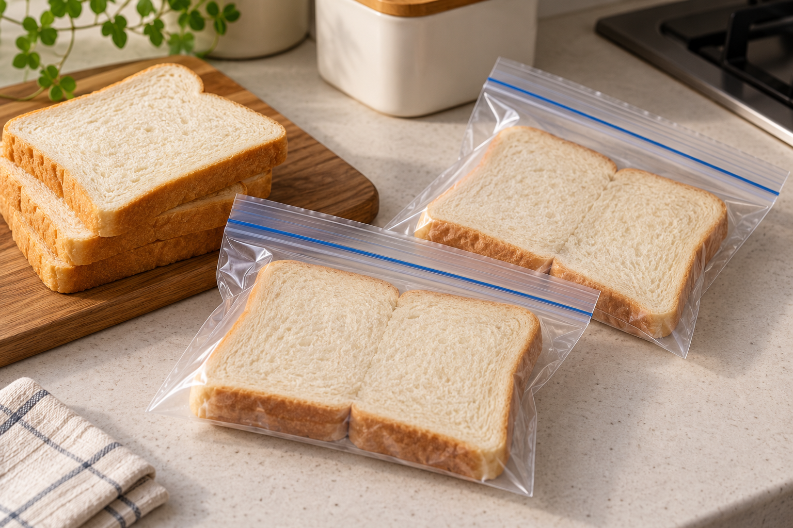
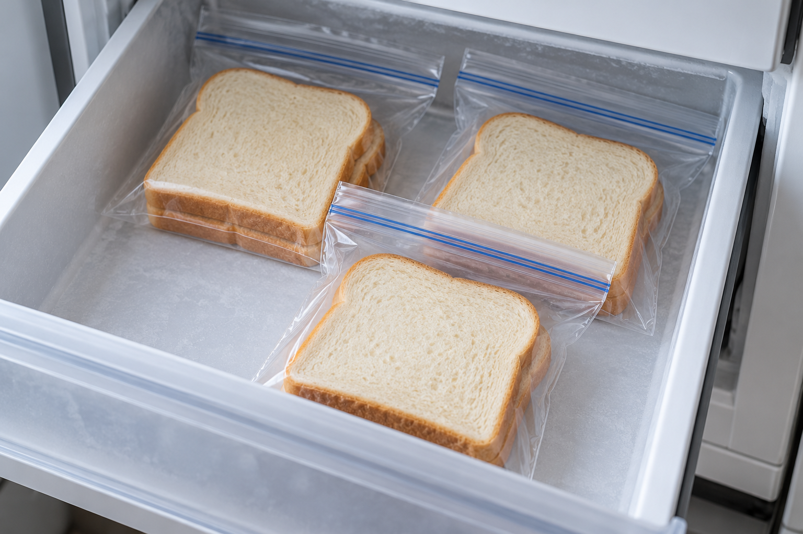

식빵 한 봉지를 조금씩 먹는다면 얼리기 전에 먹을 분량부터 나눠 두세요. 크림이나 고기 같은 속재료가 없는 일반 식빵에 쓰는 방법이에요. 봉지 전체를 해동하지 않고 필요한 양만 꺼낼 수 있어요.

## 따뜻한 빵은 완전히 식힌 뒤

직접 굽거나 따뜻하게 산 식빵은 완전히 식힌 뒤 포장해요. 뜨거울 때 싸면 수증기가 안에 갇혀 물방울이 맺힐 수 있어요. 이미 식어 있는 식빵은 그대로 소분하면 됩니다.

## 먹을 분량을 나눠 밀폐하기

한 번에 먹을 양을 정해 봉지마다 나눠 담으세요. 한 장씩 꺼내고 싶다면 조각 사이에 작은 유산지를 넣어 구분할 수도 있어요. 유산지는 조각을 나누는 용도라서 바깥 밀폐 포장은 따로 필요해요.

> 판매할 때 담긴 얇은 빵 봉지만 믿고 얼리지 마세요. 냉동용으로 표시된 봉지를 골라 입구를 잘 닫고 공기 노출을 줄여요.

## 꺼낸 분량만 실온에서 해동

먹을 봉지만 꺼내 포장한 상태로 실온에서 해동할 수 있어요. 걸리는 시간은 빵 크기와 실내 온도에 따라 달라지니 정해진 시간만으로 판단하지 마세요.

전자레인지로 해동하면 빵이 마르거나 단단해질 수 있어요. 냉동은 냉동 전의 품질을 유지하는 방법이에요. 맛이 떨어진 빵을 새것처럼 되돌리거나 일정 기간의 품질을 보장하지는 않아요.

※ 출처: King Arthur Baking, 미국 국립가정식품보존센터, 일리노이대학교 익스텐션
