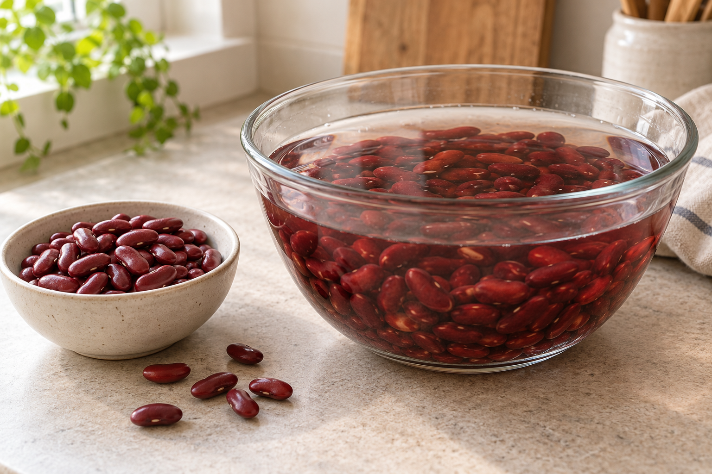
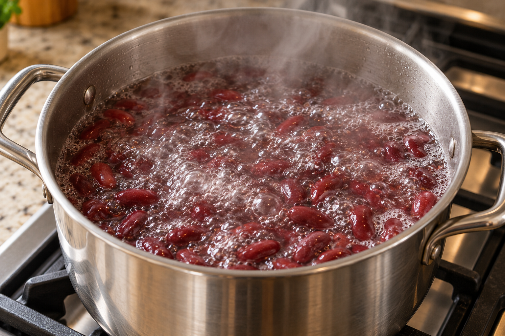

수프나 칠리에 말린 붉은 강낭콩을 넣는다면 불림 뒤 끓이는 과정까지 준비하세요. 불리기만 해서는 끝나지 않아요. 여기서는 다른 콩이 아닌 붉은 강낭콩(red kidney beans)의 건조품을 다뤄요.

## 불린 물은 버리고 새 물로 끓이기

미국 FDA는 최소 5시간 불린 뒤 새 물에서 최소 30분 끓이도록 안내해요. 불린 물은 버리고 물을 새로 받아 끓이는 순서예요. 불림과 끓임은 각각 필요한 단계로, 30분에 불리는 시간이 포함되는 건 아니에요.

캐나다 보건부는 불릴 때 콩 부피의 2~3배 물을 쓰고, 최소 5시간 뒤 그 물을 버리라고 안내해요. 끓임은 미리 불린 콩을 최소 10분간 세차게 끓이는 안내여서 FDA와 수치가 달라요. 이 글의 조리 순서는 FDA 안내를 따르며, 두 기관의 시간을 섞어 줄이지 않아요.

> 이 시간은 FDA가 안내한 불림·끓임 조건이에요. 모든 조리기기의 총 조리시간이나 원하는 식감의 완성을 보장하는 시간은 아니에요.

## 슬로쿠커로 끓임을 대신하지 않기

캐나다 보건부는 건조 붉은 강낭콩 조리에 슬로쿠커·크록폿을 쓰지 말라고 안내해요. 콩에 든 렉틴을 파괴할 만큼 온도가 높아지지 않기 때문이에요. 낮은 온도에서 오래 익히는 것으로 끓이는 단계를 대신하지 마세요.

## 통조림은 건조품과 준비가 달라요

통조림 붉은 강낭콩은 제조 중 열처리로 렉틴이 충분히 파괴돼요. 그래서 렉틴 제거를 목적으로 건조품처럼 다시 불리고 끓일 필요는 없어요. 다만 이 설명이 개봉 후 보관이나 모든 가공 콩 제품의 섭취 조건까지 보장하는 것은 아니에요.

※ 출처: 미국 FDA, 캐나다 보건부
