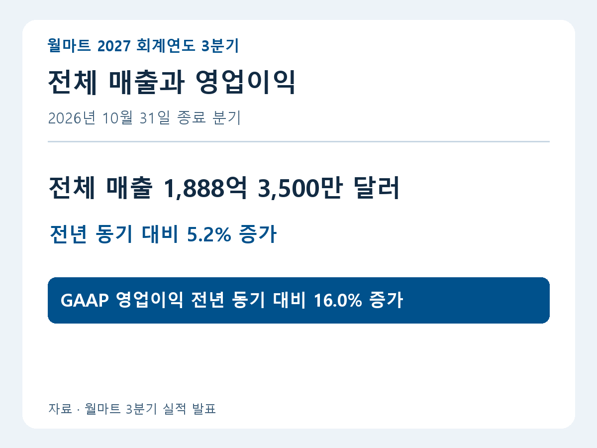
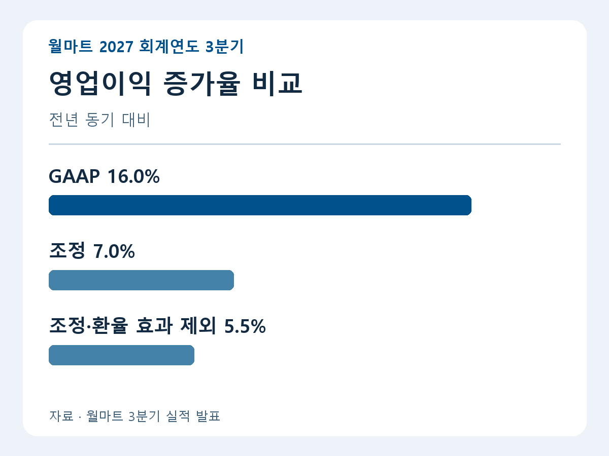
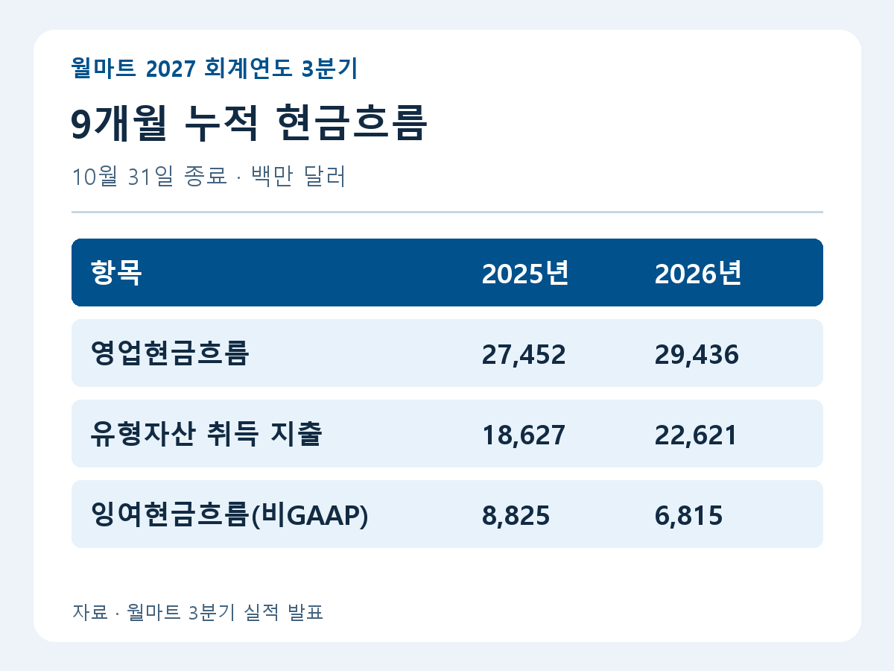
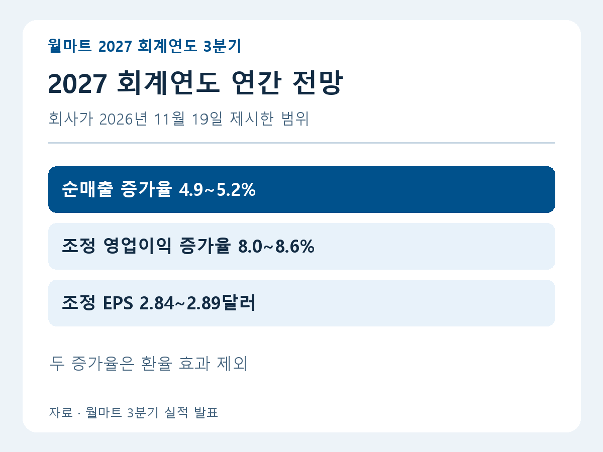

2026년 11월 28일 갱신. 월마트가 11월 19일 발표한 2027 회계연도 3분기 실적을 반영했다. 10월 31일 종료 분기의 GAAP 영업이익은 전년 동기 대비 16.0% 늘었다. 같은 기간의 조정 항목과 환율 영향을 반영하면 증가율은 5.5%다.

## 영업이익 증가율을 바꾼 비교 기준

3분기 전체 매출은 188,835백만 달러로 5.2% 늘었다. 전년 동기와 같은 환율로 환산하면 매출 증가율은 4.5%다. 아래 금액은 10월 31일 종료 분기 기준이며 단위는 백만 달러다.

| 영업이익 기준 | 2026년 | 2025년 | 전년 동기 대비 |
| --- | ---: | ---: | ---: |
| GAAP | 7,770 | 6,696 | 16.0% |
| 조정 | 7,770 | 7,263 | 7.0% |
| 조정·환율 효과 제외 | 7,663 | 7,263 | 5.5% |

월마트는 비교 기준인 전년 영업이익에 PhonePe 비현금 주식보상 비용 722백만 달러를 더하고 소송 관련 충당금 환입 155백만 달러를 뺐다. 올해 조정 영업이익에서 환율 효과 107백만 달러를 빼면 7,663백만 달러다.

GAAP 희석 주당순이익(EPS)은 0.62달러였다. 월마트는 주식 등 투자자산에서 발생한 세후 순손실의 주당 효과 0.03달러를 뺐다. 조정 EPS는 0.65달러다.

출처는 [월마트 3분기 실적 발표 및 조정표](https://www.sec.gov/Archives/edgar/data/104169/000010416926000168/earningsreleasefy27q3.htm)다.

## 설비투자가 영업현금 증가분을 웃돌았다

2026년 10월 31일까지 9개월 누적 영업현금흐름은 전년보다 1,984백만 달러 늘었다. 같은 기간 유형자산 취득 지출은 3,994백만 달러 증가해 잉여현금흐름은 2,010백만 달러 줄었다.

| 9개월 누적 현금 지표(백만 달러) | 2026년 | 2025년 |
| --- | ---: | ---: |
| 영업현금흐름 | 29,436 | 27,452 |
| 유형자산 취득 지출 | 22,621 | 18,627 |
| 회사 정의 잉여현금흐름(비GAAP) | 6,815 | 8,825 |

월마트는 영업현금흐름에서 유형자산 취득 지출을 빼 잉여현금흐름을 계산한다. 부채 상환액과 기업 인수대금은 이 계산에 포함하지 않는다.

출처는 [월마트 3분기 현금흐름표 및 잉여현금흐름 조정표](https://www.sec.gov/Archives/edgar/data/104169/000010416926000168/earningsreleasefy27q3.htm)다.

## 매장과 온라인을 연결하는 사업

Walmart U.S., Walmart International, Sam’s Club U.S.가 보고 사업부다. 매장 재고를 활용한 픽업·배송이 성장에 기여했고 3분기 글로벌 전자상거래 매출은 전년보다 17% 늘었다. 글로벌 광고 사업은 25%, 회원비 수익은 17% 증가했다.

월마트는 2016년 Jet.com과 2024년 VIZIO 인수를 마쳤고 2026년 1월 Nasdaq-100에 편입됐다. 3분기 성장률만으로 인수별 기여도를 계산하기는 어렵다. 광고 사업은 계약에 따라 순매출 또는 매출원가 차감으로 반영되므로 전체 매출에 별도로 더하면 중복될 수 있다.

출처는 [월마트 3분기 발표 자료](https://corporate.walmart.com/news/2026/11/walmart-releases-q3-fy27-earnings), [Jet.com 인수 발표](https://corporate.walmart.com/news/2016/09/19/walmart-completes-acquisition-of-jet-com-inc), [VIZIO 인수 발표](https://corporate.walmart.com/news/2024/12/03/walmart-completes-acquisition-of-vizio), [Nasdaq 편입 공지](https://ir.nasdaq.com/node/109851)와 [구성 종목 자료](https://www.nasdaq.com/docs/global-indexes/NDX)다.

## 다음 발표에서 확인할 지표

월마트는 2027 회계연도 순매출 증가율을 4.9~5.2%, 조정 영업이익 증가율을 8.0~8.6%로 내다봤다. 두 성장률은 환율 효과를 제외한 전망이다. 조정 EPS 전망은 2.84~2.89달러다.

2분기에는 관세 환급 약 2,900백만 달러가 매출원가를 낮췄고 월마트는 상당 부분을 가격 투자 등 고객 관련 활동에 썼다고 설명했다. 3분기를 평가할 때는 전년 조정 항목과 환율을 반영한 수치부터 본다. 이를 기준으로 매장 배송 증가가 비용과 이익률에 어떤 영향을 주는지 살펴볼 만하다.

전자상거래 주문이 늘어도 배송비와 인건비가 함께 오르면 주문당 비용은 개선되지 않을 수 있다. 매장·물류·기술에 투자한 뒤 설비 지출 증가세가 둔화하는지, 재고와 영업현금흐름이 함께 개선되는지도 다음 분기에 확인할 지표다.

출처는 [월마트 2분기 Form 10-Q](https://www.sec.gov/Archives/edgar/data/104169/000010416926000154/wmt-20260731.htm)와 [3분기 발표의 연간 전망](https://www.sec.gov/Archives/edgar/data/104169/000010416926000168/earningsreleasefy27q3.htm)이다.

정보 제공을 위한 글이며 개별 투자 권유가 아니다. 투자에는 원금 손실 가능성이 있으며 과거 성과가 미래 수익을 보장하지 않는다.
