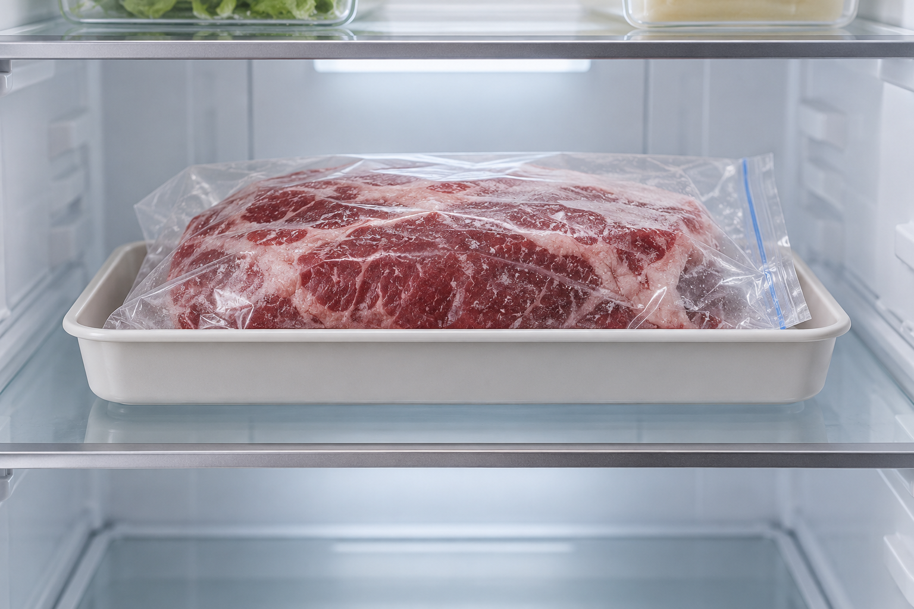
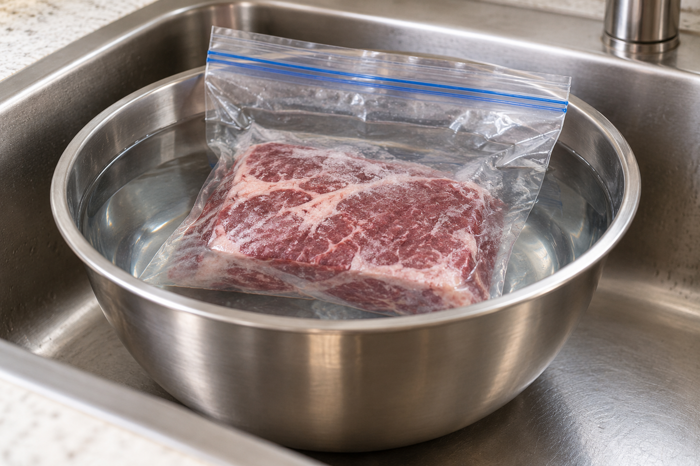

저녁에 쓸 냉동 생고기라면 냉장실에서 해동할 수 있도록 미리 준비하세요. 급할 때는 찬물이나 전자레인지로 해동할 수 있지만 이 두 방법은 해동 직후 조리할 때 선택해야 해요.

### 냉장실에 옮길 때는 육즙도 함께 관리하기

FoodSafety.gov는 육류·가금류·해산물의 해동 방법으로 냉장실을 가장 안전하게 권해요. 포장이 새지 않는지 확인하고 밀봉 봉지나 용기에 담아 다른 식품과 분리하세요.

봉지 아래에 받침 용기를 두면 육즙이 다른 식품으로 흐르지 않게 담아둘 수 있어요. 냉장실에 옮겨 놓았다는 이유만으로 안심하기보다는, 냉장고의 온도 관리 상태도 확인하세요.

### 급할 때는 해동과 조리를 이어서

찬물 해동을 할 때도 고기는 물이 새지 않는 밀봉 봉지에 담아요.

**찬물이나 전자레인지로 해동했다면 바로 조리하세요.** FDA가 두 방법에 함께 붙이는 조건이에요. 해동만 먼저 해두고 조리는 나중으로 미루는 계획이라면 냉장실 해동부터 고려하세요.

### 조리대에 꺼내 두는 방법은 피하기

FDA는 식품을 실온에서 해동하지 않도록 안내해요. 냉동 생고기를 주방 조리대에 올려놓고 녹이는 방법도 피해야 해요.

냉동했다고 유해한 미생물이 없어지는 것은 아니에요. 해동한 고기는 조리 단계까지 안전하게 다뤄야 하며, 색이나 질감만 보고 충분히 익었다고 판단하지 마세요.

※ 출처: [FDA, Safe Food Handling](https://www.fda.gov/food/buy-store-serve-safe-food/safe-food-handling), [FoodSafety.gov, 4 Steps to Food Safety](https://www.foodsafety.gov/keep-food-safe/4-steps-to-food-safety)
