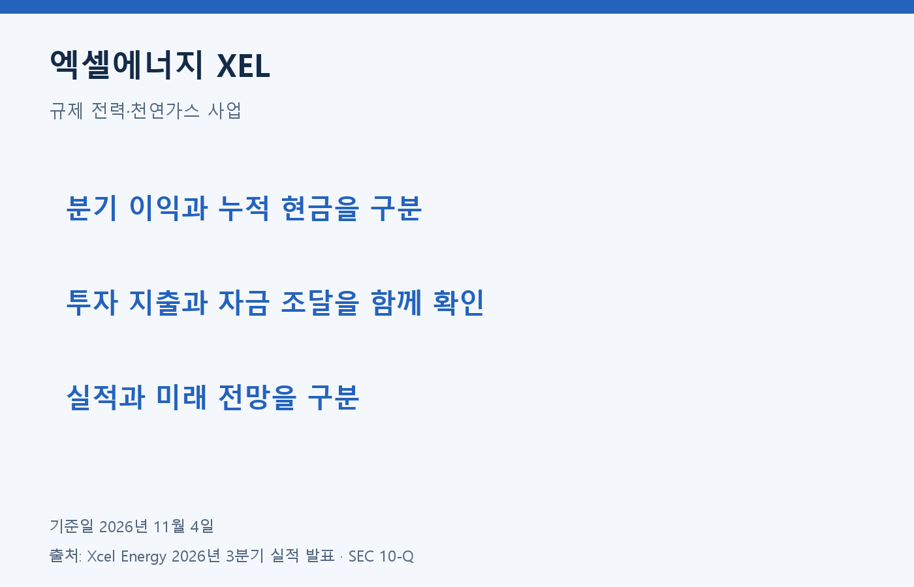
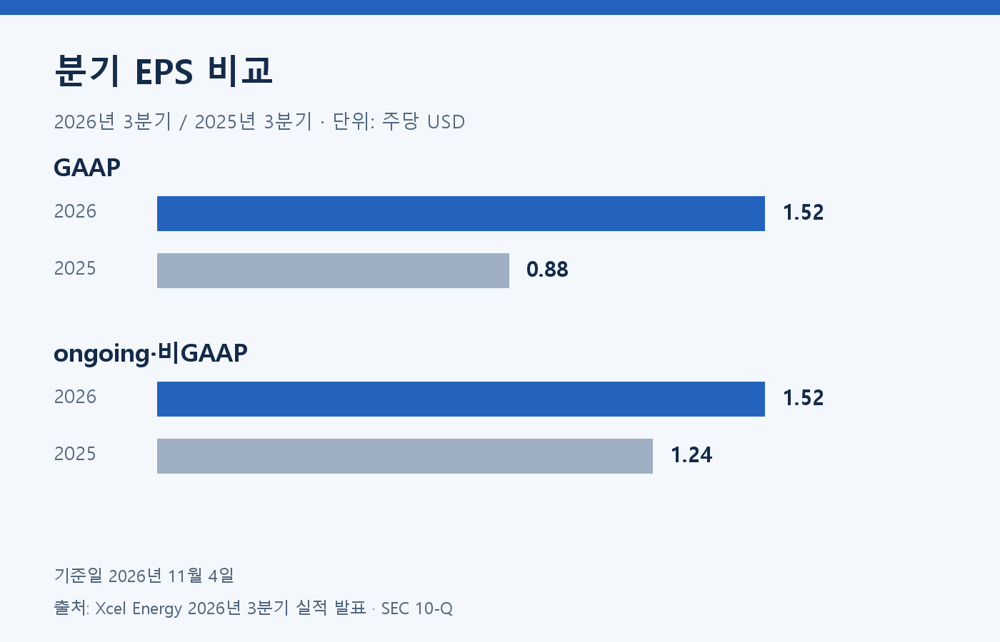
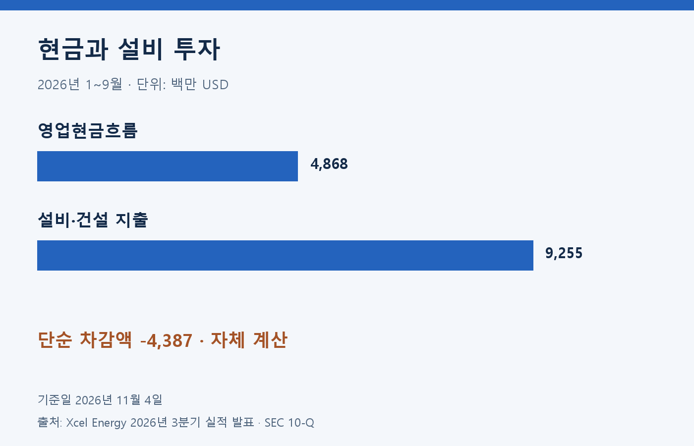
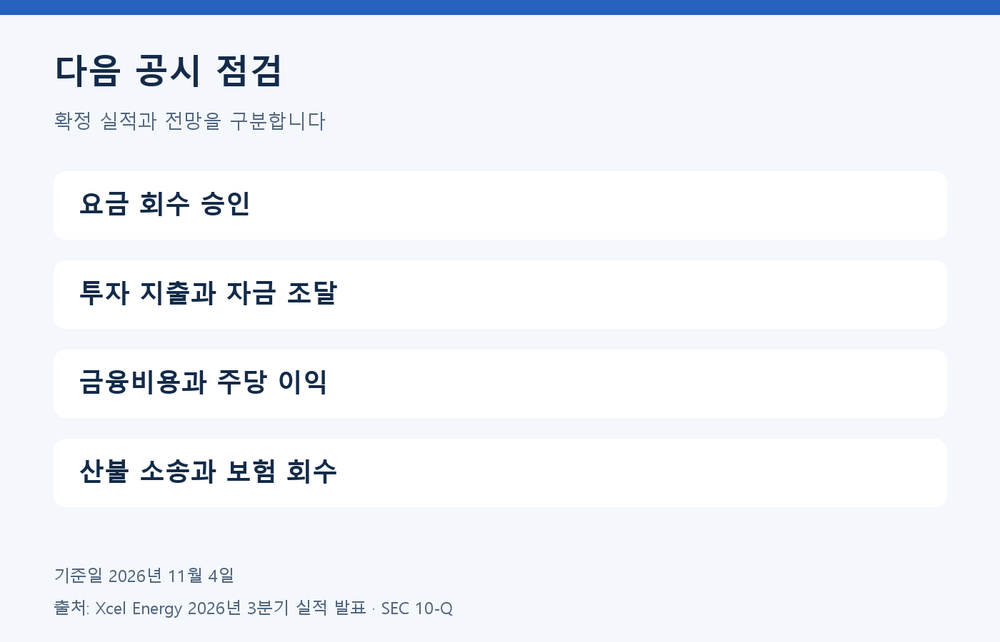

엑셀에너지는 규제 전력·천연가스 사업을 운영한다. 이익 증가와 대규모 설비 투자가 함께 나타나므로 실적과 자금 조달을 나란히 살펴볼 필요가 있다. 분석 기준일은 2026년 11월 4일이다.

## 분기 이익과 비교 기준

최신 실적은 2026년 9월 30일 종료 3개월이며 10월 29일 발표됐다. 아래 EPS는 주당 USD, 이외 금액은 백만 USD다.

| 지표 | 2026년 3분기 | 2025년 3분기 |
| --- | ---: | ---: |
| 매출 | 4,172 | 3,915 |
| GAAP 순이익 | 960 | 524 |
| GAAP 희석 EPS | 1.52 | 0.88 |
| ongoing 희석 EPS·비GAAP | 1.52 | 1.24 |

출처: 회사 실적 발표·SEC 10-Q. 전년 산불 소송 비용의 영향으로 GAAP와 ongoing의 비교 출발점이 다르다. 분기 EPS를 단순히 네 배 해 연간 이익으로 쓰지 않는다.

## 현금은 9개월 누적으로 비교

| 항목·백만 USD | 2026년 1~9월 |
| --- | ---: |
| 영업현금흐름 | 4,868 |
| 설비·건설 지출 | 9,255 |
| 단순 차감액·자체 계산 | -4,387 |

출처: SEC 10-Q 현금흐름표. 단순 차감액은 회사의 비GAAP 지표나 최종 현금 잔액이 아니다. 배당과 차입 등 재무활동은 별도다.

## 성장 계획과 위험

회사는 2026년 ongoing EPS 4.10~4.16 USD, 2027년 4.48~4.62 USD를 전망한다. 2027~2031년 기본 설비 투자 계획은 70,000백만 USD다. 모두 미래 계획이며 규제 결정과 자금 조달 등에 따라 달라질 수 있다.

요금 회수 승인, 금융비용, 산불 관련 소송과 보험 회수는 확인할 위험이다. 투자 확대가 주당 이익 증가를 보장하지 않는다.

## 자체 분석: 이익 증가 다음에 확인할 자금 조달

이번 실적은 이익 성장과 투자 부담을 함께 읽어야 한다고 본다. 전력 인프라의 투자비는 요금으로 회수하는 구조다. 설비를 늘리는 일과 주주 이익을 늘리는 일 사이에 규제 승인과 자금 조달이 놓여 있다. 투자 계획의 총액만으로 성장을 평가하면 이 과정을 빠뜨리기 쉽다.

다음 공시에서는 투자 지출과 영업현금의 차이, 새로 조달한 자금의 비용을 함께 확인하려 한다. 당장의 현금 부족을 사업 실패로 단정할 수는 없지만 차입과 주식 발행의 부담도 사라지지 않는다. 특히 이익 총액이 늘어나는 동안 주당 이익은 어떤 속도로 바뀌는지 따로 보겠다.

규제 사업의 경쟁은 동일 제품을 판매하는 기업끼리의 가격 비교만으로 설명하기 어렵다. 고객의 에너지 선택과 투자비 회수 조건을 함께 검토하는 편이 타당하다. 회사의 전망을 확정 수익으로 받아들이지 않고 실제 요금 결정, 투자 집행과 현금으로 확인하겠다. 검증한 주가가 없어 PER·PEG와 목표주가는 계산하지 않는다.

정보 제공 목적이며 개별 투자 권유가 아닙니다. 원금 손실 가능성이 있고, 과거 성과는 미래 수익을 보장하지 않습니다.

## 근거 자료

- [Xcel Energy 2026년 3분기 실적 발표](https://investors.xcelenergy.com/news-events/news-releases/news-details/2026/Xcel-Energy-Third-Quarter-2026-Earnings-Report/default.aspx): 2026년 10월 29일, EPS·전망·투자 계획.
- [SEC Form 10-Q](https://www.sec.gov/Archives/edgar/data/72903/000007290326000181/xel-20260930.htm): 2026년 9월 30일 종료, 손익·현금흐름·사업·위험.
- [Nasdaq 구성기업 안내](https://www.nasdaq.com/articles/global-indexes/nasdaq-100-index): XEL 포함 확인, 2026년 11월 4일 열람.
