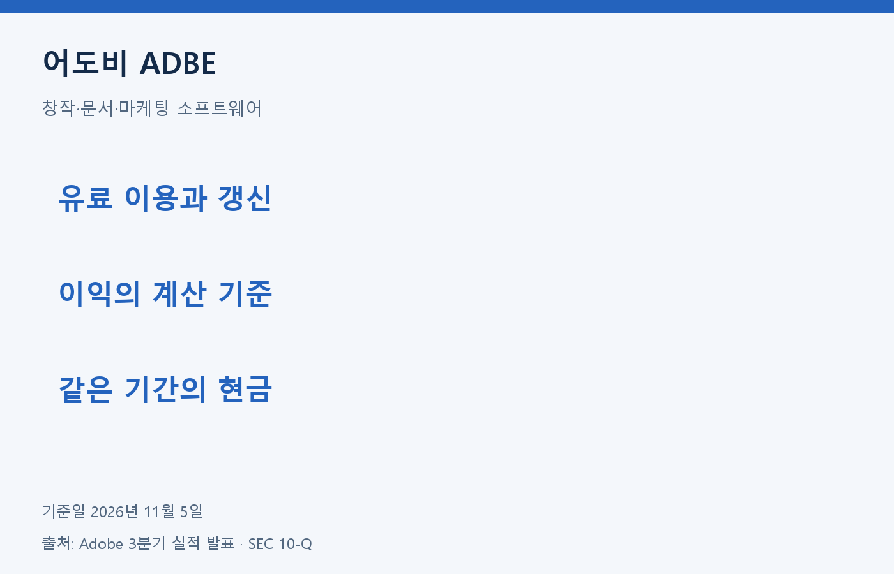
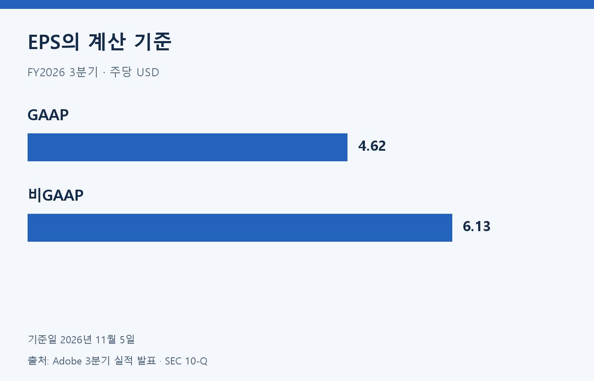
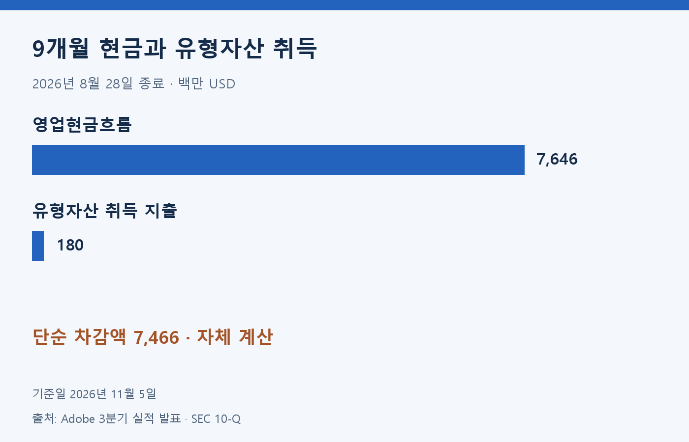
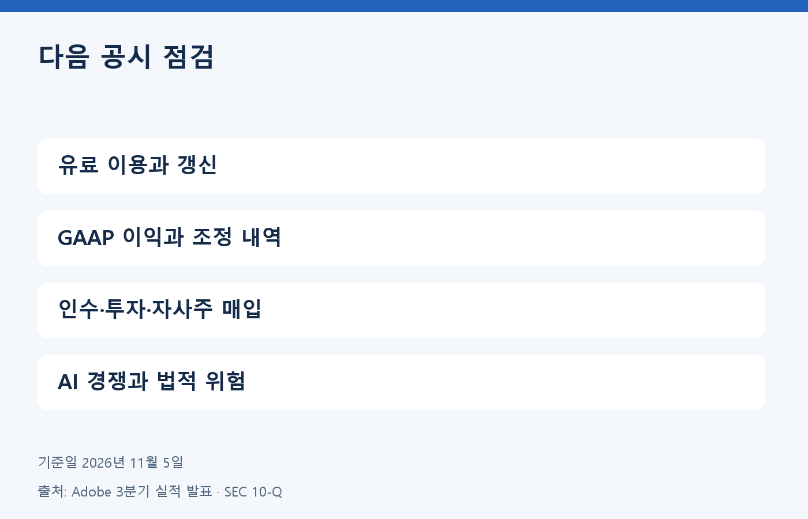

어도비는 창작·문서·마케팅 소프트웨어를 공급한다. 구독 매출이 늘어나는 동안 생성형 AI는 제품의 기능과 경쟁 구도를 함께 바꾸고 있다. 분석 기준일은 2026년 11월 5일이다.

## 구독 사업의 성장과 이익

최신 발표 실적은 2026년 8월 28일 종료된 FY2026 3분기다. 발표일은 9월 10일이며 회계연도와 달력 연도를 구분한다. 아래 금액은 백만 USD, EPS는 주당 USD다.

| 항목 | FY2026 3분기 |
| --- | ---: |
| 매출 | 6,760·발표 반올림 |
| 매출 전년 동기 대비 | 13% |
| GAAP 영업이익 | 2,350·발표 반올림 |
| 비GAAP 영업이익 | 2,970·발표 반올림 |
| GAAP 희석 EPS | 4.62 |
| 비GAAP 희석 EPS | 6.13 |

출처: Adobe 3분기 실적 발표. 비GAAP는 회사의 조정 지표이므로 GAAP와 구분한다. 두 EPS의 차이를 추가 현금 수입으로 해석하지 않는다.

구독은 고객이 서비스를 계속 이용하고 갱신할 때 매출을 쌓는 구조다. 분기 말 ARR은 반복 수익의 연간 환산 지표이며 해당 분기의 매출이나 현금 수입과 같지 않다. ARR을 분기 매출에 더하면 중복 계산이 된다.

## 누적 현금과 지출을 같은 기간으로 읽기

| 항목·백만 USD | 2026년 8월 28일 종료 9개월 |
| --- | ---: |
| 영업현금흐름 | 7,646 |
| 유형자산 취득 지출 | 180 |
| 단순 차감액·자체 계산 | 7,466 |
| 주식보상비용·비현금 조정 | 1,582 |

출처: SEC 10-Q 현금흐름표. 7,646−180은 제한된 항목의 자체 계산이며 최종 현금 잔액이나 회사가 제시한 지표가 아니다. 인수·투자·자사주 매입 등의 자금 이동은 별도로 남는다.

주식보상비용은 영업현금흐름 계산에서 비현금 항목으로 조정된다. 비용이 현금으로 바로 나가지 않는다는 사실과 주주에게 경제적 부담이 없다는 판단은 구분해야 한다. 주식 수 변화와 자사주 매입도 함께 읽을 필요가 있다.

## AI 기회와 경쟁 위험

창작 도구와 문서 작업에 AI 기능을 결합하면 고객의 작업 시간을 줄이는 방향으로 제품을 확장할 수 있다. 기존 작업 흐름과의 결합이 고객의 갱신 결정에 어떤 영향을 주는지 확인해야 한다. 다만 기능 사용 증가만으로 유료 전환이나 이익 증가를 확정할 수는 없다.

10-Q는 AI·클라우드 기반 신규 경쟁자, 제3자 모델 이용 제한과 AI의 법적·평판 위험을 설명한다. 사용자가 다른 도구로 이동하거나 경쟁 제품이 더 빠르게 채택되면 성장 조건이 달라질 수 있다. 회사의 미래 목표는 실적과 분리하며 검증하지 않은 주가·PER·PEG·목표주가는 제시하지 않는다.

## 자체 분석: 유료 이용의 지속성 확인

어도비를 평가할 때는 새 기능의 수보다 고객이 돈을 내고 계속 쓰는 이유를 확인하려 한다. 창작과 문서 작업은 결과물의 품질뿐 아니라 편집 과정과 협업 방식도 중요하다. 기존 작업 흐름에 기능이 잘 결합되면 갱신에 도움이 될 수 있지만 이런 가능성을 이미 확보한 이익으로 계산하지 않겠다.

다음 실적에서는 구독 성장과 GAAP 이익의 방향을 함께 보겠다. 매출이 늘어도 개발·판매 비용과 세금 때문에 순이익의 속도는 다를 수 있다. 비GAAP 수치가 높다는 이유만으로 비용을 무시하지 않고 조정 내역이 반복되는지도 확인하겠다.

현금은 같은 기간의 투자 지출과 비교하되 인수와 주주 환원을 따로 살펴보겠다. 영업현금에서 유형자산 취득만 차감한 금액은 사용 가능한 돈의 최종 잔액을 설명하지 못한다. AI 경쟁의 성패도 제품 발표보다 갱신·매출·비용의 변화로 판단하는 편이 타당하다고 본다.

정보 제공 목적이며 투자 권유가 아닙니다. 원금 손실 가능성이 있으며 과거 성과는 미래 수익을 보장하지 않습니다.

## 근거 자료

- [ir](https://news.adobe.com/news/2026/09/adobe-q3fy26-financial-results)
- [sec_release](https://www.sec.gov/Archives/edgar/data/796343/000079634326000147/adbeex991q326.htm)
- [sec](https://www.sec.gov/Archives/edgar/data/796343/000079634326000156/adbe-20260828.htm)
- [nasdaq](https://www.nasdaq.com/articles/global-indexes/nasdaq-100-index)
