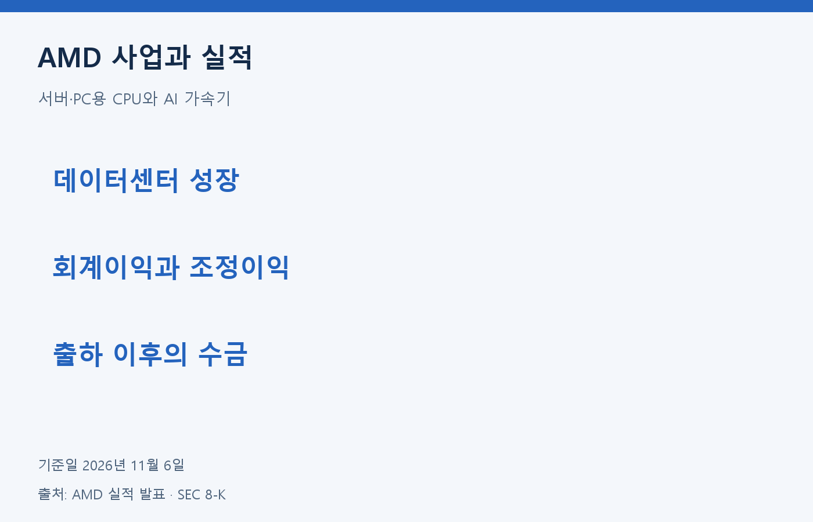
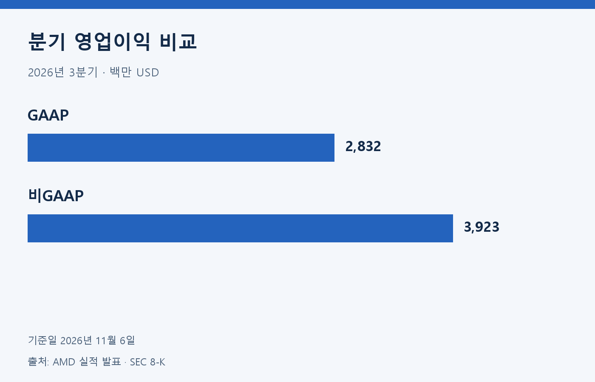
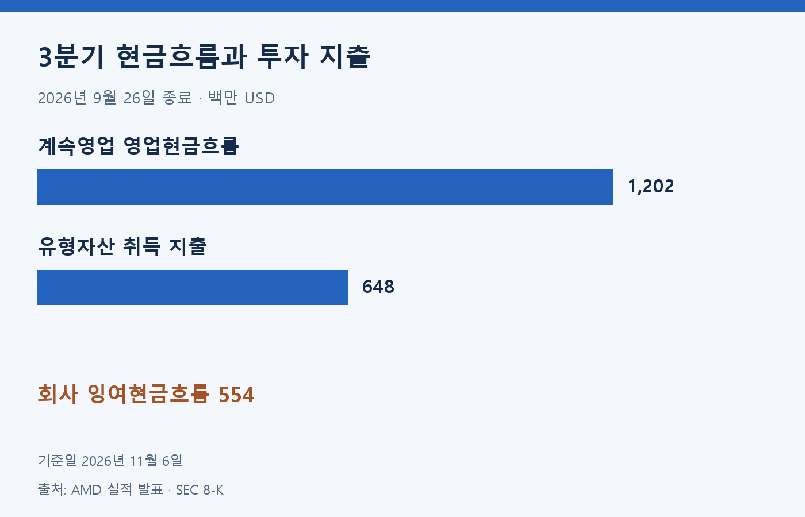
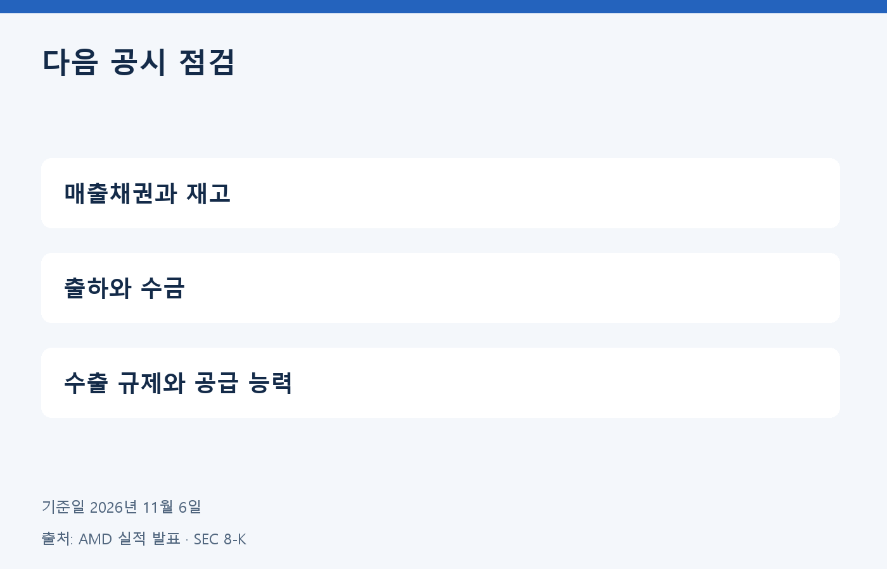

AMD는 서버·PC용 CPU와 AI 가속기, 그래픽·임베디드 반도체를 설계한다. 분석 기준일은 2026년 11월 6일이다. 최신 실적은 9월 26일 종료된 3분기로, 11월 3일 발표됐다.

## 데이터센터가 이끈 매출

분기 매출은 전년 동기보다 45% 증가했다. 데이터센터 매출은 8,546백만 USD로 전년보다 97% 늘었다. EPYC CPU와 Instinct GPU 수요가 성장 배경이지만 데이터센터 전체 매출을 AI GPU 매출로 해석하면 안 된다.

| 지표 | 2026년 3분기 |
| --- | ---: |
| 매출·백만 USD | 13,377 |
| GAAP 영업이익·백만 USD | 2,832 |
| 비GAAP 영업이익·백만 USD | 3,923 |
| GAAP 희석 EPS·USD | 1.46 |
| 비GAAP 희석 EPS·USD | 2.09 |

출처: AMD 3분기 실적 발표·SEC 8-K 첨부자료. 비GAAP는 회사 조정 지표이며 GAAP와 구분한다.

## 현금은 매출과 다른 방향

| 항목·백만 USD | 3분기 | 9개월 누적 |
| --- | ---: | ---: |
| 계속영업 영업현금흐름 | 1,202 | 6,523 |
| 유형자산 취득 지출 | 648 | 1,845 |
| 회사 제시 잉여현금흐름 | 554 | 4,678 |

출처: AMD 실적 발표 현금흐름표·비GAAP 조정표. 잉여현금흐름은 계속영업 영업현금에서 유형자산 취득 지출을 뺀 회사 지표다. 분기와 누적 수치를 섞지 않는다.

전년 동기 계속영업 영업현금흐름은 1,788백만 USD였다. 이번 분기에는 매출채권과 재고 증가 등이 현금을 사용했다. 매출 증가만으로 현금 회수도 개선됐다고 판단하기 어렵다.

## 성장 전망과 경쟁 조건

회사는 4분기 매출을 약 17,000백만 USD, 오차 범위 ±3%로 전망했다. 이는 11월 3일 제시한 미래 전망이며 달성된 매출이 아니다. 공급 확대와 고객 주문이 실제 출하·수금으로 이어지는지 확인해야 한다.

AI 가속기는 NVIDIA, 서버 CPU는 Intel 등과 경쟁한다. 성능뿐 아니라 소프트웨어 지원과 공급 능력도 고객 선택에 영향을 준다. 회사는 수출 규제, 외부 제조사 의존, 메모리 등 부품 공급과 주요 고객 상실을 위험으로 설명한다.

## 자체 분석: 수금과 재고를 함께 확인

AMD의 성장 속도를 볼 때 데이터센터 매출을 CPU와 GPU 수요가 합쳐진 결과로 읽으려 한다. 이 부문이 빠르게 커져도 특정 제품의 경쟁 우위를 같은 비율로 계산할 수는 없다. 제품별 매출이 충분히 공개되지 않으면 확인 가능한 범위까지만 판단하는 편이 타당하다.

이번 분기에는 매출과 영업현금의 방향이 달랐다. 성장에 필요한 재고 확보와 고객 수금 시차가 원인일 수 있지만 현금 사용이 일시적이라고 단정하지 않겠다. 다음 공시에서 매출채권과 재고가 매출 증가에 비해 얼마나 변했는지 확인하고 회수 속도가 개선되는지 보겠다.

4분기 전망을 이미 확보한 성과로 계산하지 않겠다. 출하가 늘더라도 투자 지출과 운전자금 부담이 커지면 주주에게 남는 현금은 다를 수 있다. GAAP와 비GAAP의 차이도 조정 내역을 읽어 판단하겠다. 검증하지 않은 주가·PER·PEG·목표주가는 제시하지 않는다.

정보 제공 목적이며 투자 권유가 아닙니다. 원금 손실 가능성이 있으며 과거 성과는 미래 수익을 보장하지 않습니다.

## 근거 자료

- [ir](https://ir.amd.com/news-events/press-releases/detail/1303/amd-reports-third-quarter-2026-financial-results)
- [sec_exhibit](https://ir.amd.com/financial-information/sec-filings/content/0000002488-26-000188/q32026991.htm)
- [sec](https://www.sec.gov/Archives/edgar/data/2488/000000248826000188/amd-20261103.htm)
- [nasdaq](https://www.nasdaq.com/articles/global-indexes/nasdaq-100-index)
