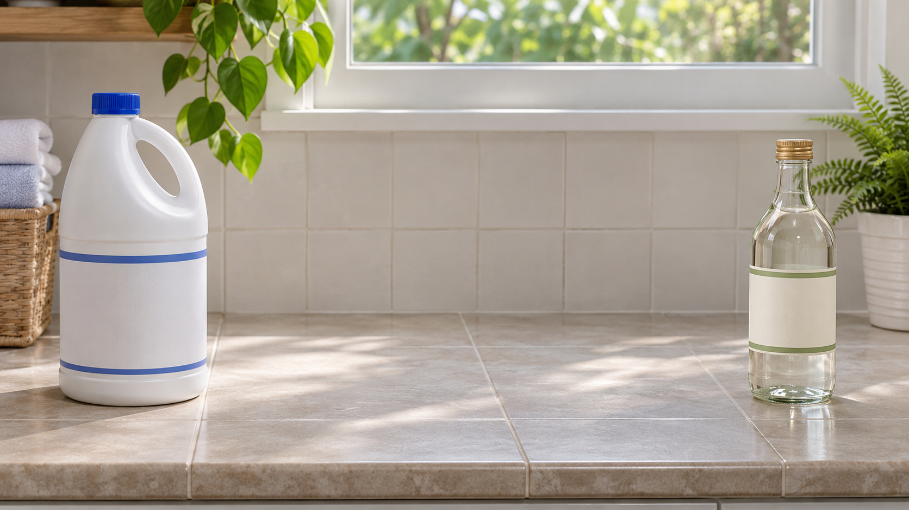
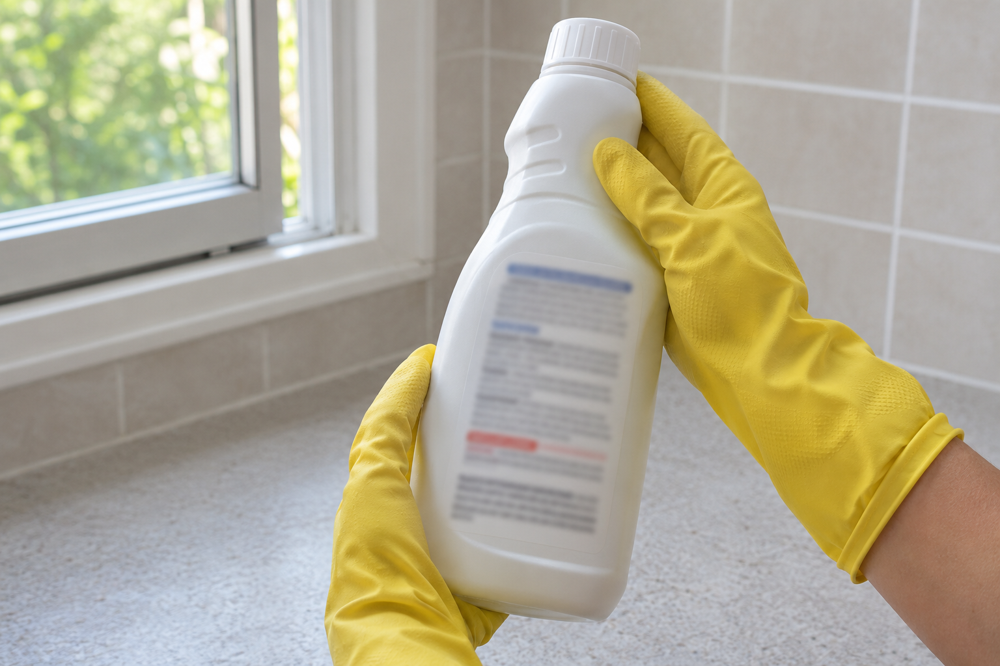

락스에 식초를 더해 청소하려 했다면 함께 섞어 쓰지 마세요. 가정용 염소계 표백제는 식초 같은 산과 만나면 독성 가스가 생길 위험이 있어요.

### 식초도 혼합 금지 대상이에요

캐나다 보건부는 염소계 표백제에 식초를 포함한 산성 제품을 섞지 말라고 안내해요. 식초가 식재료라는 이유로 청소할 때도 안전한 조합이 되는 것은 아니에요.

미국 질병통제예방센터도 표백제를 다른 세정제나 소독제와 혼합하지 말라고 설명해요. 청소 효과를 높이려고 다른 제품을 덧붓거나 적은 양이면 괜찮다고 판단하지 마세요.

### 사용 전에는 용기 표시부터 확인하기

여기서 말하는 혼합 금지는 가정용 염소계 표백제에 관한 안내예요. 집에 있는 제품의 성분과 사용상 주의사항을 확인하고 희석 방법과 사용법은 해당 제품 표시를 따르세요.

실내에서 사용할 때는 환기하고 표시에서 안내하는 보호장구를 갖춰요. 서로 다른 제품의 사용법을 한데 합치거나 다른 제품에 적힌 희석량을 그대로 옮겨 쓰지 마세요.

### 남은 제품은 원래 용기에 보관하기

사용한 뒤에는 원래 용기의 뚜껑을 닫고 표시된 보관 지침을 따라요. 어린이나 반려동물이 닿지 않는 곳에 두어야 해요.

음료병처럼 내용물을 오해할 수 있는 용기로 옮겨 담지 마세요. 원래 용기를 유지하면 다음에 사용할 때도 성분과 주의사항을 확인할 수 있어요.

※ 출처: [CDC 표백제 청소·소독 안내](https://www.cdc.gov/hygiene/about/cleaning-and-disinfecting-with-bleach.html), [캐나다 보건부 가정용 화학제품 안전 안내](https://www.canada.ca/en/health-canada/services/home-safety/household-chemical-safety.html)
