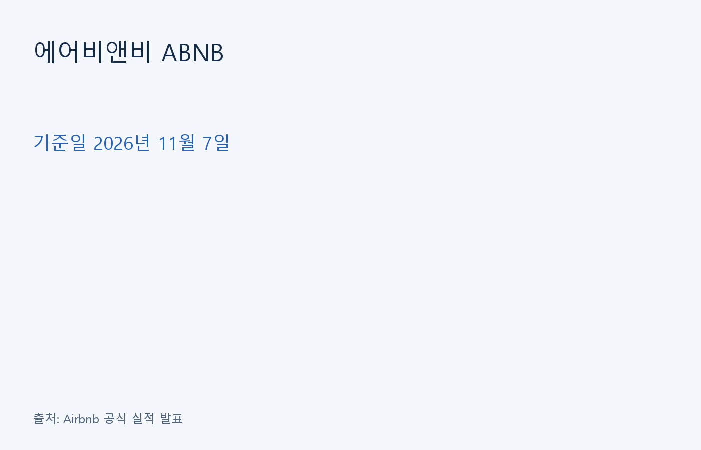
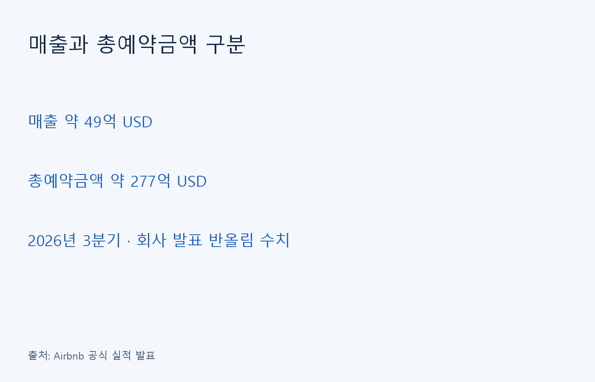
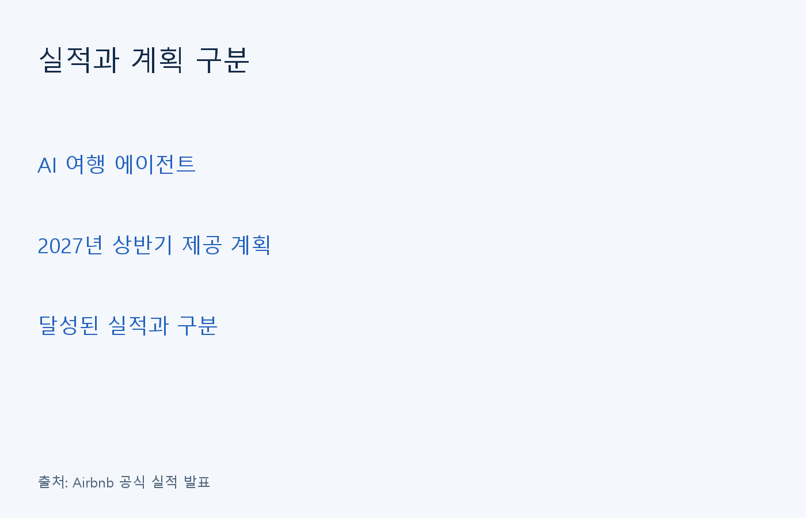

에어비앤비는 숙소와 여행 서비스를 연결하는 플랫폼이다. 분석 기준일은 2026년 11월 7일이며 회사는 11월 5일 3분기 실적을 발표했다.

## 거래 규모와 회사 매출 구분

공식 발표에서 3분기 매출은 약 49억 USD로 전년보다 19% 늘었다. 총예약금액은 약 277억 USD로 21% 증가했다. 총예약금액은 플랫폼 거래 규모이므로 회사 매출과 합산하지 않는다.

| 항목 | 2026년 3분기 |
| --- | ---: |
| 매출 | 약 49억 USD |
| 총예약금액 | 약 277억 USD |
| 순이익 | 약 19억 USD |

출처: Airbnb 2026년 3분기 공식 발표. 반올림된 발표 수치다.

## 실적과 회사 계획의 경계

회사는 AI 여행 에이전트를 2027년 상반기부터 이용자에게 제공할 계획이라고 설명했다. 이는 미래 출시 계획이며 현재 달성한 매출이나 이익을 뜻하지 않는다.

## 현금흐름은 같은 기간으로 비교

| 항목·백만 USD | 2026년 3분기 | 2026년 1~9월 |
| --- | ---: | ---: |
| 영업현금흐름 | 1,508 | 4,486 |
| 유형자산 취득 지출 | 82 | 103 |
| 회사 잉여현금흐름·비GAAP | 1,426 | 4,383 |

출처: 2026년 3분기 Form 10-Q 잉여현금흐름 조정표. 영업현금에서 유형자산 취득 지출을 뺀 회사 지표이며 모든 의무 지출을 차감한 금액은 아니다.

후불 결제인 Reserve Now, Pay Later는 숙박일에 가까운 시점에 현금을 받는다. 회사는 이 방식의 확대가 현금 유입 시점에 영향을 준다고 설명한다. 예약·매출·수금을 같은 사건으로 읽지 않아야 한다.

## 경쟁과 규제의 영향

Booking Holdings와 Expedia, Google, 호텔 체인도 고객의 여행 예약을 놓고 경쟁한다. 독특한 숙소가 있어도 전체 가격과 사용 편의, 신뢰·안전, 고객 지원에서 선택받아야 한다. 호스트 역시 여러 플랫폼을 이용할 수 있다.

이익 전망을 볼 때 수요 확대뿐 아니라 준수 비용과 서비스 운영 비용도 함께 고려해야 한다. 단기 임대 규제와 세금, 개인정보·소비자 보호, 법적 분쟁은 사업 조건을 바꿀 위험이다.

출처: 2025년 Form 10-K 경쟁·위험 요인, 2026년 3분기 Form 10-Q 법적 분쟁·규제 주석.

## 자체 분석: 예약 이후의 현금을 확인

플랫폼 분석에서는 거래가 늘어난 이유와 회사에 남는 현금을 따로 살펴야 한다. 총예약금액이 증가해도 수수료 구조, 결제 시점, 취소와 환불 조건에 따라 현금 회수는 달라질 수 있다. 이번 발표의 성장률만으로 현금 창출력이 같은 속도로 개선됐다고 판단하기는 어렵다.

다음 검토에서는 영업현금흐름과 설비투자 지출을 같은 기간으로 맞춰 비교할 필요가 있다. 회사가 제시하는 조정 지표도 회계상 순이익과 구분해서 살펴야 한다. 분기와 누적 수치를 섞으면 여행 수요의 계절성과 결제 시점의 영향을 잘못 읽을 수 있다.

신규 서비스와 AI 기능은 반복 예약이나 운영 비용을 통해 실적에 영향을 줄 가능성이 있다. 다만 기능 발표 자체를 이익 증가의 증거로 삼기는 이르다. 예약 증가가 실제 이용과 수금으로 이어지는지, 비용과 위험을 반영한 뒤에도 현금이 남는지가 후속 공시의 확인 대상이다.

## 자주 묻는 질문

### 매출을 총예약금액으로 나누면 수수료율인가요?

예약과 매출은 인식 시점이 다릅니다. 한 분기 두 수치를 단순히 나눈 값을 계약상 수수료율로 소개하면 안 됩니다.

### 조정 EBITDA는 순이익과 같은가요?

회사가 일부 항목을 조정한 비GAAP 지표입니다. 회계상 순이익을 대신하는 지표로 읽지 않습니다.

### 현재 주가의 적정 수준도 판단하나요?

검증하지 않은 주가·PER·PEG·목표주가는 제시하지 않습니다. 이 글은 사업과 공시를 읽는 정보성 분석입니다.

정보 제공 목적이며 개별 투자 권유가 아니다. 원금 손실이 가능하고 과거 성과는 미래 수익을 보장하지 않는다.
