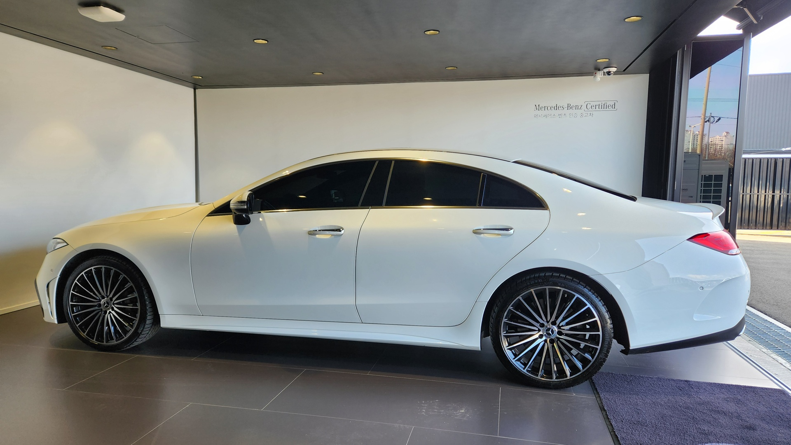
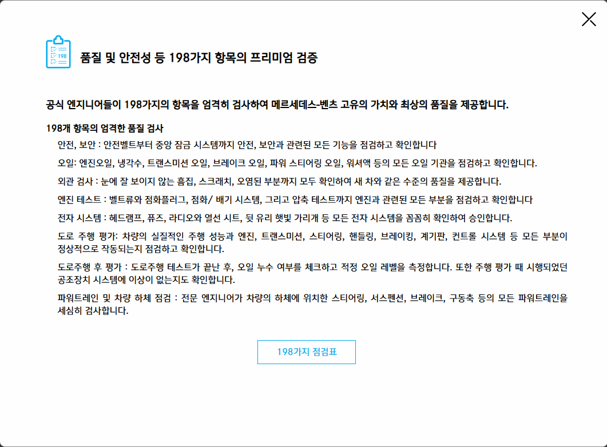
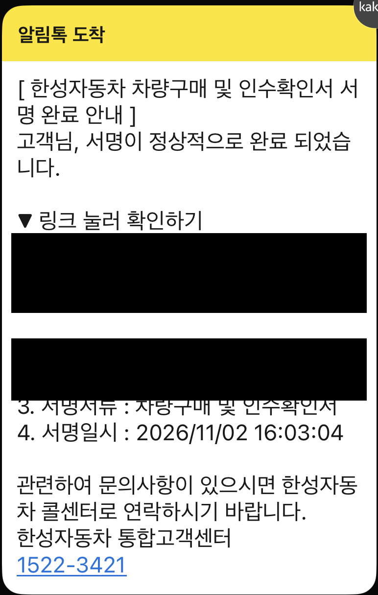
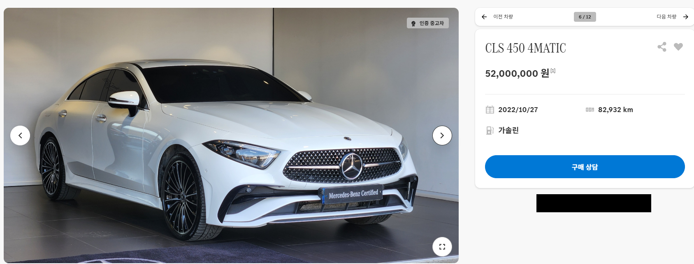
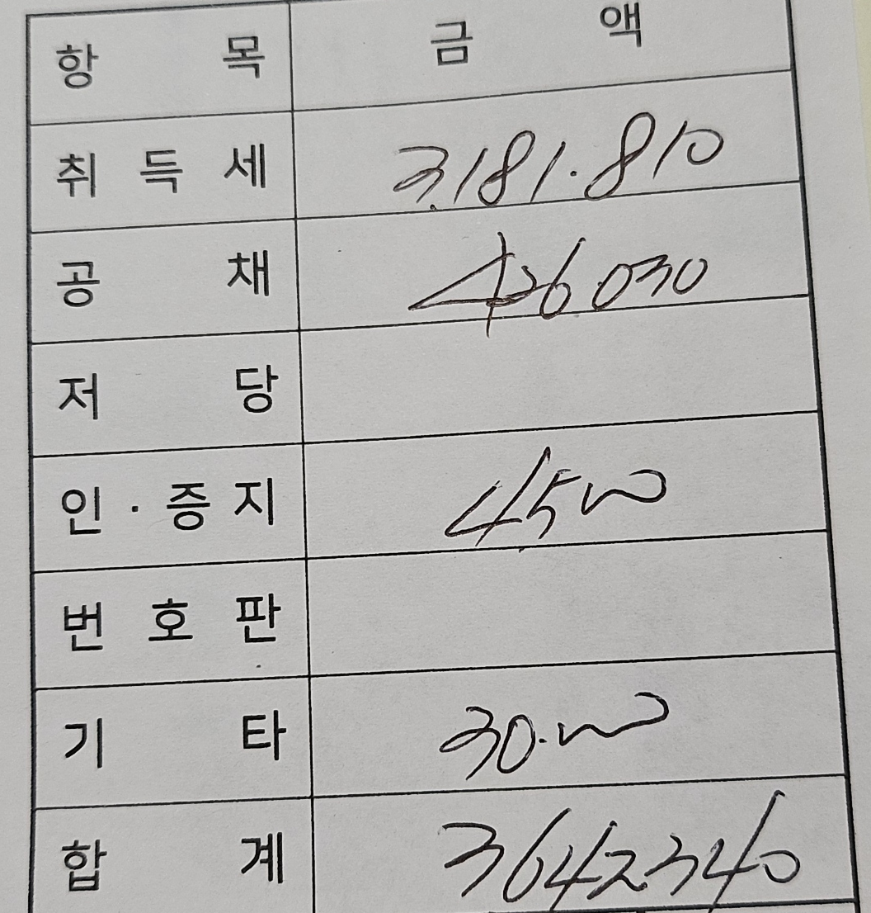
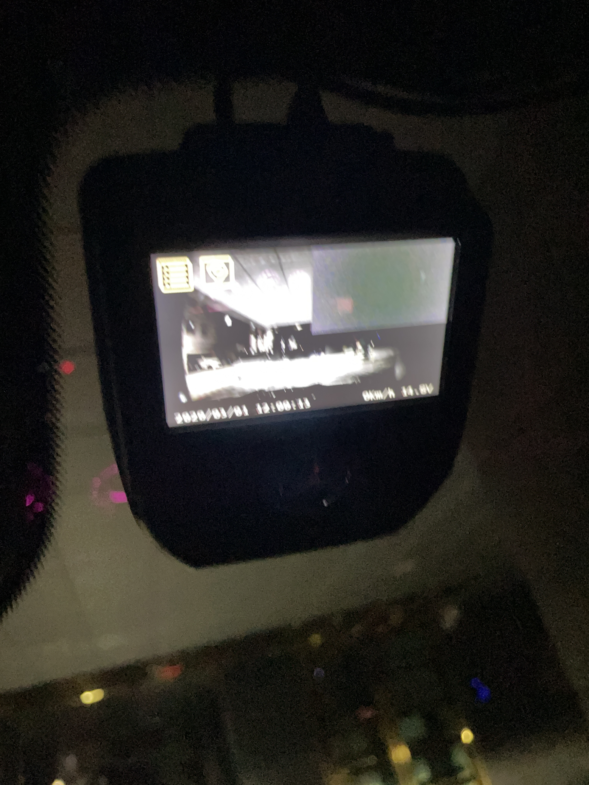
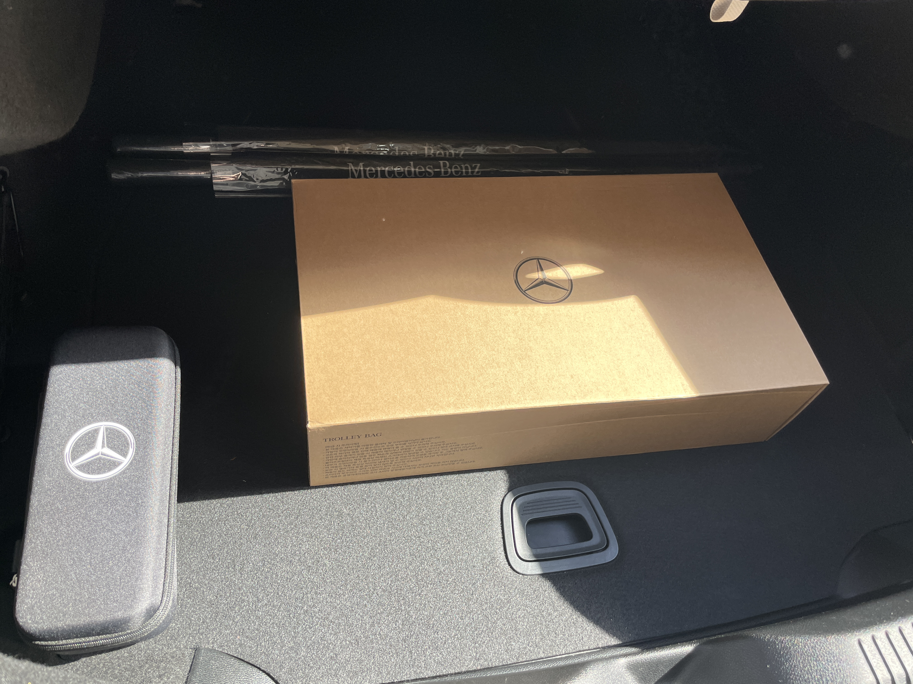

### 구매 전 핵심 체크포인트

- **가격 협상:** 제 거래에서는 표시가 5,200만 원에서 차량가 5,000만 원으로 협상했어요.
- **프로모션:** 구매 당시 기본 1년 보증을 총 2년으로 연장받았어요.
- **추가비용:** 차량대금·관리비·취득세 등 등록비 합계는 54,082,340원, 약 5,408만 원이었어요.

2026년 10월 말, 벤츠 인증중고차로 CLS를 계약하고 11월 초에 출고했어요. 계약부터 인수까지 서류를 온라인으로 처리할 수 있어 편했어요.

## 벤츠 인증중고차는 무엇을 확인하나요?

벤츠 인증중고차는 벤츠가 공식 수입한 차량 가운데 **198가지 품질 기준을 통과한 차량**이에요. 메르세데스-벤츠 코리아가 안내하는 Mercedes-Benz Certified 프로그램이에요.

제공된 점검 안내에는 안전·보안 기능, 오일, 외관, 엔진과 전자장치 점검이 담겨 있어요. 도로 주행과 하체 점검도 포함돼 있어 인증이라는 이름과 함께 어떤 부분을 확인하는지 살펴볼 수 있었어요.

## 계약을 위한 전시장 방문은 한 번

이번 계약에서는 전시장에 한 번 방문한 뒤 계약부터 인수까지 필요한 서류를 온라인으로 등록할 수 있었어요. 인수확인서도 전자서명으로 처리했고 서명이 끝났다는 알림을 받았어요. 서류 때문에 전시장을 여러 번 찾아가지 않아도 된다는 점이 특히 편했어요.

제가 구매한 차는 **CLS 450 4MATIC**이에요. 최초등록일은 2022년 10월 27일이고 매물 화면의 주행거리는 82,932km였어요.



## 인증중고 매물도 가격을 협상했어요

매물에 표시된 가격은 **5,200만 원**이었어요. 딜러와 협상한 뒤 차량 가격을 **5,000만 원**으로 정해 인수하기로 했고 표시가와는 200만 원 차이가 났어요.

여기에 매물 정보에 포함된 **차량관리비 44만 원**이 별도로 있었어요. 차량 가격과 관리비를 합하면 5,044만 원으로, 계약금·잔금 입력 화면의 금액 합계와 같아요.

## 프로모션으로 보증 기간이 총 2년으로 늘었어요

제가 구매할 때는 프로모션이 진행 중이었어요. **기본 1년 보증을 총 2년으로 연장**해주는 혜택을 받았어요.

인증중고차도 프로모션 기간의 혜택을 확인해볼 만해요. 적용 기간과 차량별 보증 범위는 계약할 때 확인해보세요.

## 차량값 외에 비용은 얼마나 들었나요?

등록 관련 비용은 수기 명세서 기준으로 **3,642,340원**, 약 364만 원이었어요. 취득세와 공채 비용, 인·증지 등을 합한 금액이에요.

제 차량 가격 5,000만 원은 부가세 포함 금액이에요. 부가세를 뺀 금액에 비영업용 승용차 취득세율 7%를 적용하면 명세서처럼 약 318만 원이 나와요.

> (5,000만 원 ÷ 1.1) × 7% ≈ 318만 원

| 항목 | 금액 |
| --- | ---: |
| 협상한 차량 가격 | 50,000,000원 |
| 차량관리비 | 440,000원 |
| 취득세 | 3,181,810원 |
| 공채 비용 | 426,030원 |
| 인·증지 | 4,500원 |
| 기타 | 30,000원 |
| 차량대금·관리비·등록비 합계 | 54,082,340원 |

중고차라도 차량을 등록할 때 취득세와 공채 비용이 따로 들었어요. 차량 가격을 협상할 때 최종 견적에 관리비와 등록비가 어떻게 붙는지도 함께 확인하면 좋겠어요.

## 출고 때 블랙박스를 바로 무료 교체해줬어요

출고할 때 블랙박스가 고장 난 상태였는데 딜러가 바로 교체해줬어요. **제가 부담한 교체 비용은 없었어요.** 문제가 생겼을 때 바로 처리해준 대응이 기억에 남아요.

출고 선물로는 **트롤리백과 우산**도 받았어요. 딜러 재량으로 받은 선물이었어요.

## 계약 전에 견적서와 보증서에서 확인할 것

계약을 앞두고 있다면 견적서와 보증서에 안내받은 내용이 어떻게 적혀 있는지 살펴보세요. 아래 내용도 계약할 때 함께 확인해두면 좋아요.

- 보증 기간·주행거리 한도와 보증 대상·제외항목
- 계약 서류와 인수확인서 처리 방식
- 출고 때 발견한 문제의 처리 방법

※ 출처: 메르세데스-벤츠 코리아 인증 중고차 안내, 판매자 제공 품질 검사 안내 및 구매 당시 매물 화면·등록 비용 자료, 국가법령정보센터 지방세법·지방세법 시행령·부가가치세법. 구매 과정과 프로모션·응대는 이번 거래에서 직접 겪은 내용이에요.

기준 시점: 2026-11-08

#벤츠인증중고차 #메르세데스벤츠 #CLS450 #CLS4MATIC #CLS구매후기 #인증중고차구매 #중고차계약 #차량구매비용 #자동차등록비 #전자계약 #출고후기 #블랙박스교체
