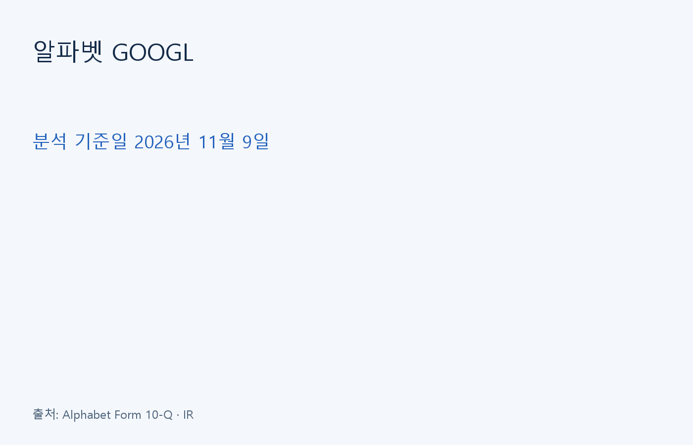
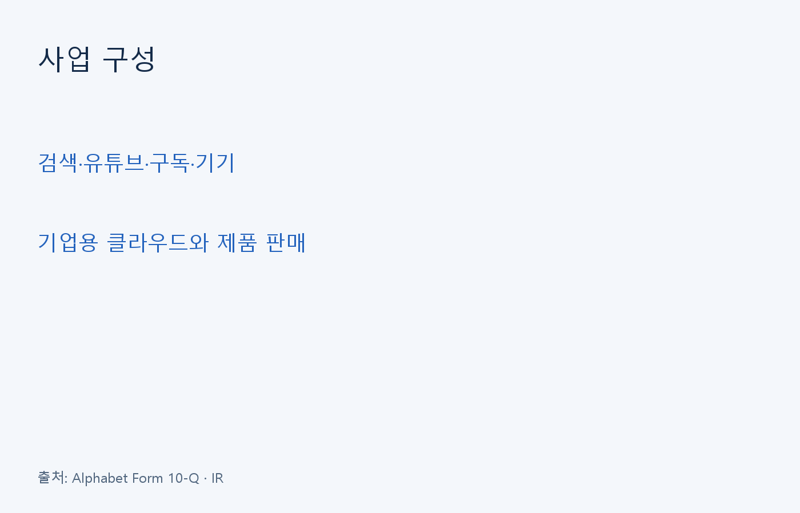
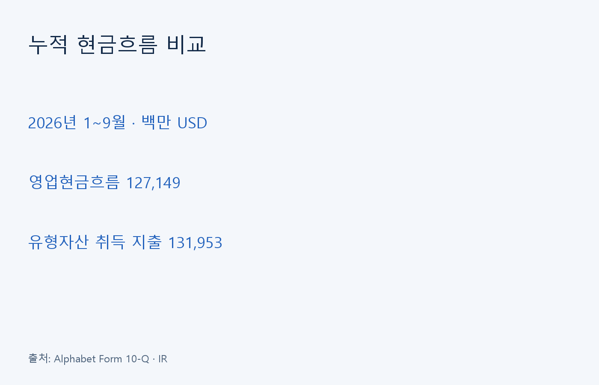
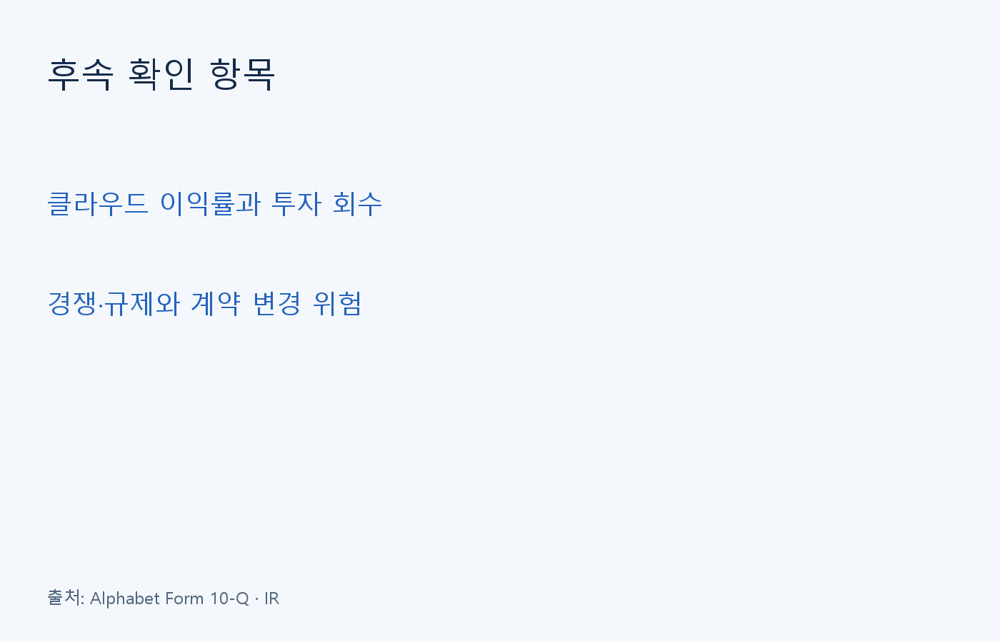

알파벳은 검색·유튜브 광고와 구독, 클라우드 서비스를 운영한다. 분석 기준일은 2026년 11월 9일이며 9월 30일 종료 분기와 10월 28일 실적 발표를 살폈다.

## 사업별 성장을 구분해서 보기

Google Services에는 광고와 구독·기기 사업이 포함된다. Google Cloud는 인프라·플랫폼·애플리케이션과 제품 판매에서 매출을 얻는다.

| 항목 | 2026년 3분기, 백만 USD |
| --- | ---: |
| 연결 매출 | 127,577 |
| Google Services 매출 | 96,302 |
| Google Cloud 매출 | 30,709 |

※ 출처: Alphabet 2026년 3분기 Form 10-Q. 연결 매출에는 Other Bets와 헤지 손익도 포함된다.

## 이익과 현금의 차이

IR 발표에서 분기 영업이익은 약 406억 USD다. 영업현금흐름은 약 423억 USD였지만 설비투자가 약 514억 USD여서 회사가 제시한 비GAAP 잉여현금흐름은 약 -91억 USD였다.

| 항목 | 2026년 1~9월, 백만 USD |
| --- | ---: |
| 영업현금흐름 | 127,149 |
| 유형자산 취득 지출 | 131,953 |
| 두 항목의 차액, 자체 계산 | -4,804 |

※ 출처: Alphabet Form 10-Q 현금흐름표와 3분기 실적 설명회. 누적 차액은 분기 지표와 기간이 다르며 회사의 모든 투자 지출을 차감한 값은 아니다.

## 성장 계획과 위험

회사는 2026년 설비투자 전망을 1,950억~2,050억 USD로 유지했다. 이는 연간 전망이며 확정된 집행 실적이 아니다. 클라우드의 외부 연산 자원 활용은 단기 이익률 부담이 될 수 있다고 설명했다.

공시는 Other Bets가 자금력 있는 경쟁사들과 경쟁하며 수익성을 확보하지 못할 위험을 명시한다. 검색·광고 등의 반독점 소송에서는 계약이나 제품 기능 변경을 요구하는 조치가 사업에 영향을 줄 수 있다.

※ 출처: Alphabet 3분기 실적 설명회 및 Form 10-Q 위험 요인.

## 자체 분석: 투자 회수 속도가 관건

클라우드 매출이 늘어도 투자 이후 현금이 남는지는 별도로 확인해야 한다. 서버와 데이터센터 지출은 먼저 발생하고 가동과 고객 사용을 통한 회수에는 시간이 걸릴 수 있다. 따라서 매출 증가만으로 설비투자의 수익성이 입증됐다고 보기는 어렵다.

이번 누적 현금흐름 비교는 영업에서 들어온 현금보다 유형자산 취득 지출이 컸다는 점을 보여 준다. 다만 이 차액만으로 자금 부족을 단정할 수는 없다. 보유 자산과 차입, 자본 조달을 함께 봐야 하며 투자 확대가 앞으로 어느 정도의 매출과 현금으로 이어질지는 아직 불확실하다.

후속 공시에서는 클라우드 성장과 이익률을 함께 살필 필요가 있다. 외부 연산 자원 비용이나 감가상각이 늘면 매출 증가가 이익 개선으로 그대로 이어지지 않을 수 있다. 규제 대응으로 유통 계약이나 서비스 구성이 바뀌는지도 투자 회수 가정에 영향을 주는 확인 항목이다.

정보 제공 목적이며 개별 투자 권유가 아니다. 원금 손실이 가능하다. 미검증 주가·PER·PEG는 제시하지 않는다.
