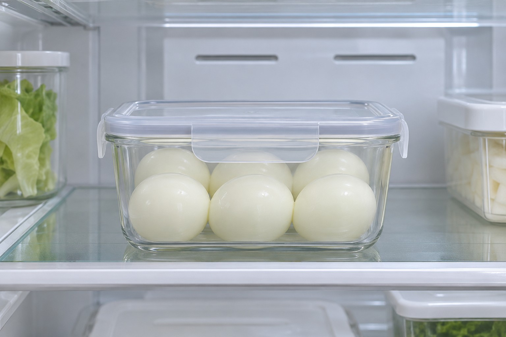
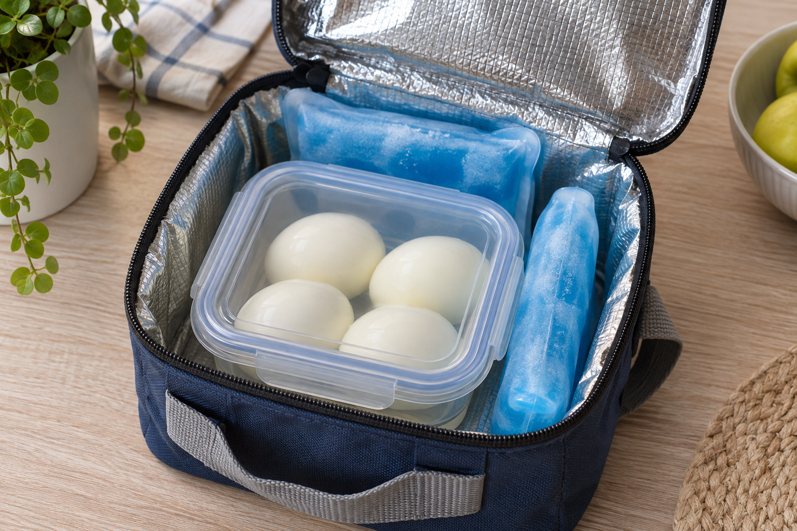

완숙 달걀을 미리 삶아 둘 때는 껍데기를 벗겼는지보다 조리한 날을 기억하는 게 중요해요. 미국 FDA는 껍데기가 있든 없든 냉장한 완숙 달걀을 조리 후 1주 안에 먹도록 안내합니다.

## 삶은 뒤에는 신속히 냉장하기

FDA의 보관 온도 기준은 40°F 이하예요. 섭씨로는 약 4.4°C이며 냉장고를 4°C 이하로 관리하면 이 기준 안에 들어갑니다. 캐나다 보건부는 완숙 달걀을 밀폐 용기에 담아 냉장하고 최대 1주 안에 먹도록 안내해요.

이 기간은 껍데기를 벗긴 날부터 다시 세는 게 아니에요. 예를 들어 월요일에 삶고 수요일에 껍데기를 벗겼다면, 보관 기간의 시작은 월요일입니다. 용기에 삶은 날을 표시해 두면 날짜를 확인하기 편해요.

## 냉장고 밖에 오래 뒀다면 따로 판단하기

‘1주’는 냉장 보관을 전제로 한 안내예요. FDA는 조리한 달걀을 냉장고 밖에 2시간 넘게 두지 말고 기온이 90°F(약 32.2°C)를 넘으면 1시간을 넘기지 않도록 합니다. 캐나다 보건부는 상온에 2시간 넘게 둔 달걀은 버리라고 안내해요.

## 도시락에는 냉동 젤팩 함께 넣기

외출할 때는 충분한 얼음이나 냉동 젤팩을 넣은 보냉용기로 차갑게 유지하세요. FDA도 직장이나 학교에 가져가는 조리 달걀 도시락에 작은 냉동 젤팩을 함께 넣도록 안내합니다. 보냉백에 넣었다는 이유만으로 몇 시간 동안 안전하다고 단정할 수는 없어요.

이 글은 집에서 만든 완숙 달걀에 관한 미국·캐나다 기관의 안내를 정리한 내용입니다. 반숙란이나 시판 포장 달걀에 같은 기간을 일괄 적용하지 말고 해당 제품의 표시와 보관 안내를 확인하세요.

출처: [FDA 달걀 안전 안내](https://www.fda.gov/media/82227/download), [캐나다 보건부 달걀 안전 안내](https://www.canada.ca/en/health-canada/services/meat-poultry-fish-seafood-safety/eggs.html)
