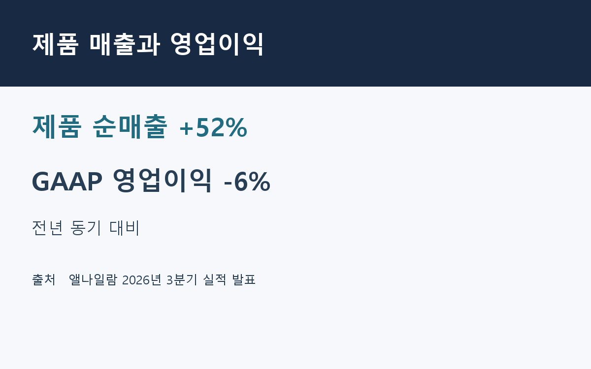
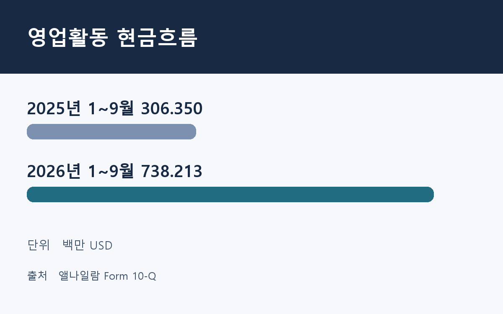
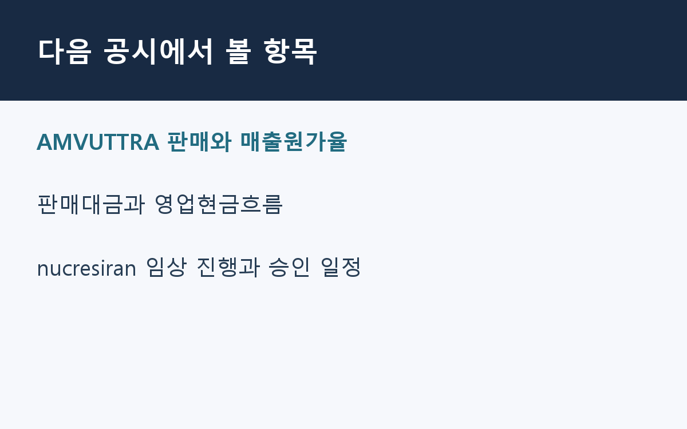

2026년 11월 11일 기준. 9월 30일에 끝난 분기의 10-Q와 10월 29일 회사 실적 발표를 대조했다.

## RNA 간섭 치료제에서 나오는 매출

앨나일람은 RNA 간섭(RNAi)을 이용해 질환에 관여하는 단백질의 생성을 줄이는 치료제를 개발한다. AMVUTTRA와 ONPATTRO는 트랜스티레틴(TTR) 관련 아밀로이드증 치료제다. 회사는 GIVLAARI와 OXLUMO도 직접 판매하고 협력사가 판매하는 Leqvio와 Qfitlia에서는 로열티를 받는다.

| 분기 손익, 백만 USD | 2025년 3분기 | 2026년 3분기 |
| --- | ---: | ---: |
| 총매출 | 1,249.026 | 1,458.086 |
| 제품 순매출 | 851.082 | 1,291.946 |
| AMVUTTRA 순매출 | 685.303 | 1,130.363 |
| 협업 순매출 | 351.742 | 71.476 |
| GAAP 영업이익 | 367.982 | 345.798 |

출처는 Alnylam 2026년 3분기 실적 발표와 Form 10-Q다. AMVUTTRA는 제품 순매출에 포함된다.

## 제품 매출이 늘어난 분기에 영업이익은 감소

제품 순매출은 전년 동기 대비 52% 증가했다. 전년 동기 협업 매출에는 Roche의 3억 USD 개발 마일스톤이 포함됐다. 올해 분기에는 제품 매출 증가에도 협업 매출이 줄었고 매출원가와 연구개발비는 늘었다. 회사는 AMVUTTRA 판매와 관련 로열티율 상승을 제품 순매출 대비 매출원가율 상승의 주된 이유로 들었다.

GAAP 순이익은 2,167.335백만 USD였다. 이전 연도 이연법인세자산에 대한 평가충당금 1,950백만 USD 환입이 분기 세금 혜택에 반영됐다. 순이익 증가폭을 해석할 때 이 회계 효과를 감안해야 한다.

## 1~9월 영업현금흐름

| 누적 현금흐름, 백만 USD | 2025년 1~9월 | 2026년 1~9월 |
| --- | ---: | ---: |
| 영업활동 현금흐름 | 306.350 | 738.213 |
| 유형자산 매입 지출 | 35.405 | 126.345 |
| 영업현금흐름에서 매입 지출을 뺀 금액 | 270.945 | 611.868 |

출처는 Form 10-Q 현금흐름표다. 마지막 행은 자체 계산이다. 공시는 현금 유입 증가의 주된 이유로 제품 판매대금 증가를 들었다.

## 자체 분석과 후속 확인 항목

이번 실적에서 사업의 변화를 가장 잘 드러내는 항목은 제품 순매출이다. 협업 수익은 개발 단계에 따라 특정 분기에 몰릴 수 있다. 제품 판매는 꾸준히 늘어도 매출원가율이 높아지면 추가 매출에서 남는 이익이 줄어든다. 다음 공시에서는 AMVUTTRA 판매와 함께 매출원가율이 어떻게 움직이는지 살펴볼 필요가 있다.

ATTR 심근병증 시장에서 Pfizer의 VYNDAQEL·VYNDAMAX와 BridgeBio의 ATTRUBY가 경쟁한다. 앨나일람 공시는 두 경쟁 약의 미국 정가가 AMVUTTRA보다 낮다고 설명한다. 보험 보장 범위와 실제 환자 접근성이 바뀌면 판매량과 순매출에 영향을 줄 수 있다.

회사는 nucresiran 3상 목표 등록 인원을 약 2,250명으로 늘렸다. ATTR 심근병증 치료제로 2030년까지 출시한다는 전망은 긍정적 임상 결과와 규제 승인을 전제로 한다. 회사가 유지한 2026년 제품 순매출 전망은 4,700~5,100백만 USD다.

기업 공시를 바탕으로 한 정보 제공 글이다. 투자에는 원금 손실 위험이 있다.
