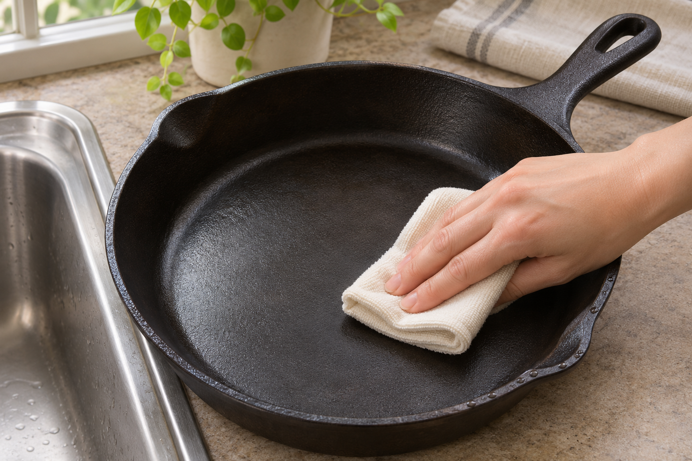
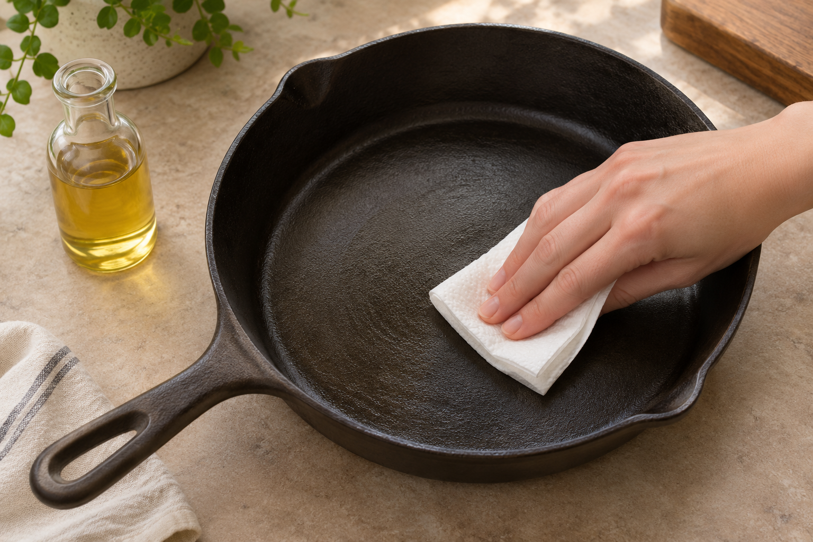

시즈닝한 무쇠팬은 씻자마자 보풀 없는 천이나 종이타월로 물기를 닦아 주세요. 물기가 오래 남으면 녹이 생길 수 있어 로지는 건조대에 세워 자연 건조하는 대신 바로 닦아 완전히 말리도록 안내합니다.

## 천으로 닦고 남은 물기까지 말리기

필드 컴퍼니는 자사 무쇠팬을 천으로 닦은 뒤 가열해 남은 물기를 날리라고 안내합니다. 씻은 팬을 가열해 말려도 되는지는 사용하는 제품의 관리 안내를 확인하세요.

## 다 마른 팬에 기름을 얇게 바르기

팬이 완전히 마르면 종이타월로 기름을 얇게 펴 발라 주세요. 기름이 고인 곳은 타월로 닦아내고 팬은 건조한 곳에 보관합니다.

법랑 코팅이 된 무쇠팬은 제품별 관리 안내를 따르세요. 로지는 자사 법랑 무쇠팬에 시즈닝이 필요 없다고 설명합니다. 빈 팬을 쿡탑에서 가열하는 것도 피하라고 안내합니다.

출처 [로지 무쇠팬 세척 안내](https://www.lodgecastiron.com/pages/how-to-clean) · [필드 컴퍼니 무쇠팬 관리 안내](https://fieldcompany.com/pages/how-to-clean-maintain-cast-iron-pan-skillet) · [로지 법랑 무쇠 관리 안내](https://www.lodgecastiron.com/pages/cleaning-care-enameled-cast-iron)
