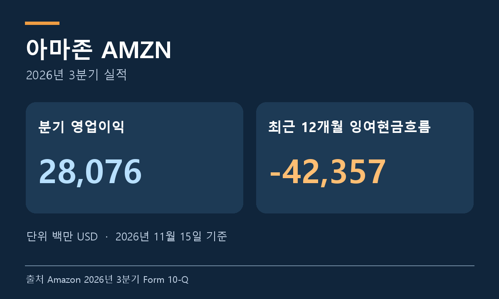
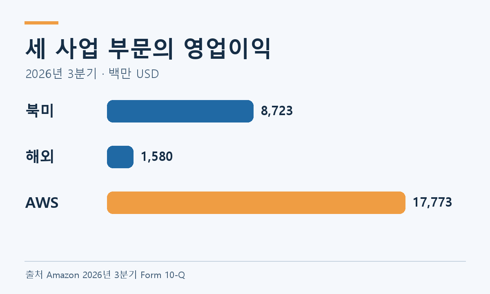
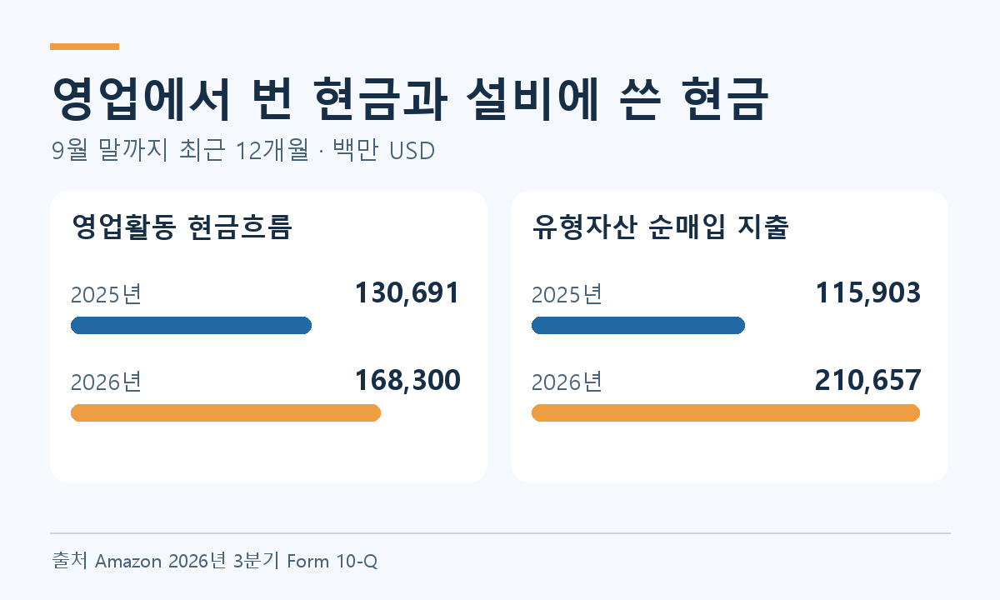
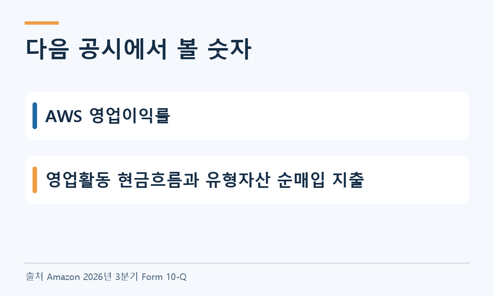

아마존의 2026년 3분기 영업이익은 28,076백만 USD로 전년 동기 17,422백만 USD보다 늘었다. 한편 9월 말까지 최근 12개월 잉여현금흐름은 42,357백만 USD 순유출이었다. 분기 손익과 연간에 가까운 현금흐름을 함께 보면 AI 인프라 투자 규모가 드러난다.

분석 기준일은 2026년 11월 15일이다. 분기 종료일은 9월 30일이며 실적은 10월 29일 발표됐다. 아마존은 나스닥100 구성 기업이다.

## 북미·해외 판매와 AWS

북미와 해외 부문은 직매입 상품을 팔고 외부 판매자에게 수수료와 물류 서비스 대가를 받는다. 두 부문에는 광고와 구독 매출도 들어간다. AWS는 기업과 개발자에게 컴퓨팅, 저장 공간, 데이터베이스 등 클라우드 서비스를 제공한다.

| 3분기 부문 실적, 백만 USD | 2025년 매출 | 2026년 매출 | 2025년 영업이익 | 2026년 영업이익 |
| --- | ---: | ---: | ---: | ---: |
| 북미 | 106,267 | 112,852 | 4,789 | 8,723 |
| 해외 | 40,896 | 43,108 | 1,199 | 1,580 |
| AWS | 33,006 | 45,984 | 11,434 | 17,773 |
| 연결 | 180,169 | 201,944 | 17,422 | 28,076 |

표의 수치로 계산하면 AWS는 연결 매출의 약 23%, 영업이익의 약 63%를 차지했다. AWS 매출은 39.3% 증가했다. 북미에서도 판매량과 광고 매출이 늘면서 영업이익이 증가했다.

분기 순이익은 20,685백만 USD로 전년의 21,187백만 USD보다 줄었다. 아마존은 전년 동기 Anthropic 투자에서 발생한 세전 이익 9,500백만 USD를 주된 비교 요인으로 들었다.

## 영업현금을 웃돈 설비 투자

| 9월 말 기준 최근 12개월, 백만 USD | 2025년 | 2026년 |
| --- | ---: | ---: |
| 영업활동 현금흐름 | 130,691 | 168,300 |
| 유형자산 순매입 지출 | 115,903 | 210,657 |
| 잉여현금흐름(회사 정의, 비GAAP) | 14,788 | -42,357 |

아마존은 유형자산 매입액에서 매각대금과 인센티브를 뺀 순지출을 계산한다. 영업활동 현금흐름에서 그 금액을 차감한 수치가 표의 잉여현금흐름이다. 회사는 순지출 증가가 주로 AI 투자에서 비롯됐다고 설명했다. 기업 인수와 비상장 지분 투자, 부채 원금 상환까지 살피려면 현금흐름표 전체가 필요하다.

## 회사 전망과 경쟁 환경

10월 29일 회사가 제시한 4분기 매출 전망은 2,400억~2,470억 USD, 영업이익 전망은 285억~335억 USD다. 올해 현금 설비투자 예상액은 약 2,200억 USD다. 회사는 에너지 파생계약 재평가 영향과 추가 인수·구조조정·법적 합의가 없다는 가정 아래 분기 전망을 제시했다.

아마존은 10-Q에서 클라우드와 온·오프라인 소매, 광고 모두 경쟁이 치열하다고 설명한다. 클라우드 가격 경쟁이 심해지거나 메모리 등 부품 수급이 불안해지면 설비를 늘려도 이익률에 부담이 생길 수 있다. 소매 쪽에서는 배송비와 관세, 소비 수요가 비용과 판매량에 영향을 준다.

## 자체 분석

투자 회수는 AWS 매출이 얼마나 빨리 현금으로 들어오느냐에 달려 있다. 설비를 늘리는 동안에는 서버와 데이터센터 지출이 먼저 발생하고 감가상각비는 이후 여러 기간에 걸쳐 손익에 반영된다. 분기 AWS 영업이익률이 유지되더라도 유형자산 순매입 지출이 영업현금보다 빠르게 늘면 잉여현금흐름 회복은 늦어질 수 있다.

다음 공시에서 AWS 매출 증가율과 부문 영업이익률을 같이 보면 늘어난 인프라 비용을 매출이 얼마나 흡수했는지 가늠할 수 있다. 연결 현금흐름에서는 영업현금 증가액과 유형자산 순매입 지출 증가액을 같은 기간으로 비교할 필요가 있다. 두 증가액의 차이가 줄어들면 현금 부담이 완화됐는지 확인할 단서가 된다.

## 출처

- [Nasdaq-100 구성종목](https://www.nasdaq.com/docs/global-indexes/NDX)
- [Amazon 2026년 3분기 실적 발표](https://ir.aboutamazon.com/news-release/news-release-details/2026/Amazon-com-Announces-Third-Quarter-Results/)
- [Amazon 2026년 9월 30일 기준 Form 10-Q](https://www.sec.gov/Archives/edgar/data/1018724/000101872426000040/amzn-20260930.htm)
