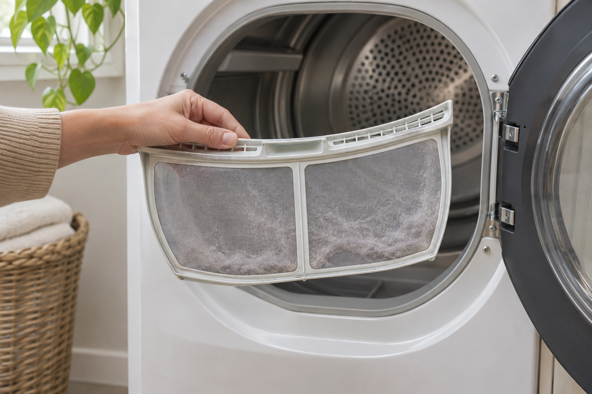
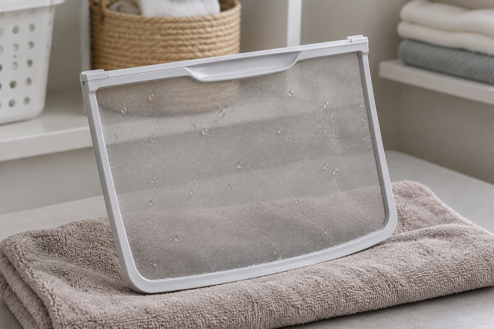

건조기를 한 번 돌렸다면 먼지 필터에 붙은 보풀을 걷어 주세요. 물로 씻는 주기는 모델 설명서를 확인하세요. 보풀이 필터 망을 막으면 공기 흐름이 줄고 빨래가 마르는 데 시간이 더 걸릴 수 있어요.

## 보풀을 걷은 뒤에도 먼지가 남을 때

LG전자 고객지원의 일부 모델 안내는 큰 보풀을 먼저 걷어 낸 뒤 남은 먼지를 진공청소기나 흐르는 물로 제거하라고 권해요. Whirlpool은 소형 히트펌프 건조기 도어 필터의 보풀을 매번 손으로 걷도록 안내합니다. 세제나 섬유유연제 잔여물은 6개월마다 물로 씻어 내고 잔여물로 망이 막히면 더 일찍 씻으라고 해요.

삼성전자서비스의 14 kg·16 kg 건조기 안내에는 매회 필터를 청소하라는 권고와 함께 보풀을 걷고 흐르는 물에 씻는 절차가 나와요. 같은 먼지 필터라도 물을 쓰는 시점이 다를 수 있으니 모델 설명서의 필터 청소 항목을 먼저 보세요.

## 씻은 필터는 완전히 말린 뒤 끼우기

물로 씻은 필터는 물기가 모두 마른 뒤 끼워 주세요. 삼성전자서비스는 분리한 필터를 그늘에 세워 말리라고 안내합니다. LG전자에 따르면 망에 물기가 남으면 건조 성능이 떨어지거나 냄새가 날 수 있어요.

## 바깥 필터의 청소 주기

이중 필터라면 바깥쪽 필터도 청소 주기를 따로 확인하세요. LG전자 고객지원의 대표 모델 안내는 속 필터를 사용할 때마다, 바깥 필터를 약 10회 사용마다 청소하도록 권합니다.

출처 [LG전자 필터 청소 안내](https://www.lge.co.kr/support/solutions-20151794532733?category=CT50019274&cstFlag=Y&mktModelCd=RL21KJU&page=0&seq=28&sort=update&subCategory=CT50109011) · [삼성전자서비스 14 kg·16 kg 필터 청소 안내](https://www.samsungsvc.co.kr/solution/25735) · [Whirlpool 소형 히트펌프 건조기 도어 필터 관리](https://producthelp.whirlpool.com/Laundry/Dryers/Compact_Heat_Pump_Dryer/Cleaning_and_Maintenance/Cleaning_the_Lint_Screen_-_Compact_Heat_Pump_Dryer) · [LG전자 내부·외부 필터 주기 안내](https://www.lge.co.kr/support/solutions-20151249371602)
