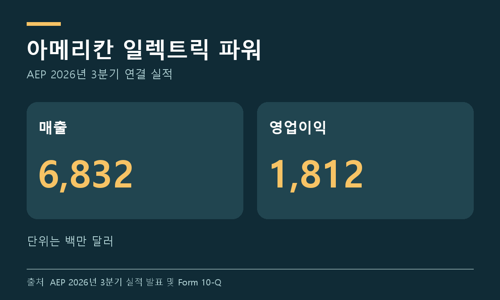
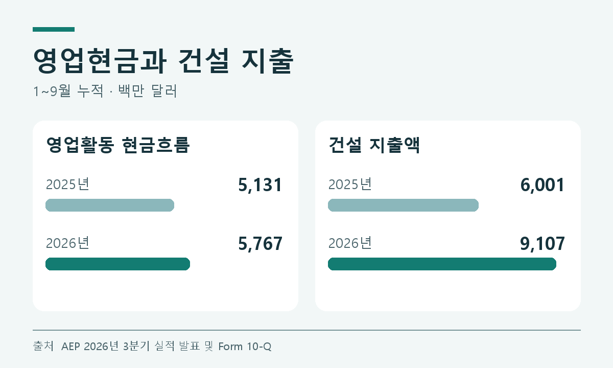

아메리칸 일렉트릭 파워(AEP)의 2026년 3분기 매출과 영업이익은 모두 전년 동기보다 늘었다. 1~9월에는 건설 지출이 영업활동 현금흐름을 3,340백만 달러 웃돌았다. 전력 수요 확대를 위한 투자가 재무에 미친 영향을 보려면 손익과 현금흐름을 함께 읽어야 한다.

분석 기준일은 2026년 11월 16일이다. 나스닥100 구성 기업인 AEP의 분기는 9월 30일에 끝났으며 회사는 10월 28일에 실적을 발표했다.

## 요금 규제를 받는 전력 사업과 경쟁 시장

AEP는 발전부터 배전까지 맡는 전력회사와 송배전 중심 전력회사를 운영한다. 송전 전용 사업도 영위한다. 규제 사업에서는 승인받은 요금과 투자비 회수 일정이 수익에 영향을 준다.

발전·마케팅 부문은 PJM에서 경쟁 발전을 하고 여러 전력시장에서 도소매 활동을 한다. 경쟁 발전 자산은 규제 요금으로 투자비를 회수하는 설비와 수익 구조가 다르다. 도매 전력 가격과 수요 변화에 따라 실적이 달라질 수 있다.

## 3분기 연결 실적

| 항목 | 2025년 3분기 | 2026년 3분기 |
| --- | ---: | ---: |
| 매출, 백만 달러 | 6,011 | 6,832 |
| 영업이익, 백만 달러 | 1,522 | 1,812 |
| 보통주 귀속 순이익, 백만 달러 | 972 | 1,187 |
| GAAP 기본 주당순이익, 달러 | 1.82 | 2.18 |
| 회사 조정 주당이익, 달러 | 1.80 | 2.23 |

매출은 약 13.7%, 영업이익은 약 19.1% 늘었다. 모두 공시 수치로 계산한 전년 동기 대비 증가율이다. 회사가 발표한 조정 주당이익은 비GAAP 지표이며 표의 연결 영업이익과 구분했다.

## 건설에 투입된 현금

| 연결 현금흐름, 백만 달러 | 2025년 1~9월 | 2026년 1~9월 |
| --- | ---: | ---: |
| 영업활동 현금흐름 | 5,131 | 5,767 |
| 건설 지출액 | 6,001 | 9,107 |
| 영업현금에서 건설 지출을 뺀 금액 | -870 | -3,340 |
| 재무활동 순현금흐름 | 3,479 | 5,643 |

건설 지출액은 유출액을 양수로 표시했다. 두 항목의 차이는 자체 계산이며 발전소 인수 등 다른 투자활동은 계산 범위에서 제외했다. 재무활동 순유입 규모도 늘었다.

## 투자 계획을 볼 때 확인할 조건

AEP가 발표한 2027~2031년 자본투자 계획은 1,000억 달러다. 회사는 같은 기간 조정 주당이익이 연간 9~11% 성장할 것으로 전망했다. 이 수치는 회사 계획과 전망에 해당한다.

회사는 2031년까지 계약으로 뒷받침된 증분 전력 부하가 84GW에 이를 것으로 예상한다. 전력 서비스 계약이나 합의서를 체결한 프로젝트만 회사 집계에 들어간다. 실제 수요는 접속 시기나 사용 규모에 따라 달라질 수 있다.

### 자체 분석

건설 지출의 증가폭은 1~9월 영업활동 현금흐름의 증가폭보다 컸다. 이 격차가 이어지면 신규 설비의 요금 회수 전에 자금을 조달하는 비용이 중요해진다. 분기 이익이 늘어도 차입 금리가 오르거나 회수 시점이 늦어지면 현금 부담이 길어질 수 있다.

대형 고객 계약은 착공 판단의 근거가 된다. 투자자는 계약의 발표 규모와 함께 실제 접속 일정, 설비 가동 시점, 각 지역 요금 심사 결과를 볼 필요가 있다. 공사비가 먼저 나가는 동안 영업현금이 얼마나 늘어나는지도 확인할 지표다. 경쟁 발전에서는 도매 가격이 실적을 좌우할 수 있으므로 규제 사업의 회수 일정과 별도로 살펴볼 만하다.

## 출처

- [Nasdaq-100 구성 기업](https://www.nasdaq.com/articles/global-indexes/nasdaq-100-index)
- [AEP 2026년 3분기 실적 발표](https://www.aep.com/news/stories/view/12347/)
- [SEC AEP 2026년 9월 말 Form 10-Q](https://www.sec.gov/Archives/edgar/data/4904/000000490426000072/aep-20260930.htm)
