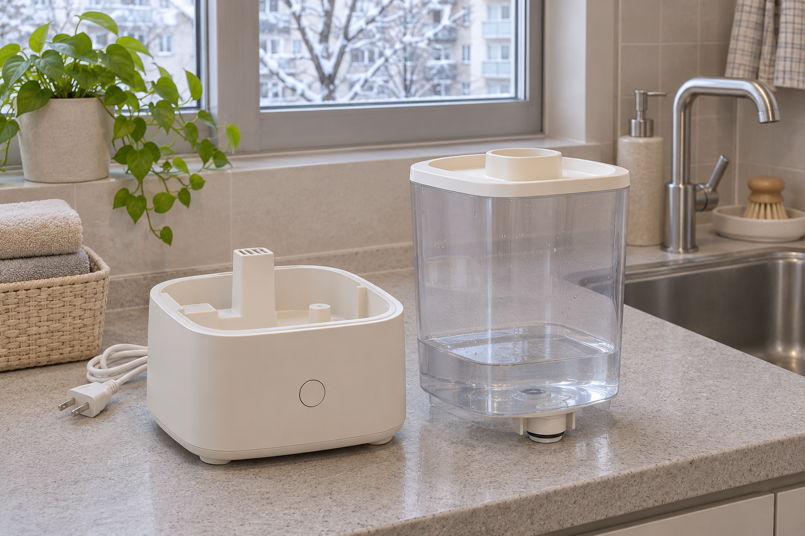
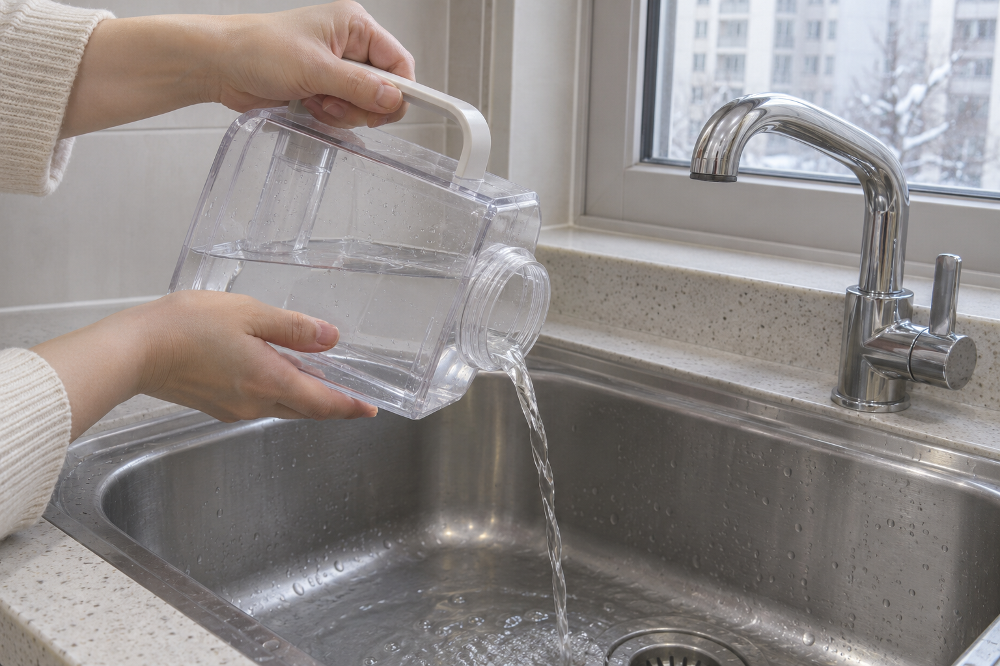

가정용 이동식 가습기는 매일 남은 물을 모두 비우고 새 물을 채워 주세요. 물통에 오래 고인 물에서는 미생물이 자랄 수 있어요.

캐나다 보건부는 찬 안개형 가습기를 쓰고 나면 물통을 비우라고 권해요. 새 물은 다시 켜기 직전에 채우라고 해요.

## 물통과 물받이 비우기

1. 가습기 전원을 끄고 플러그를 뽑아요.
2. 물통을 비워요. 본체에 따로 물이 고이는 곳이 있으면 같이 비워 주세요. 초음파식 가습기의 진동자 쪽에 남은 물은 제품에 표시된 배출 방향을 따라 버려요.
3. 물이 닿는 곳의 물기를 닦고 사용할 때 새 물을 채워요. 물통의 최대 수위 표시를 지켜 주세요.

## 매일 물을 갈아도 세척은 따로

미국 환경보호청은 이동식 가습기를 3일에 한 번 청소하라고 권해요. 물통 벽이나 물이 닿는 안쪽을 살펴보세요.

물때와 침전물은 솔이나 수세미로 제거해요. 어느 부위를 어떻게 세척할지는 제품 설명서를 확인하세요.

한국소비자보호원(현 한국소비자원)은 2005년 서울과 수도권 53가구의 가습기 물통과 진동자 부분에서 시료를 채취했어요. 53대 중 18대(34.0%)에서 병원성 세균이나 알레르기 유발균이 나왔어요. 당시 조사 대상에 한정된 결과예요.

## 한동안 사용하지 않을 때

가습기를 보관할 때는 물통과 물받이에 고인 물을 비우고 물이 닿은 부품을 말려 주세요. 오랫동안 보관한 가습기는 물을 채우기 전에 세척하세요.

참고 자료 [한국소비자원 물 교환 요령](https://www.kca.go.kr/home/sub.do?menukey=4006&mode=view&no=1001139155) · [미국 환경보호청 가정용 가습기 관리 안내](https://www.epa.gov/indoor-air-quality-iaq/use-and-care-home-humidifiers) · [캐나다 보건부 찬 안개형 가습기 안내](https://www.canada.ca/en/health-canada/services/household-products/cool-mist-humidifiers.html) · [한국소비자보호원 2005년 가정용 가습기 조사](https://www.kca.go.kr/home/sub.do?menukey=4002&mode=view&no=1000527129) · [한국소비자원 소비자시대 2025년 12월호 가습기 사용 주의사항](https://www.kca.go.kr/webzine/board/view?div=kca_2512&linkId=954&menuId=MENU00307)
