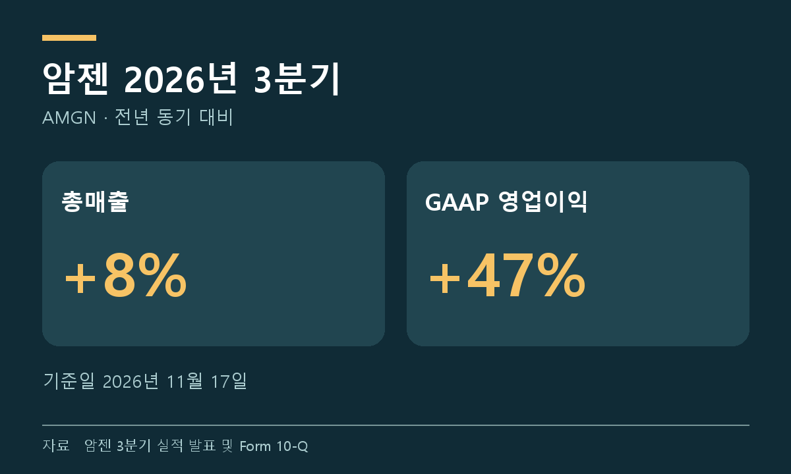
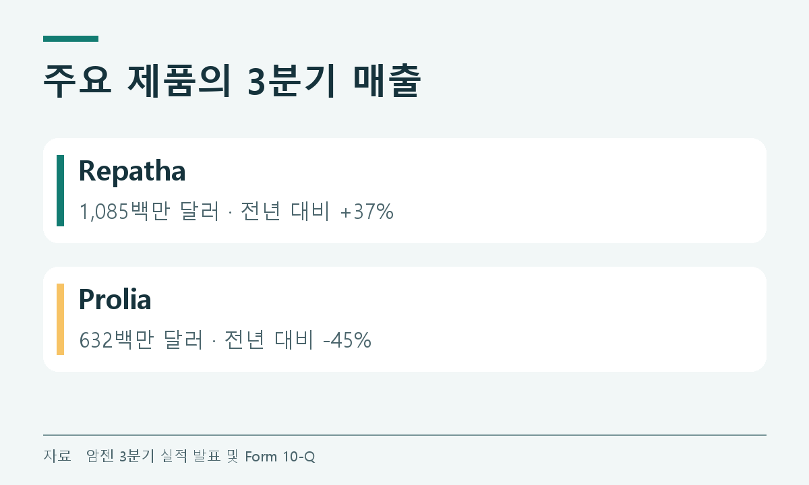
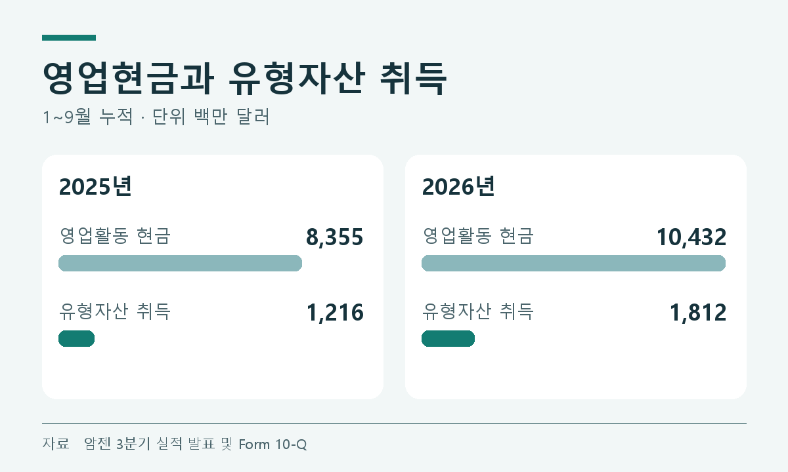

암젠의 2026년 3분기 매출은 전년 동기보다 8%, GAAP 영업이익은 47% 늘었다. 회사가 발표한 분기 잉여현금흐름은 42억 달러에서 37억 달러로 줄었지만 1~9월 누적 영업현금은 증가했다.

분석 기준일은 2026년 11월 17일이다. 암젠은 나스닥100 구성 기업이며 9월 30일에 마감한 3분기 실적을 11월 3일에 발표했다.

## 사업과 제품 경쟁

암젠은 인체 치료제 개발·생산·판매를 하나의 사업 부문으로 보고한다. 3분기 제품 매출은 9,883백만 달러였고 기타 매출은 482백만 달러였다. 회사는 제품 매출 증가를 판매량 증가로 설명했다.

콜레스테롤 저하제 Repatha 매출은 전년 동기보다 37% 증가한 1,085백만 달러다. 반면 골다공증 치료제 Prolia의 매출은 바이오시밀러 출시로 판매량과 순판매가격 등이 하락하면서 45% 감소한 632백만 달러였다.

## 연결 손익

| 항목 | 2025년 3분기 | 2026년 3분기 |
| --- | ---: | ---: |
| 총매출, 백만 달러 | 9,557 | 10,365 |
| GAAP 영업이익, 백만 달러 | 2,526 | 3,710 |
| 조정 영업이익, 백만 달러 | 4,305 | 4,676 |
| GAAP 희석 주당순이익, 달러 | 5.93 | 7.08 |
| 조정 주당순이익, 달러 | 5.64 | 6.45 |

전년의 Otezla 무형자산 손상차손과 인수 관련 자산의 상각비 감소가 GAAP 영업이익 비교에 영향을 줬다. 2026년 3분기 연구개발비는 2,111백만 달러로 전년 동기 1,900백만 달러보다 늘었다. 조정 수치는 회사가 인수 관련 비용 등 일부 항목을 조정한 비GAAP 지표다.

## 분기와 누적 현금흐름

| 1~9월 누적, 백만 달러 | 2025년 | 2026년 |
| --- | ---: | ---: |
| 영업활동 현금흐름 | 8,355 | 10,432 |
| 유형자산 취득 지출 | 1,216 | 1,812 |
| 영업활동 현금흐름에서 유형자산 취득을 뺀 금액 | 7,139 | 8,620 |

마지막 줄은 Form 10-Q를 이용한 자체 계산이다. 전년 2분기의 해외이익 환류세 최종 납부액 18억 달러가 누적 비교에 영향을 줬다. 회사는 3분기 잉여현금흐름 감소를 운전자본 변화로 설명했으며 전년 3분기에는 리베이트 및 대금 회수 시점이 현금흐름에 유리했다고 밝혔다.

## 임상 개발과 약가 부담

암젠은 체중 관리 후보물질 MariTide의 3상 시험을 진행 중이다. 회사의 11월 3일 연간 매출 전망은 389억~397억 달러, 설비투자 전망은 약 26억 달러다. 임상 진행과 연간 전망은 기준일 현재 미래 실적에 영향을 줄 수 있는 변수다.

Enbrel 3분기 매출은 5% 늘었으나 1~9월 매출은 11% 줄었다. 회사는 누적 순판매가격 하락 요인으로 2026년부터 적용된 미국 Medicare Part D 약가 결정과 340B 프로그램 판매 비중 증가를 들었다. 9월 말 차입금 잔액은 회사 발표 기준 540억 달러다. 후속 공시에서 차입금 상환과 신규 조달도 확인할 필요가 있다.

### 자체 분석

제품별 매출 차이를 보면 암젠의 성장률이 바뀌는 경로를 구체적으로 볼 수 있다. Repatha 매출 증가액은 291백만 달러로 Prolia 감소액 507백만 달러보다 작았다. 그런데 회사 제품 매출 전체는 746백만 달러 늘었다. 개별 제품의 판매량과 순판매가격이 얼마나 움직였는지 살펴야 다른 제품의 성장으로 감소분을 얼마나 메우는지 판단할 수 있다.

현금흐름에서는 세금과 운전자본 효과의 방향부터 확인해야 한다. 비교 기간의 세금 납부 기저가 누적 영업현금 증가에 영향을 줬고 분기 잉여현금은 반대로 줄었다. 다음 공시에서는 Repatha와 Prolia의 매출 변화에 더해 설비 지출을 뺀 현금과 차입금 잔액을 확인할 필요가 있다. MariTide는 시험 결과와 허가 여부에 따라 매출 기여 가능성이 달라진다.

## 출처

- [Nasdaq-100 구성 목록](https://www.nasdaq.com/docs/global-indexes/NDX)
- [암젠 2026년 3분기 실적 발표](https://www.amgen.com/newsroom/press-releases/2026/11/amgen-reports-third-quarter-2026-financial-results)
- [SEC 2026년 9월 말 Form 10-Q](https://www.sec.gov/Archives/edgar/data/318154/000031815426000155/amgn-20260930.htm)

기업 공시를 읽기 위한 정보이며 개별 투자 권유가 아니다. 투자에는 원금 손실 가능성이 있다.
