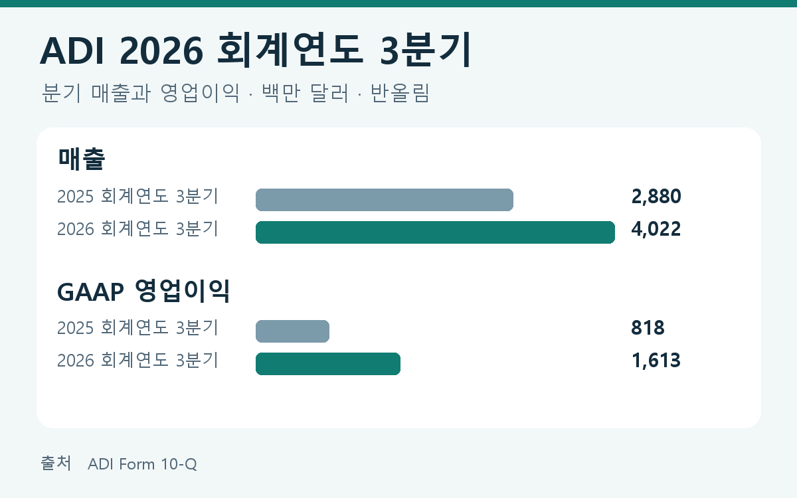
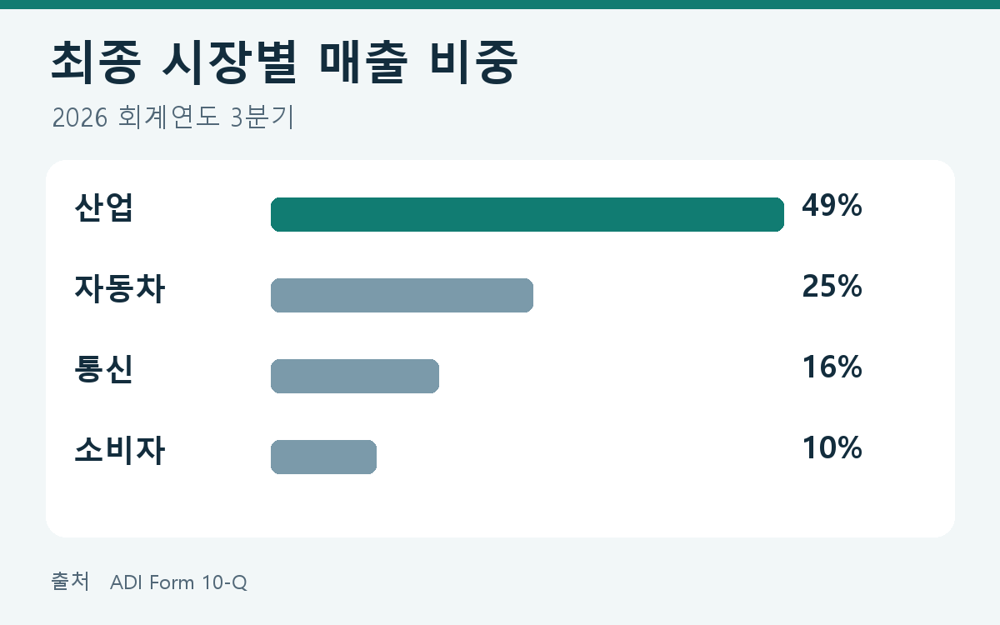
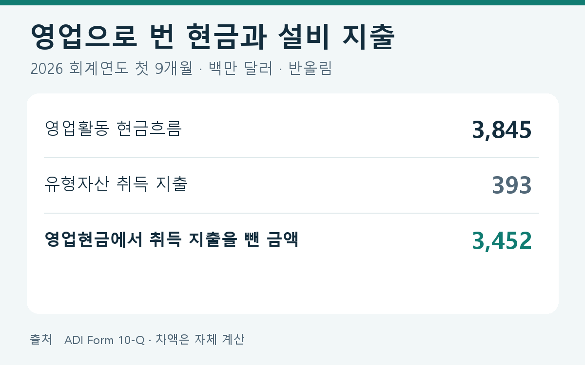
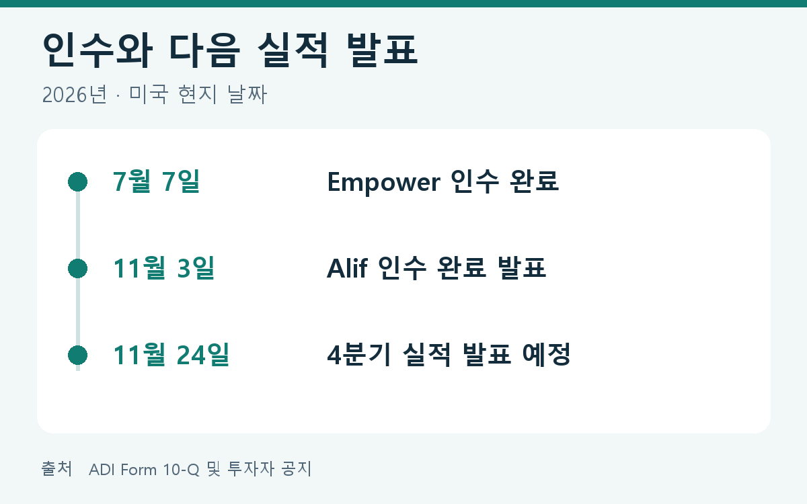

아날로그 디바이시스(ADI)의 2026 회계연도 3분기 매출은 전년 동기보다 40% 늘었고 GAAP 영업이익은 거의 두 배가 됐다. 산업용 제품에서 매출 증가액이 가장 컸으며 통신 시장 내에서는 데이터센터의 성장세가 가장 강했다.

분석 기준일은 2026년 11월 18일이다. 나스닥100 구성 기업인 ADI는 8월 1일에 마감한 3분기 실적을 8월 19일에 발표했다.

## 사업과 최종 시장

ADI는 신호 변환과 전력 제어에 쓰이는 반도체를 공급한다. 이 반도체는 센서가 포착한 신호를 디지털로 변환하거나 전력을 제어한다. 산업, 자동차, 통신, 소비자 제품에 쓰이며 각 시장의 수요 변화가 매출 구성에 반영된다.

| 최종 시장 | 2026 회계연도 3분기 매출, 백만 달러 | 매출 비중 | 전년 동기 대비 |
| --- | ---: | ---: | ---: |
| 산업 | 1,971.926 | 49% | +53% |
| 자동차 | 998.227 | 25% | +16% |
| 통신 | 654.515 | 16% | +84% |
| 소비자 | 397.231 | 10% | +6% |

산업 시장에서는 시험 장비와 항공우주·방산이 빠르게 성장했다. 통신 시장의 데이터센터 수요에는 AI 인프라 투자가 영향을 줬다고 회사는 설명했다.

## 연결 손익

분기 매출은 2,880.348백만 달러에서 4,021.899백만 달러로 늘었다. GAAP 영업이익은 818.028백만 달러에서 1,612.969백만 달러로 증가했다. 매출총이익률은 62.1%에서 67.3%로 올랐다. 회사는 수요가 늘어 설비 고정비를 더 효율적으로 활용했다고 밝혔다. 판매 제품 구성도 유리했다고 설명했다.

## 누적 현금흐름과 자본 배분

| 회계연도 첫 9개월, 백만 달러 | 2025 | 2026 |
| --- | ---: | ---: |
| 영업활동 현금흐름 | 3,111.392 | 3,844.515 |
| 유형자산 취득 지출 | 318.399 | 392.677 |
| 영업현금에서 유형자산 취득 지출을 뺀 금액 | 2,792.993 | 3,451.838 |

표의 마지막 행은 Form 10-Q를 바탕으로 계산했다. 2025년 유형자산 매각 대금과 두 기간의 기업 인수 지출은 이 계산에서 제외했다. 2026년 첫 9개월 순인수 지출은 1,536.049백만 달러였다. 회사는 투자현금흐름 변화의 주된 원인으로 7월 Empower Semiconductor 인수를 들었다.

## 인수와 다음 실적

ADI는 11월 3일 Alif Semiconductor 인수 완료를 발표했다. 9월 계약 발표에는 현금 선지급액 13억 5,000만 달러와 최대 2억 달러의 조건부 추가 대가가 명시됐다. 마이크로컨트롤러와 센서 처리 기술을 결합해 제품을 넓히려는 거래다. 통합 비용과 매출 기여는 후속 공시에서 확인할 사안이다.

8월에 발표한 4분기 매출 전망은 42억~44억 달러였다. 4분기 실제 실적은 11월 24일 미국 동부시간에 발표할 예정이다.

### 자체 분석

통신 매출의 증가율은 산업보다 높았지만 매출 증가액은 산업이 약 679백만 달러로 통신의 약 300백만 달러보다 컸다. 데이터센터 투자가 계속되더라도 산업 고객의 주문이 둔화하면 전체 성장률이 내려갈 수 있다. 경쟁사인 텍사스 인스트루먼트도 아날로그와 임베디드 반도체를 공급한다. 두 회사의 제품이 겹치는 시장에서는 가격과 성능을 모두 살펴야 한다.

매출 대비 누적 영업현금 비율은 공시 기준 39%에서 36%로 내려갔다. 매출이 커지는 속도에 비해 현금 유입 증가가 더뎠다는 뜻이다. 8월 1일 기준 매출채권 회수일수도 직전 회계연도 말의 44일에서 50일로 늘었다. 다음 공시에서는 이 지표가 줄어드는지, Alif 인수에 따른 현금 지출이 얼마나 반영되는지 함께 볼 필요가 있다.

## 출처

- [나스닥100 구성 목록, 2026년 11월 2일 기준](https://www.nasdaq.com/docs/global-indexes/NDX)
- [ADI 2026 회계연도 3분기 실적 발표](https://investor.analog.com/node/30656/pdf)
- [SEC 2026년 8월 1일 마감 Form 10-Q](https://www.sec.gov/Archives/edgar/data/6281/000000628126000073/adi-20260801.htm)
- [Alif 인수 계약](https://investor.analog.com/news-releases/news-release-details/analog-devices-acquire-alif-semiconductor-adding-ai-native) · [인수 완료](https://investor.analog.com/news-releases/news-release-details/analog-devices-completes-acquisition-alif-semiconductor)
- [텍사스 인스트루먼트 2025 Form 10-K](https://www.sec.gov/Archives/edgar/data/97476/000009747626000059/txn-20251231.htm)
- [ADI 4분기 실적 발표 일정](https://investor.analog.com/events/event-details/q4-2026-analog-devices-inc-earnings-conference-call)

기업 공시 해설이며 개별 투자 권유가 아니다. 투자에는 원금 손실 가능성이 있다.
