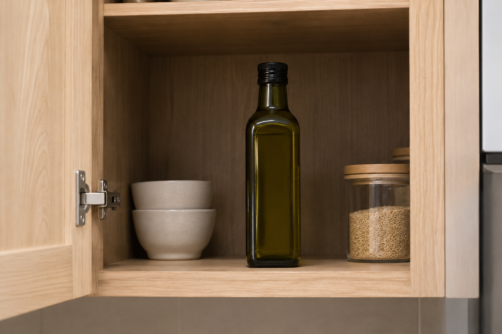
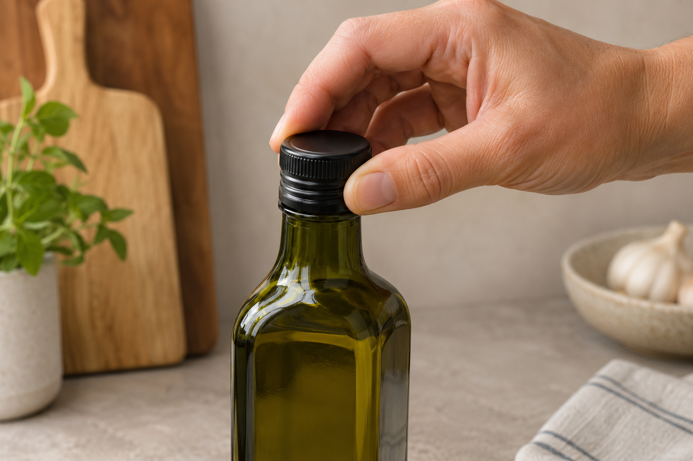

개봉한 올리브유는 서늘한 찬장에 두세요. 가스레인지와 햇빛 드는 창가에서는 떨어진 곳이 좋아요. 빛과 열에 오래 노출되면 올리브유의 풍미가 떨어질 수 있어요.

## 찬장 안쪽의 그늘진 자리

불을 켰을 때 찬장 안까지 따뜻해진다면 더 서늘한 자리를 골라요. 투명한 병에 든 올리브유는 특히 빛을 받지 않도록 찬장 안쪽에 넣고 문을 닫으세요.

## 기름을 따르고 나면 마개 닫기

조리에 필요한 만큼만 따르고 마개를 바로 닫으세요. 기름이 공기와 닿으면 산화가 빨라져 풍미가 떨어질 수 있어요.

국제올리브협회는 맛과 향을 지키려면 개봉한 뒤 1~3개월 안에 쓰도록 권해요. 올리브유를 가끔 쓴다면 다음엔 평소 쓰는 양에 맞춰 작은 병을 골라 보세요.

참고 자료 [국제올리브협회 소비자 보관 지침](https://www.internationaloliveoil.org/wp-content/uploads/2020/12/COI-CBPS-Doc.-n%C2%BA-1-ENG.pdf) · [UC Davis 올리브유 보관 안내](https://www.ucdavis.edu/research/labs-to-lives/blog/olive-avocado-oil)
