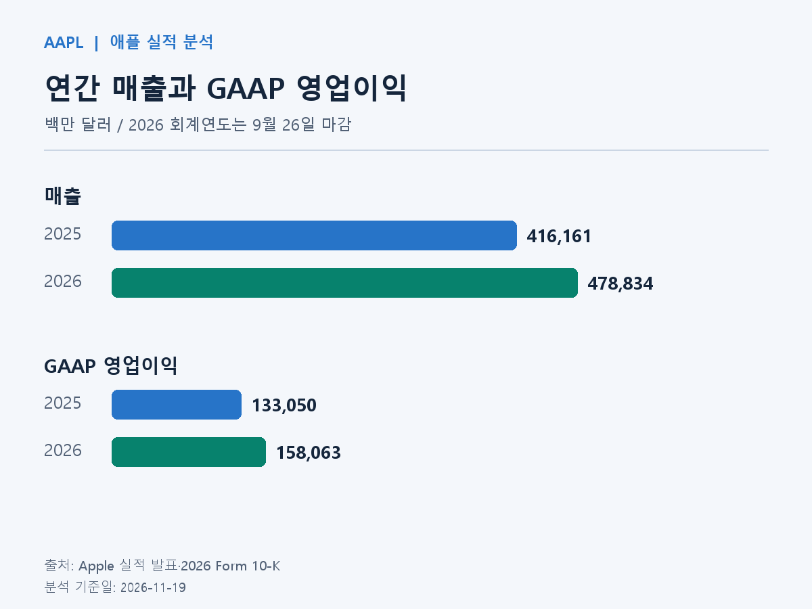
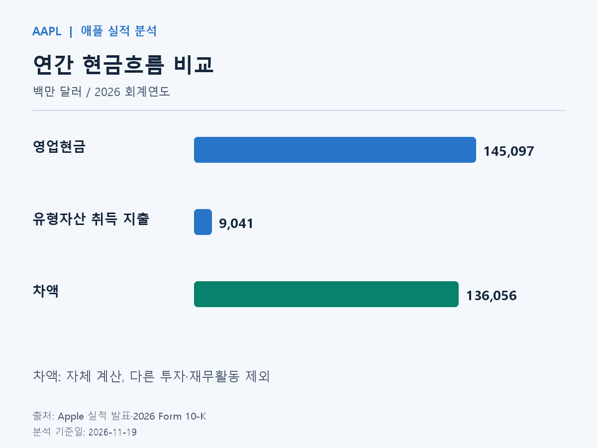
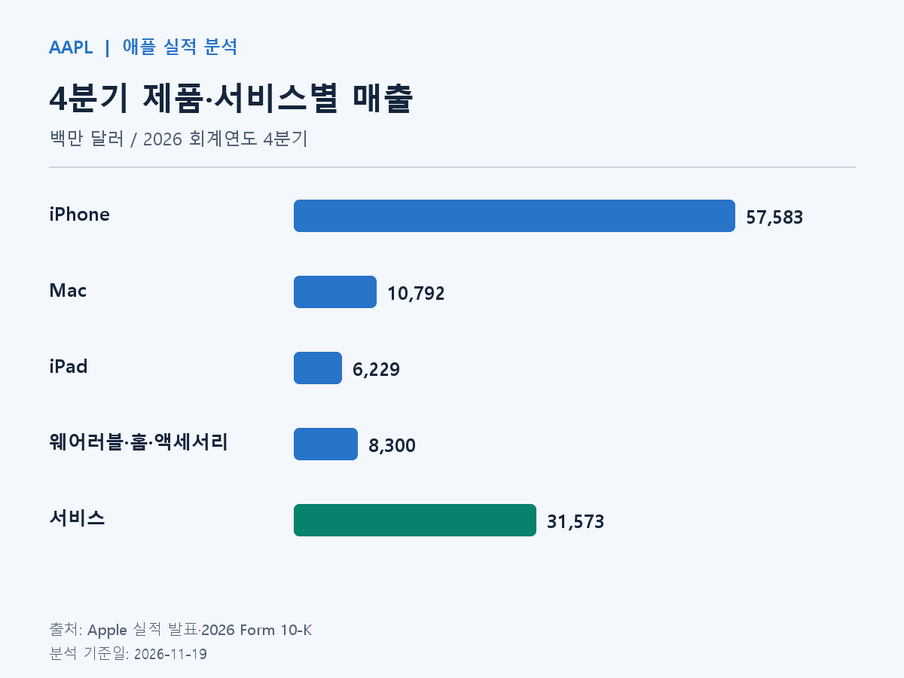
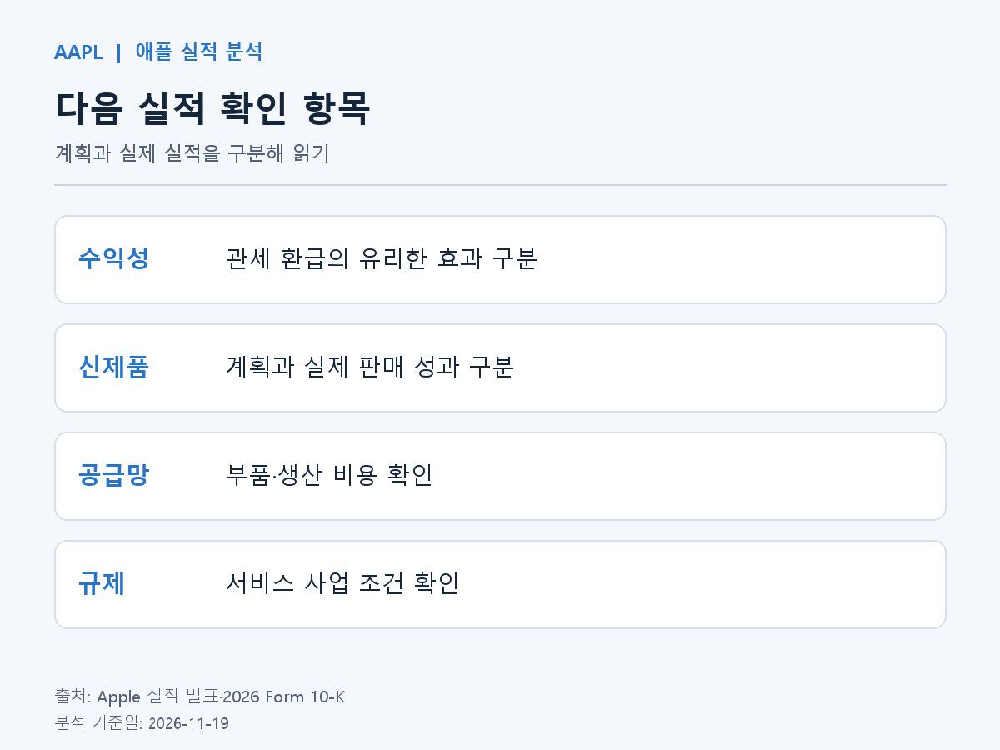

애플(AAPL)은 2026 회계연도에 매출과 영업이익을 늘렸다. 다만 4분기 수익성에는 관세 환급 효과가 들어 있어 다음 분기의 기초 수익력과 구분해 읽어야 한다. 연간 현금흐름에서는 영업현금 증가와 유형자산 취득 지출 감소가 함께 나타났다.

분석 기준일은 2026년 11월 19일이다. 나스닥의 11월 2일 공식 NDX 자료에서 애플의 구성종목 편입을 확인했다. 실적 기간은 9월 26일 마감한 2026 회계연도와 그 마지막 분기다. 발표일은 11월 2일이다.

## 사업 구조와 경쟁력

애플은 iPhone, Mac, iPad와 웨어러블 등을 판매하고 서비스 매출도 올린다. 하드웨어·운영체제·앱·서비스를 함께 설계하는 방식이 사업의 기반이다. 기기 교체 수요와 기기 이용자의 서비스 소비를 함께 살펴볼 필요가 있다.

통합 설계와 생태계는 경쟁 요소지만 가격, 제품 성능, 보안, 유통과 지원도 경쟁에 영향을 준다. 낮은 가격을 앞세운 경쟁과 빠른 AI 기술 변화가 지속되는 시장이다. 기존 고객 기반만으로 다음 제품의 성공을 보장하기는 어렵다.

※ 출처: Apple 2026 Form 10-K, 사업 및 경쟁 항목.

## 핵심 지표와 재무 분석

| 백만 달러, EPS는 달러 | 2025 회계연도 | 2026 회계연도 |
| --- | ---: | ---: |
| 매출 | 416,161 | 478,834 |
| GAAP 영업이익 | 133,050 | 158,063 |
| 순이익 | 112,010 | 132,175 |
| 희석 EPS | 7.46 | 8.98 |
| 영업활동 현금흐름 | 111,482 | 145,097 |
| 유형자산 취득 현금 지출 | 12,715 | 9,041 |
| 영업현금에서 위 지출을 뺀 금액 | 98,767 | 136,056 |

마지막 행은 공시된 두 현금흐름 항목을 뺀 자체 계산이다. 기업 인수 등 다른 투자활동과 배당·자사주 매입을 모두 차감한 금액은 아니다. 회사의 별도 조정 지표로 취급하지 않았다.

연간 영업이익 증가와 함께 현금 창출도 늘었다. 다만 현금흐름표에는 재고·매출채권·매입채무 등 운전자본 변동이 반영되므로 순이익과 영업현금의 차이를 전부 현금 수익성 개선으로 해석할 수는 없다.

※ 출처: Apple 2026 Form 10-K 연결 손익계산서·현금흐름표. 단위는 백만 달러이며 EPS만 달러다.



## 4분기 제품 구성과 이익의 조건

| 4분기, 백만 달러 | 2025 | 2026 |
| --- | ---: | ---: |
| 전체 매출 | 102,466 | 114,477 |
| iPhone | 49,025 | 57,583 |
| Mac | 8,726 | 10,792 |
| iPad | 6,952 | 6,229 |
| 웨어러블·홈·액세서리 | 9,013 | 8,300 |
| 서비스 | 28,750 | 31,573 |
| GAAP 영업이익 | 32,427 | 35,631 |

iPhone과 Mac의 매출은 늘었지만 iPad와 웨어러블·홈·액세서리는 줄었다. 전체 성장률을 모든 제품의 수요 회복으로 넓혀 읽으면 안 된다. 서비스의 반복 소비가 기기 매출 변동을 얼마나 보완하는지도 관찰 대상이다.

발표 자료의 4분기 매출총이익률은 47.9%다. 여기에는 관세 환급에 따른 약 1%포인트의 유리한 영향이 포함됐다. 희석 EPS 2.10달러에도 환급 효과 0.05달러가 들어 있다. 이 수치를 환급이 없는 다음 분기의 이익률이나 EPS 전망으로 그대로 옮길 수 없다.

※ 출처: Apple 2026년 11월 2일 실적 발표 및 첨부 연결 재무제표.

## 성장 가능성과 확인할 위험

신제품과 AI 기능이 고객의 교체 수요를 늘릴지는 출시 이후 매출과 비용에서 확인해야 한다. 회사가 소개한 제품 계획과 이미 마감한 분기의 실적은 시점이 다르다. 제품 발표만으로 추가 매출 규모를 계산하지 않았다.

부품과 위탁생산 등 외부 공급망 의존은 판매 기회와 원가 모두에 영향을 줄 수 있다. 무역 정책과 관세도 비용을 바꾸며 서비스 관련 법률·규제 변화는 사업 조건에 영향을 준다. 사업 성장을 평가할 때는 매출 증가와 함께 매출총이익률, 연구개발비, 운전자본 부담을 같이 읽는 편이 타당하다.

※ 출처: Apple 2026 Form 10-K 위험요인 및 11월 2일 발표의 미래예측 진술.

## 자체 분석

애플의 이번 실적에서는 판매 성장과 현금 여력을 각각 평가할 수 있다. 연간 영업현금이 늘고 유형자산 취득 지출이 줄면서 두 항목의 차액도 커졌다. 그러나 이 차액을 주주에게 모두 돌려줄 수 있는 자금으로 보기는 어렵다. 다른 투자활동과 부채 상환, 배당·자사주 매입까지 고려하면 자금 사용의 범위가 달라진다.

제품별로는 성장의 폭을 확인하는 일이 우선이다. iPhone과 Mac의 증가가 전체 매출을 뒷받침했지만 감소한 제품군도 있다. 서비스가 늘었다는 사실과 하드웨어 전반의 수요가 강하다는 판단은 별개다. 다음 실적에서 매출 구성이 달라지면 이익률에 주는 영향도 달라질 수 있다.

수익성을 비교할 때는 4분기에 관세 환급이 포함됐다는 점에 주의가 필요하다. 환급의 유리한 영향을 명시한 수치와 신제품의 향후 효과를 구분하면 성장 기대를 실제 실적과 섞는 오류를 줄일 수 있다. 현재 주가와 같은 시점의 평가배수를 검증하지 않았으므로 저평가·고평가나 목표주가를 제시하지 않는다.

## 자료와 기준

- [Apple 2026년 4분기 발표](https://www.apple.com/newsroom/2026/11/apple-reports-fourth-quarter-results/)
- [Apple 연결 재무제표](https://images.apple.com/newsroom/pdfs/fy2026q4/FY26_Q4_Consolidated_Financial_Statements.pdf)
- [SEC 2026 Form 10-K](https://www.sec.gov/Archives/edgar/data/320193/000032019326000026/aapl-20260926.htm)
- [Nasdaq NDX 구성종목 자료](https://www.nasdaq.com/docs/global-indexes/NDX)

기준 시점: 2026-11-19. 특정 종목의 매수·매도를 권유하지 않는 정보성 분석이다. 투자에는 원금 손실 가능성이 있으며 과거 실적은 미래 수익을 보장하지 않는다.
