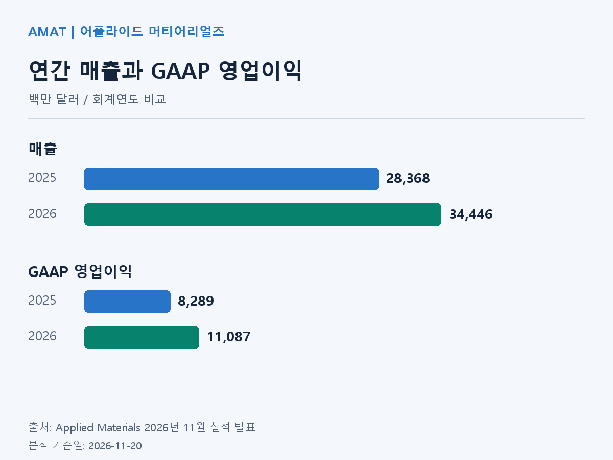
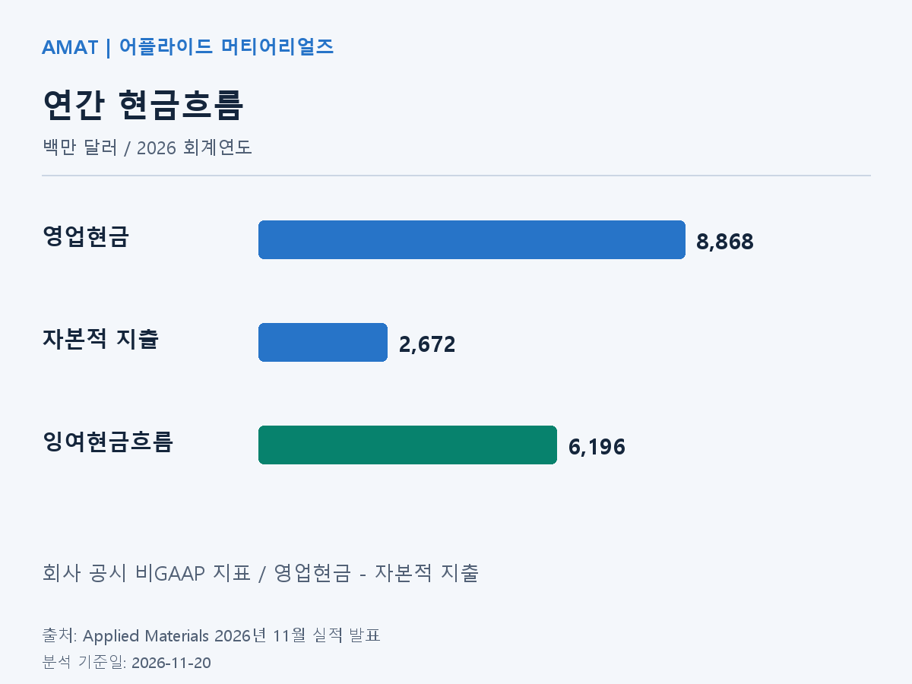
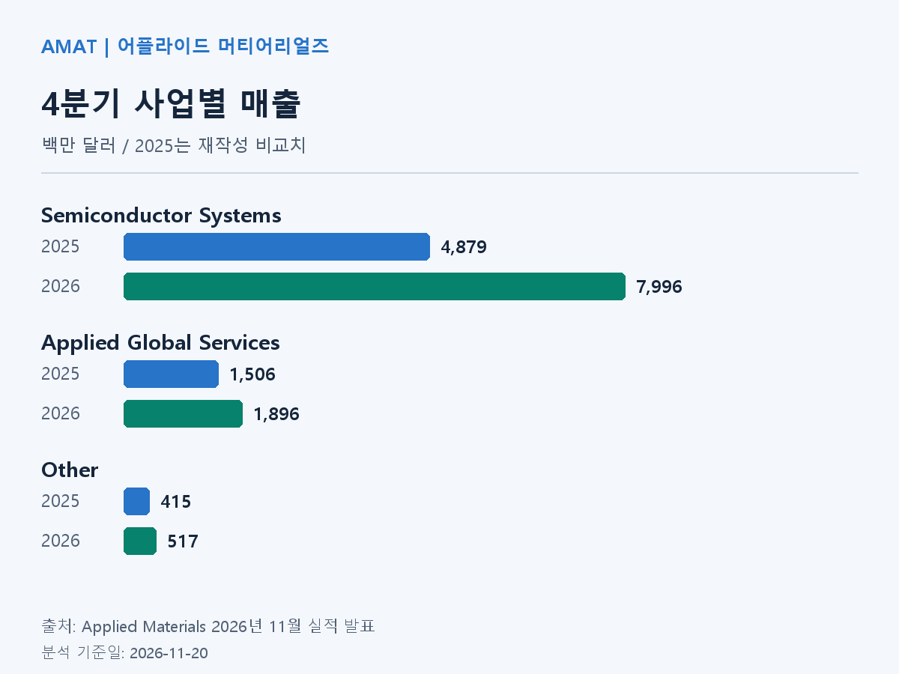
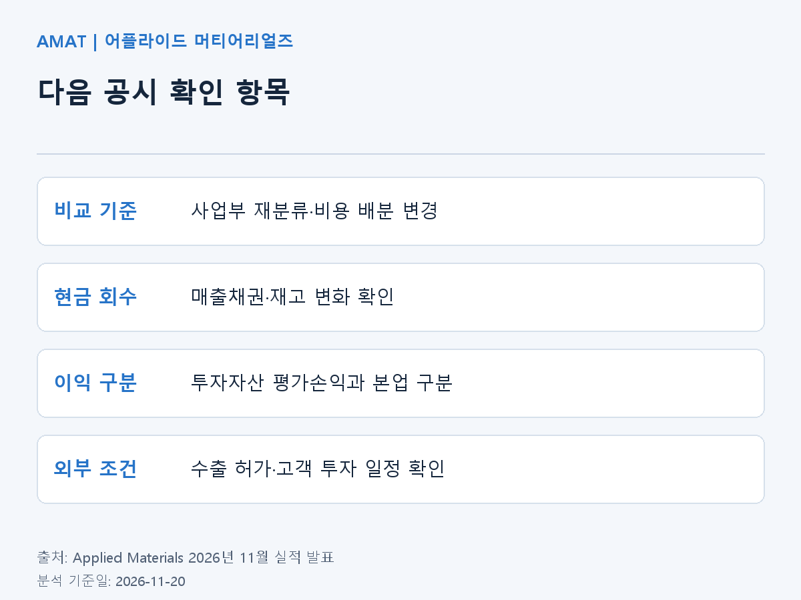

어플라이드 머티어리얼즈(AMAT)는 2026 회계연도 4분기에 매출과 영업이익을 늘렸다. 반도체 장비와 서비스가 모두 성장했으며 이익을 읽을 때는 투자자산 평가손실과 본업의 수익성을 구분할 필요가 있다.

분석 기준일은 2026년 11월 20일이다. Nasdaq의 11월 2일 공식 NDX 자료에서 구성종목을 확인했다. 실적은 10월 25일 마감한 회계연도와 마지막 분기이며 11월 12일 발표된 미감사 연결 요약 재무제표를 사용했다.

## 사업 구조와 경쟁

AMAT는 반도체 제조에 쓰이는 재료 공정 장비와 관련 서비스를 공급한다. Semiconductor Systems와 Applied Global Services가 주요 사업이며 디스플레이 사업 실적은 Other에 포함된다. 장비 수요와 설치 장비의 서비스 수요를 나눠 보는 편이 유용하다.

증착·식각 등 공정별 경쟁도 다르다. Lam Research의 연차보고서는 해당 시장에서 AMAT를 경쟁사로 명시한다. 공정 기술의 채택과 고객 지원 역량은 경쟁 요소지만 AI 투자 확대가 모든 업체의 점유율 상승을 보장하지는 않는다.

※ 출처: Applied Materials 2026년 11월 실적 발표; Lam Research 2026 연차보고서 경쟁 항목.

## 연간 실적과 현금흐름

| 백만 달러, EPS는 달러 | 2025 회계연도 | 2026 회계연도 |
| --- | ---: | ---: |
| 매출 | 28,368 | 34,446 |
| GAAP 영업이익 | 8,289 | 11,087 |
| 순이익 | 6,998 | 10,088 |
| 희석 EPS | 8.66 | 12.62 |
| 영업활동 현금흐름 | 7,958 | 8,868 |
| 자본적 지출 | 2,260 | 2,672 |
| 회사 공시 비GAAP 잉여현금흐름 | 5,698 | 6,196 |

연간 영업현금 8,868에서 자본적 지출 2,672를 빼면 6,196이다. 이 계산은 회사의 비GAAP 잉여현금흐름과 일치한다. 배당·자사주 매입·기업 인수 등 모든 현금 지출을 차감한 잔액으로 해석해서는 안 된다.

연간 순이익보다 영업현금이 작았으며 현금흐름표의 영업자산·부채 변동은 1,936의 현금 감소 요인이었다. 매출채권과 재고의 증가를 함께 점검해야 한다. 매출 성장과 현금 회수는 같은 속도로 움직이지 않을 수 있다.

※ 출처: Applied Materials 실적 발표 첨부 손익계산서·현금흐름표·비GAAP 조정표. 단위는 백만 달러다.



## 4분기 성장과 비교 기준

| 4분기, 백만 달러 | 2025 재작성 비교치 | 2026 |
| --- | ---: | ---: |
| 전체 매출 | 6,800 | 10,409 |
| Semiconductor Systems 매출 | 4,879 | 7,996 |
| Applied Global Services 매출 | 1,506 | 1,896 |
| Other 매출 | 415 | 517 |
| GAAP 영업이익 | 1,712 | 3,658 |

2026 회계연도부터 200mm 장비 사업이 서비스 부문에서 Semiconductor Systems로 옮겨졌다. 본사 지원 비용도 사업부에 전액 배분하기 시작했다. 표에는 회사가 같은 기준으로 재작성한 전년 비교치를 사용했으며 옛 발표의 사업부 숫자를 그대로 이어 붙이지 않았다.

4분기 GAAP 희석 EPS는 3.40달러, 비GAAP EPS는 4.16달러다. 조정표에는 전략 투자자산 미실현 손실 653 등이 포함된다. 두 지표의 차이를 전부 장비 판매의 이익 변화로 설명할 수 없다.

※ 출처: Applied Materials 사업부 정보 및 GAAP·비GAAP 조정표.

## 성장 계획과 위험요인

회사는 EPIC Center의 연구개발 협력 확대를 발표했다. 기술 공동개발이 실제 장비 채택과 매출로 연결되는 시점은 별도로 확인해야 한다. 협력 발표만으로 추가 매출을 계산하지 않았다.

2027 회계연도 1분기 회사 전망은 매출 11,100±500, 비GAAP 희석 EPS 4.35±0.20달러다. 매출 단위는 백만 달러이며 아직 마감하지 않은 분기의 예상이다. 수출 허가·무역 규정 변화, 고객 투자 일정, 공급업체의 납기와 공정별 경쟁이 실적에 영향을 줄 수 있다.

※ 출처: Applied Materials 11월 12일 실적 발표의 전망·미래예측 진술.

## 자체 분석

이번 실적에서는 사업부 매출 증가가 영업이익 확대와 함께 나타났다. 장비 부문의 매출만 보는 것보다 서비스의 매출과 이익이 함께 증가했는지 확인하면 성장의 범위를 더 구체적으로 파악할 수 있다. 다만 사업부 재분류가 있었으므로 비교의 출발점은 회사가 재작성한 전년 수치여야 한다.

현금흐름에서는 이익과 다른 흐름이 보인다. 매출과 순이익의 증가에 비해 영업현금 증가는 완만했고 자본적 지출도 늘었다. 다음 공시에서 매출채권·재고 증가와 현금 회수의 관계를 확인할 필요가 있다. 여기서 회사의 잉여현금흐름은 설비투자 이후의 현금 창출 지표이며 모든 투자·환원 지출 이후의 잔액은 아니다.

투자자산 평가손실은 GAAP와 비GAAP EPS 차이를 설명하는 항목이다. 이를 제거한 수치만으로 주식의 저평가를 판단하지 않았다. 성장 지속 여부는 다음 분기의 실제 장비 매출, 영업이익률, 운전자본에서 다시 확인해야 한다. 검증된 주가·밸류에이션 자료가 없어 적정주가나 매수 의견은 제시하지 않는다.

## 자주 묻는 질문

### 회계연도와 달력연도는 같은가?

회사의 2026 회계연도는 10월 25일 마감했다. 회사가 별도로 정의한 calendar 2026은 2026 회계연도 2분기부터 2027 회계연도 1분기까지이므로 기간을 구분해야 한다.

### 분기 잉여현금흐름은 얼마인가?

4분기 영업현금 3,300에서 자본적 지출 684를 뺀 2,616이다. 연간 수치 6,196과 기간이 다르다.

### 다음 분기 전망은 확정 실적인가?

회사의 예상치이며 실제 실적과 다를 수 있다. 비GAAP EPS 전망은 GAAP EPS와도 구분해야 한다.

※ 출처: Applied Materials 2026년 11월 12일 발표와 SEC Form 8-K Exhibit 99.1.

이 글은 개별 종목 투자 권유가 아니다. 투자에는 원금 손실 가능성이 있으며 과거 실적은 미래 수익을 보장하지 않는다.

기준 시점: 2026-11-20
