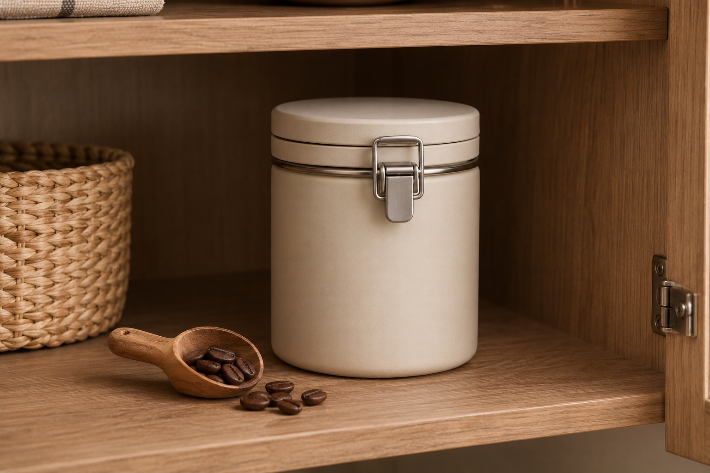
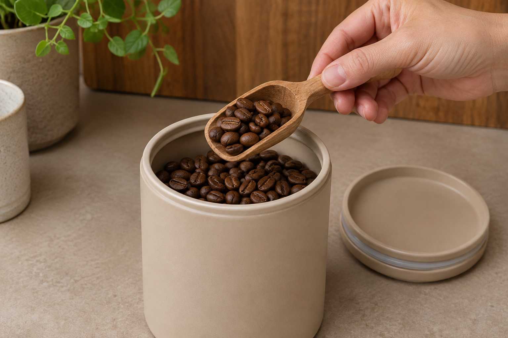

매일 꺼내 쓰는 볶은 원두는 공기·수분·열·빛을 덜 받게 보관하세요. 냉장고에 넣을지 정하기 전에 용기와 놓는 자리를 먼저 살피는 게 좋아요.

## 서늘한 수납칸에 밀폐용기 두기

불투명한 밀폐용기를 서늘하고 어두운 곳에 두세요. 투명한 용기는 빛을 막지 못하고 오븐이나 식기세척기 근처 수납칸은 뜨거워질 수 있어요. 오후 햇빛이 강하게 드는 자리도 피하세요.

원두는 주변 냄새를 흡수할 수 있어요. 냄새가 남은 용기나 향이 강한 식품 곁에 두지 않는 편이 좋아요.

## 한두 주에 쓸 양을 사고, 내리기 직전에 갈기

미국 커피협회(NCA)는 한두 주에 쓸 정도로 적은 양을 자주 사도록 권해요. 원두를 미리 모두 갈아 두기보다 커피를 내리기 직전에 필요한 만큼 분쇄하세요. 한두 주는 구매량을 정하는 권고이지 그 뒤 곧바로 먹을 수 없게 된다는 기한은 아니에요.

## 냉장·냉동할 때는 수분 유입을 함께 살피기

냉장·냉동 보관에 대한 공식 안내도 모두 같지는 않아요. 스텀프타운은 냉장·냉동을 피하도록 권하며 냉동실에서 반복해 꺼냈다 넣으면 원두에 수분이 들어갈 수 있다고 설명해요.

반면 NCA는 냉장·냉동을 선택할 경우 제대로 밀폐되는 용기를 쓰라고 안내해요. 필요한 양을 꺼낸 뒤 나머지는 결로가 생기기 전에 되돌리도록 권하죠. 따라서 냉장고에 넣었다는 이유만으로 보관을 잘못했다고 단정하기는 어려워요.

참고 자료 [미국 커피협회의 원두 보관 안내](https://www.aboutcoffee.org/beans/storage-and-shelf-life/) · [스텀프타운의 커피 보관 안내](https://support.stumptowncoffee.com/hc/en-us/articles/5568076789901-Where-should-I-store-my-coffee-In-the-freezer-On-the-counter)
