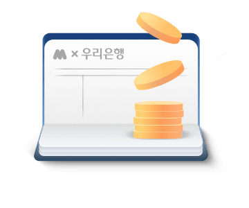
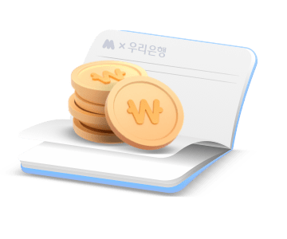

모니모 우리 매일이자 통장을 처음 만들면 모니머니 7천원, 적금과 예금까지 개설하고 입금 조건을 채우면 최대 2만원을 받을 수 있어요. 이벤트는 **2026년 11월 12일부터 12월 28일까지** 진행해요. 개설 전에 이벤트 동의를 마치고 혜택을 받을 계좌는 지급일까지 유지해야 해요.

## 모니머니는 내 통장으로 출금할 수 있나요?

**모니머니는 본인 명의 계좌로 환급받을 수 있어요.** 삼성카드 모니머니 이용약관상 1모니머니의 가치는 1원이에요. 모니모 앱이나 고객센터를 통해 보유액의 일부 또는 전부를 환급 신청할 수 있어요.

앱 안에서만 쓰는 혜택으로 생각할 필요는 없어요. 다만 환급의 세부 기준과 절차는 모니모 운영정책을 따르므로 실제 출금할 때 앱 안내를 확인해 주세요.

## 7천원부터 최대 2만원까지 받는 조건

이자통장 개설 혜택에 예·적금과 신규 입금 혜택을 더하는 구조예요. 모니모 회원가입만으로 2만원을 받는 이벤트는 아니에요.

| 참여 항목 | 조건 | 모니머니 |
| --- | --- | ---: |
| 매일이자 통장 | 이벤트 동의 후 최초 개설 | 7,000원 |
| 별빛 적금 | 이어서 최초 개설 | 4,000원 |
| 은하 예금 | 이어서 최초 개설 | 4,000원 |
| 추가 입금 혜택 | 행사 중 매일이자 통장에 신규 입금한 금액 누적 100만원 이상 | 5,000원 |
| 모두 충족 | 위 네 가지 조건 충족 | **20,000원** |

적금과 예금 중 하나만 개설하면 4천원, 둘 다 개설하면 8천원이 추가돼요. 두 상품은 **모니모 우리 매일이자 통장을 보유한 사람만** 가입할 수 있어요.

## 통장·적금·예금은 얼마부터 만들 수 있나요?

이자통장에는 가입금액 제한이 없고 별빛 적금은 주차별 1천원부터, 은하 예금은 10만원부터예요. 아래 금액은 상품의 가입·납입 최소액이며 추가 5천원을 받기 위한 입금액과는 구분해 주세요.

| 상품 | 최소 가입·납입금액 | 가입기간·한도 |
| --- | --- | --- |
| 모니모 우리 매일이자 통장 | 가입금액 제한 없음 | 수시입출금 |
| 모니모 우리 별빛 적금 | 주차별 1,000원 | 14주·28주 / 주차별 최대 20만원 |
| 모니모 우리 은하 예금 | 100,000원 | 6개월·12개월 / 최대 1천만원 |

적금의 1천원은 전체 가입기간의 총 납입액이 아닌 **주차별 최소액**이에요. 예금 10만원도 혜택을 받기 위해 쓰고 없어지는 비용이 아니라 계좌에 맡기는 원금이에요. 중도해지하면 적용 이율이 달라질 수 있으니 필요한 자금인지 살펴보고 가입하세요.

## 100만원은 잔액으로 계속 남겨야 할까요?

공식 이벤트 안내는 **잔액 유지 조건 없이 신규 입금액을 누적해 산정**한다고 명시해요. 행사기간 중 매일이자 통장에 새로 입금한 금액의 누적액이 100만원 이상이면 추가 혜택 대상이에요.

대신 계좌 유지 조건은 따로 있어요. 모니머니는 **2027년 1월 12일에 일괄 지급될 예정**이며 지급 시점에 해당 계좌를 해지했거나 재개설한 경우 혜택을 받을 수 없어요. 모니모에서 탈회한 경우도 제외되므로 입금 잔액과 계좌 유지 조건을 혼동하지 마세요.

## 가입 전에 자주 묻는 내용

### 우리은행 기존 고객도 가입할 수 있나요?

상품 안내상 가입대상은 17세 이상 실명의 개인인 내국인이며 각 상품은 1인 1계좌예요. 이번 이벤트는 해당 상품의 최초 개설 여부를 따져요. 기존 우리은행 고객이라는 이유만으로 제외된다고 단정할 수는 없어요.

### 적금은 자동이체로 납입할 수 있나요?

별빛 적금은 매일이자 통장을 통해서만 저축할 수 있고 자동이체는 불가해요. 가입 후 주차별 납입을 직접 챙겨 주세요.

### 사전예약 당첨자도 7천원을 함께 받나요?

사전예약 당첨 혜택은 첫 번째 통장 개설 이벤트 혜택과 중복 지급되지 않아요. 당첨자는 두 번째 이벤트와 보너스 이벤트의 개설 인정기간에 별도 예외가 있으므로 본인에게 온 안내도 함께 확인해야 해요.

행사 내용과 지급 일정은 모니모·제휴은행 사정으로 변경되거나 조기 종료될 수 있어요. 이 글은 상품 가입을 권유하는 글이 아니며 가입 전 이벤트 유의사항과 상품설명서·약관을 확인해 주세요.

※ 출처: 모니모 우리은행 출시 이벤트, 우리은행 상품 안내, 삼성카드 모니머니 이용약관. 상품·약관 확인일: 2026년 11월 20일.

#모니모 #모니머니 #우리은행 #이자통장 #별빛적금 #은하예금 #계좌개설이벤트 #모니머니출금 #예금가입금액 #적금납입 #은행이벤트 #앱테크
