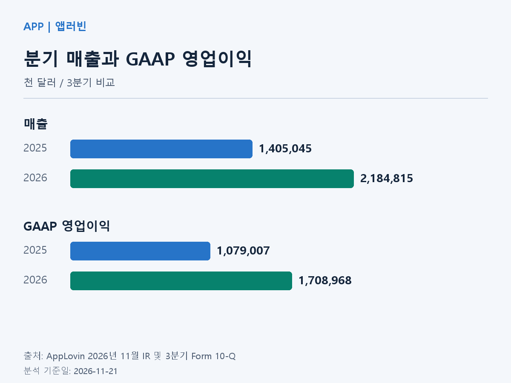
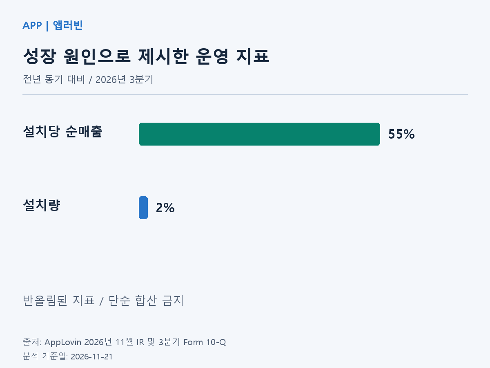
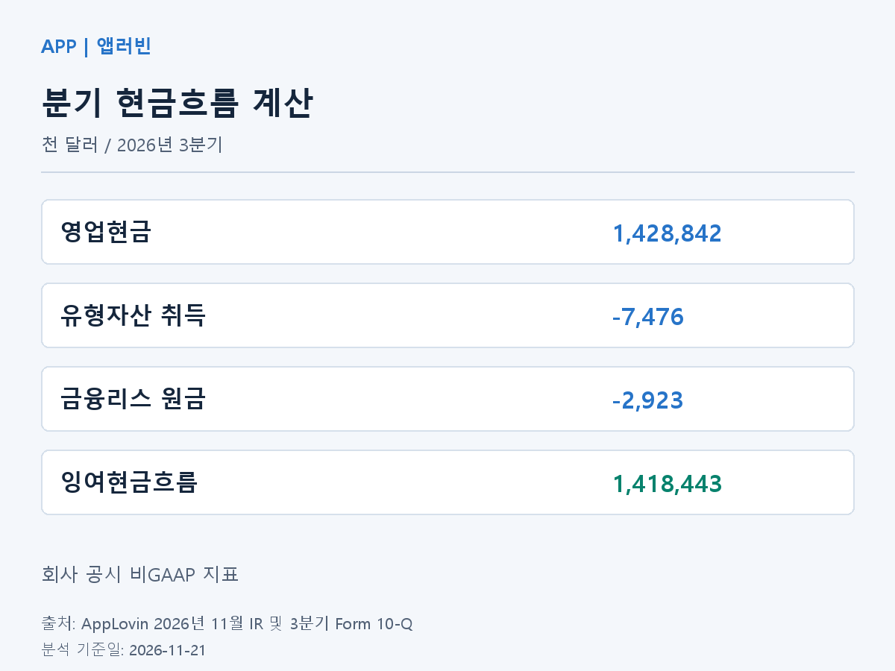
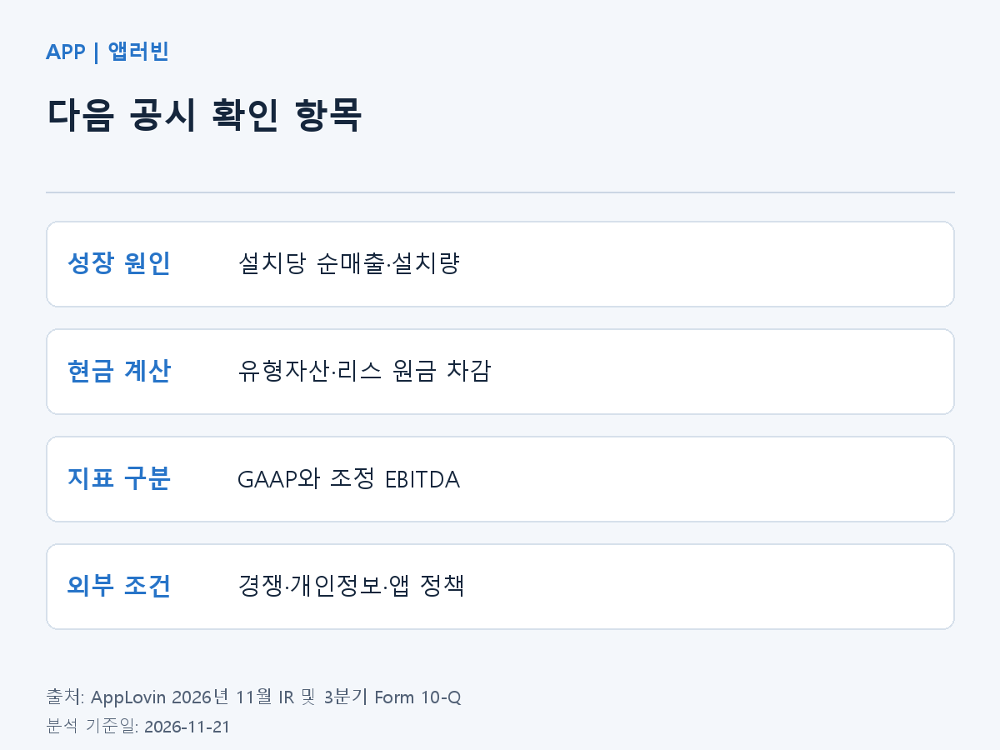

앱러빈(APP)의 2026년 3분기 매출은 전년 동기보다 55% 증가했다. 광고 성과 개선과 높은 현금 창출을 함께 확인하되, 비GAAP 지표의 조정 항목과 광고 생태계 의존도를 따로 살펴야 한다.

분석 기준일은 2026년 11월 21일이다. Nasdaq의 11월 2일 NDX 자료에서 구성종목을 확인했으며 실적은 9월 30일 종료 분기를 기준으로 삼았다. 11월 4일 IR 발표와 SEC Form 10-Q를 대조했다.

## 광고 성과를 판매하는 사업

앱러빈은 광고주가 고객을 찾고 광고 성과를 높이도록 돕는 플랫폼 기업이다. 10-Q에 따르면 매출 대부분은 AppLovin Ads에서 발생한다. 광고주 지출 확대와 플랫폼의 성과 개선이 매출을 좌우하므로 모바일 게임 보유 기업이라는 과거 인상만으로 사업을 읽기 어렵다.

회사는 3분기 성장 원인으로 설치당 순매출 55% 증가와 설치량 2% 증가를 제시했다. 두 비율은 각각 반올림된 운영 지표이므로 단순히 더해 매출 성장률을 재현해서는 안 된다.

※ 출처: AppLovin 2026년 3분기 Form 10-Q, 매출 인식 및 경영진 논의.

## 실적은 얼마나 늘었나

| 3분기, 천 달러 | 2025년 | 2026년 |
| --- | ---: | ---: |
| 매출 | 1,405,045 | 2,184,815 |
| GAAP 영업이익 | 1,079,007 | 1,708,968 |
| 순이익 | 835,545 | 1,438,902 |
| 영업활동 현금흐름 | 1,053,422 | 1,428,842 |
| 회사 공시 비GAAP 잉여현금흐름 | 1,048,999 | 1,418,443 |

회사가 발표한 조정 EBITDA 이익률은 84%, GAAP 순이익률은 66%다. 조정 EBITDA에는 주식보상비용과 상각 등 조정이 들어가므로 영업이익이나 현금 잔액으로 읽으면 안 된다. 분기 희석 EPS는 4.30달러다.

※ 출처: 2026년 11월 4일 실적 발표 및 SEC Exhibit 99.1 손익계산서·조정표.



## 현금흐름 계산에서 빠뜨리기 쉬운 항목

3분기 영업현금 1,428,842에서 유형자산 취득 7,476과 금융리스 원금 2,923을 빼면 1,418,443이다. 모두 천 달러이며 회사가 공시한 비GAAP 잉여현금흐름과 일치한다. 유형자산 취득만 차감하면 회사 지표와 달라진다.

1~9월 누적 값은 별도 기간이다. 영업현금 3,589,275에서 유형자산 취득 9,316과 금융리스 원금 11,451을 차감하면 3,568,508이다. 자사주 매입 등 모든 자금 사용을 뺀 잔액을 뜻하지는 않는다.

※ 출처: 3분기 실적 발표 현금흐름 조정표 및 2026년 3분기 Form 10-Q.

## 성장 기대와 경쟁 위험

4분기 매출 전망은 2,365~2,395백만 달러다. 회사가 제시한 예상 범위이며 확정 실적이 아니다. 조정 EBITDA 이익률 전망 84~85%도 GAAP 이익률 전망과 구분해야 한다.

10-Q는 Meta·Google·Amazon·Unity Software·Liftoff Mobile 등을 경쟁사로 명시한다. 광고주의 예산 이동, 개인정보 규제, 앱 플랫폼 정책 변화는 성과 측정과 광고 효율을 흔들 수 있다. 성장률이 높아도 이런 외부 조건에서 자유롭지는 않다.

※ 출처: 2026년 11월 IR 전망 및 Form 10-Q 경쟁·위험 항목.

## 자체 분석

설치당 순매출이 설치량보다 빠르게 늘었다는 점에서, 이번 분기는 광고 성과와 수익화 개선을 먼저 점검할 만하다. 다만 이 지표만으로 광고주의 투자수익이 모든 업종에서 개선됐다고 단정할 수는 없다. 다음 분기에도 성과 개선이 유지되는지, 설치량 변화가 매출에 어떤 영향을 주는지 따로 비교해야 한다.

현금 창출은 높은 이익률을 뒷받침하지만 지표 정의를 맞춰 읽어야 한다. 금융리스 원금을 빠뜨리거나 분기와 누적 기간을 섞으면 현금 창출력을 다르게 평가하게 된다. GAAP 영업이익, 조정 EBITDA, 잉여현금흐름을 나란히 보는 이유다.

경쟁 플랫폼과 앱 운영체제의 정책도 함께 확인할 필요가 있다. 자체 기술의 개선이 이어져도 광고주 예산과 데이터 이용 조건은 달라질 수 있다. 주가와 평가배수를 검증하지 않은 상태에서는 이번 실적만으로 저평가 여부를 판단하지 않는다.

## 자료와 기준

- [AppLovin 2026년 3분기 IR 실적 발표](https://investors.applovin.com/news/news-details/2026/AppLovin-Announces-Third-Quarter-2026-Financial-Results/default.aspx)
- [SEC Form 10-Q, 2026년 9월 30일 종료 분기](https://www.sec.gov/Archives/edgar/data/1751008/000175100826000069/app-20260930.htm)
- [SEC 실적 발표 Exhibit 99.1](https://www.sec.gov/Archives/edgar/data/1751008/000175100826000068/exhibit991-3q26earningspre.htm)
- [Nasdaq NDX 공식 구성자료](https://www.nasdaq.com/docs/global-indexes/NDX)

이 글은 투자 권유가 아니다. 원금 손실 가능성이 있으며 과거 실적은 미래 수익을 보장하지 않는다.
