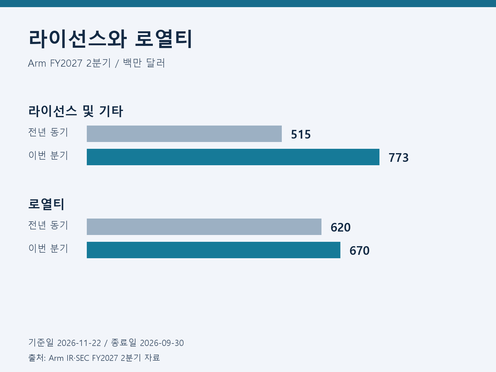
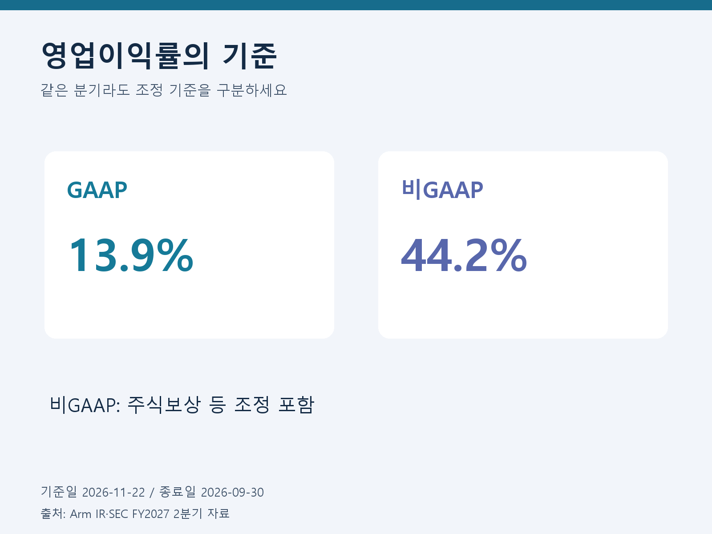
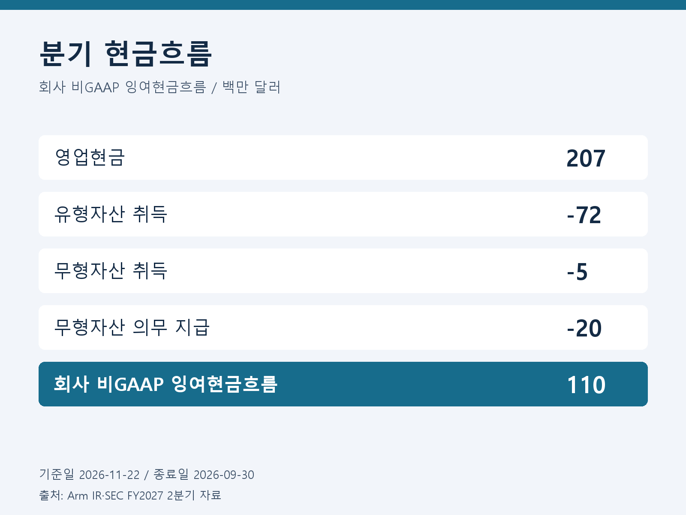
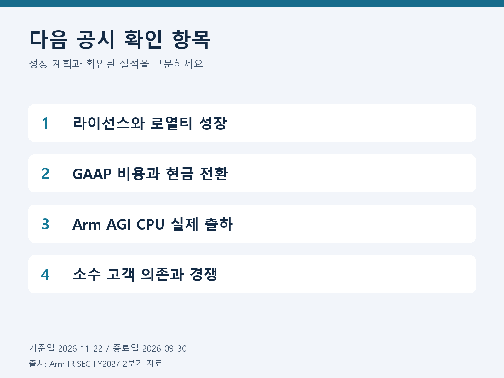

Arm의 성장을 읽을 때는 계약 단계의 라이선스와 생산 이후의 로열티를 나눠 봐야 한다. 이번 분기에는 두 수익원의 증가 속도와 현금 창출의 차이가 드러났다.

분석 기준일은 2026년 11월 22일이다. Nasdaq의 11월 2일 구성자료에서 ARM을 확인했다. 최신 실적은 9월 30일 종료한 FY2027 2분기로, 11월 4일 IR 자료와 SEC Form 6-K 첨부자료를 대조했다.

## 설계 기술에서 발생하는 수익

Arm은 반도체 설계 IP의 이용 계약에서 라이선스 수익을, 고객이 관련 칩을 생산·출하하는 단계에서 로열티를 얻는다. 대형 계약의 체결 시점과 회계 처리에 따라 분기 라이선스 매출은 변동한다.

※ 출처: Arm FY2027 2분기 실적 설명회, 2026년 11월 4일.

## 실적과 현금흐름

| 백만 달러, 분기 | 전년 동기 | 이번 분기 |
| --- | ---: | ---: |
| 매출 | 1,135 | 1,443 |
| 라이선스 및 기타 | 515 | 773 |
| 로열티 | 620 | 670 |
| GAAP 영업이익 | 163 | 201 |
| GAAP 순이익 | 238 | 130 |
| 영업활동 현금흐름 | 567 | 207 |
| 회사 비GAAP 잉여현금흐름 | 411 | 110 |

매출 증가율은 27%다. 라이선스 및 기타는 50%, 로열티는 8% 증가했다. GAAP 영업이익률은 13.9%, 비GAAP 영업이익률은 44.2%로, 주식보상 등 조정 항목을 구분해야 한다.

※ 출처: Arm 주주서한·SEC Exhibit 99.2, 손익계산서와 지표 조정표.



분기 잉여현금흐름은 영업현금 207에서 유형자산 취득 72, 무형자산 취득 5, 무형자산 의무 지급 20을 차감한 110이다. 모두 백만 달러이며 회사의 비GAAP 정의다. 유형자산만 빼거나 최근 12개월 잉여현금흐름 1,096과 같은 기간으로 취급하면 비교가 달라진다.

※ 출처: 주주서한 17쪽 현금흐름 조정표.

## 성장 계획과 경쟁 위험

회사는 Arm AGI CPU의 첫 상업 출하를 FY2027 4분기로 계획한다. FY2027~2028 합계 최대 20억 달러 매출도 회사의 기대이며 이번 분기 확정 실적이 아니다. 신제품 수요 예측, 치열한 경쟁, 소수 고객 의존은 공시가 제시한 위험이다.

※ 출처: Arm 실적 설명회 및 SEC 첨부 주주서한 미래예측·위험 항목.

## 자체 분석

라이선스 성장률이 로열티보다 높으므로 이번 매출 증가를 볼 때는 신규 계약의 규모와 인식 시점을 함께 살펴야 한다. 계약 체결이 늘어도 고객의 칩 생산과 판매가 뒤따르기 전에는 로열티가 같은 속도로 늘어난다고 볼 수 없다. 다음 공시에서는 두 수익원의 성장률 차이가 좁혀지는지 확인할 필요가 있다.

높은 매출총이익률만으로 비용 부담이 작다고 판단하기도 어렵다. 연구개발과 주식보상 등을 반영한 GAAP 영업이익률을 비GAAP 수치와 함께 읽어야 한다. 분기 현금흐름은 최근 12개월 수치와 방향이 다르므로 기간을 맞춰 비교하는 편이 낫다.

직접 설계한 칩의 판매는 추가 성장 기회지만 개발·공급·고객 확보의 실행 위험도 수반한다. 기존 IP 고객과 신사업의 관계를 지켜보면서 실제 출하와 매출 인식으로 목표 달성 여부를 확인해야 한다. 검증한 주가와 평가배수가 없어 이번 실적만으로 저평가 여부를 판단하지 않는다.

## 자료와 기준

- [nasdaq](https://www.nasdaq.com/docs/global-indexes/NDX)
- [ir](https://investors.arm.com/financials/quarterly-annual-results)
- [letter](https://investors.arm.com/static-files/0b5baa2e-fc47-4d05-b724-e49de7bd4356)
- [sec](https://www.sec.gov/Archives/edgar/data/1973239/000197323926000141/exhibit992fye27q230-sepx26.htm)
- [call](https://investors.arm.com/static-files/6f3ab670-7d16-479b-948a-7b1df5ff5b32)

이 글은 투자 권유가 아니다. 원금 손실 가능성이 있으며 과거 실적은 미래 수익을 보장하지 않는다.
