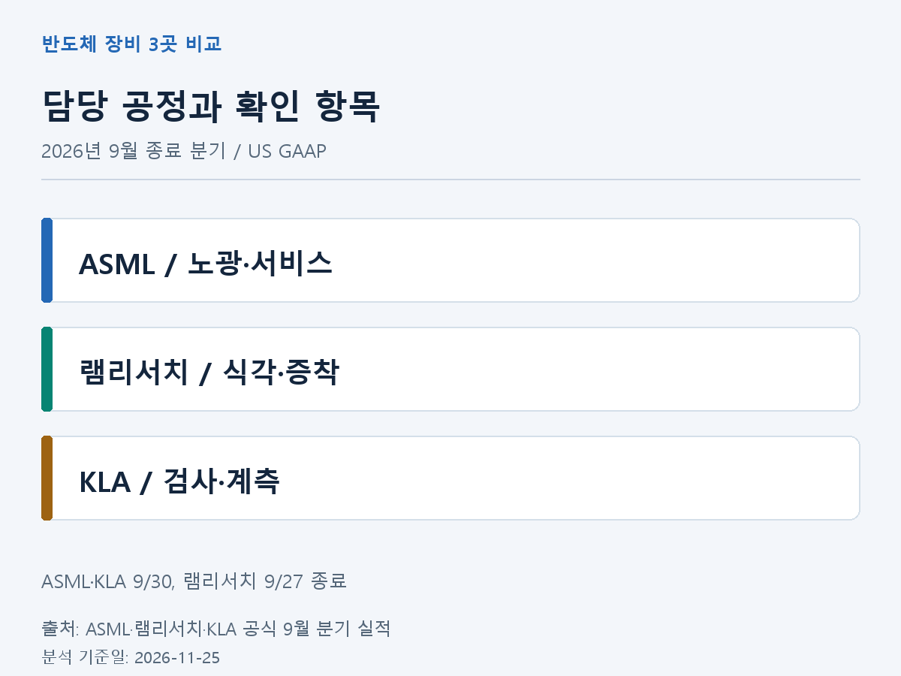
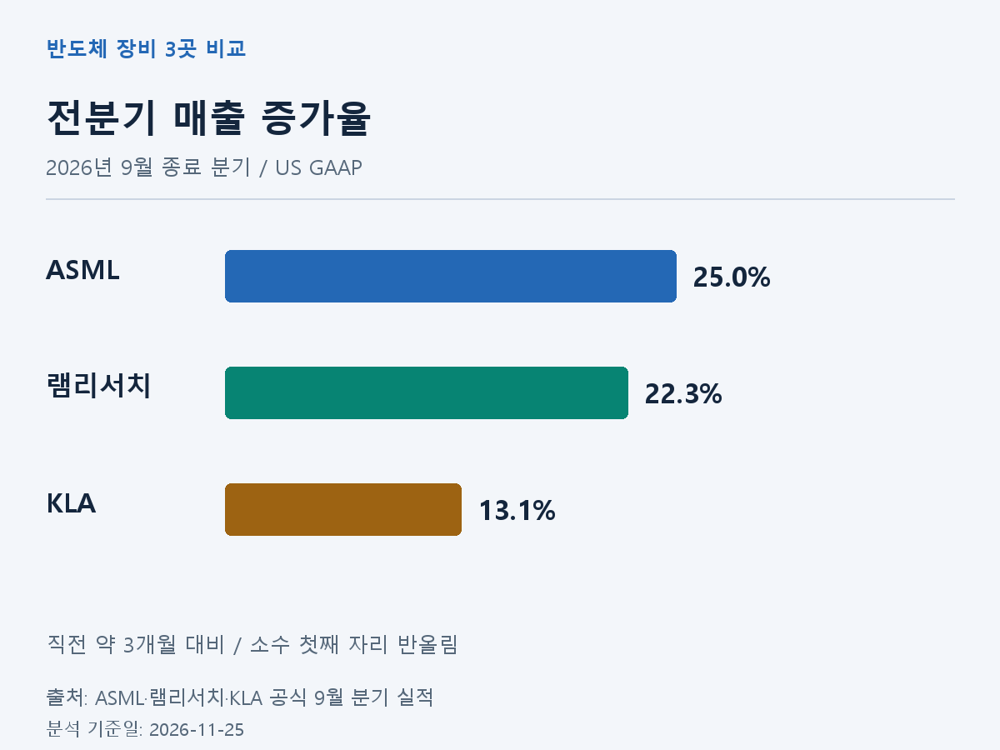
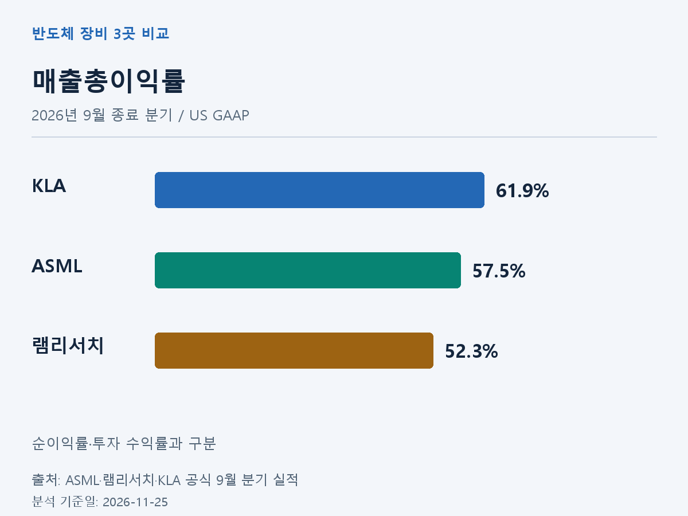
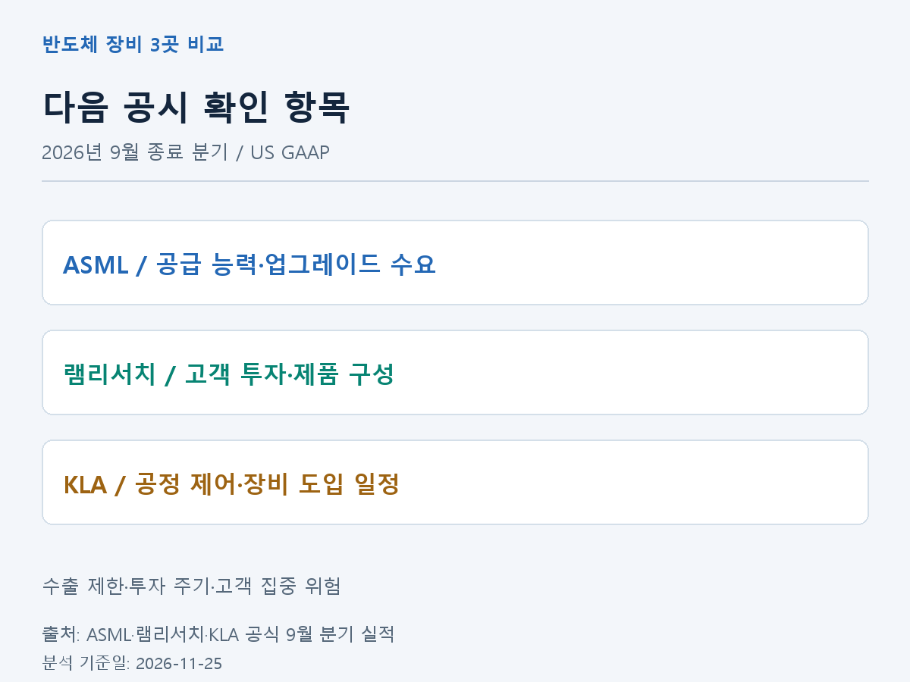

반도체 장비주를 비교할 때는 같은 분기의 성장률과 같은 회계 기준의 이익률을 먼저 맞춰야 한다. 2026년 9월 분기에는 ASML의 전분기 매출 증가율이, KLA의 매출총이익률이 비교 대상 중 가장 높았다. 이 두 순위만으로 주식의 투자 매력을 결정할 수는 없다.

분석 기준일은 2026년 11월 25일이다. Nasdaq의 11월 2일 NDX 구성자료에 포함된 ASML·램리서치(LRCX)·KLA(KLAC)를 비교했다. 회사마다 담당 공정과 매출 구성이 달라 장비 업황을 여러 각도에서 살펴볼 수 있다.

## 비교 기간과 단위를 먼저 맞추기

모두 2026년 9월에 끝난 약 3개월 실적이며 US GAAP 기준이다. ASML과 KLA는 9월 30일, 램리서치는 13주 회계 달력에 따라 9월 27일 종료했다. 완전히 같은 날짜 범위는 아니므로 며칠의 출하·검수 차이가 분기 수치에 미칠 영향을 염두에 둬야 한다.

ASML은 유로, 나머지 두 회사는 달러로 보고한다. 환산 환율을 임의로 정하지 않고 각 통화를 유지했다. 아래 표의 매출은 규모 순위용이 아니며 EPS도 주식 수와 통화가 달라 기업 간 대소 비교에 쓰지 않는다. 컨센서스와 주가 기준을 확보하지 않아 서프라이즈나 PER은 제시하지 않는다.

| 회사·종료일 | 매출(백만, 각 통화) | 전분기 대비 | GAAP 매출총이익률 | GAAP 희석 EPS |
| --- | ---: | ---: | ---: | ---: |
| ASML · 9/30 | 11,662 EUR | 25.0% | 57.5% | 12.93 EUR |
| 램리서치 · 9/27 | 8,219.418 USD | 22.3% | 52.3% | 2.19 USD |
| KLA · 9/30 | 4,136.015 USD | 13.1% | 61.9% | 1.18 USD |

전분기 증가율은 각 회사의 직전 약 3개월 매출 9,326·6,722.238·3,657.556백만(각 통화)을 분모로 계산해 소수 첫째 자리로 반올림했다. KLA EPS는 2026년 6월 11일 시행한 10대 1 주식분할을 반영한 값이다.

※ 출처: ASML 10월 14일 실적·SEC 발표자료, 램리서치 10월 21일 실적·Form 10-Q, KLA 10월 28일 실적·9월 분기 Form 10-Q.

## 공정 차이가 숫자에 반영되는 방식

ASML은 반도체 회로 패턴을 만드는 노광 장비와 설치 장비의 서비스·업그레이드를 공급한다. 9월 분기 설치 기반 관리 매출은 3,289백만 유로였다. 회사는 생산성 업그레이드 수요가 매출총이익률에 기여했다고 설명했다.

램리서치는 식각·증착 등 반도체 제조 공정 장비에 집중한다. 10-Q는 분기 매출 증가 원인으로 파운드리와 메모리 고객의 장비 수요를 들었다. 유리한 고객·제품 구성이 이익률에 기여했다는 설명도 있어 매출 증가율을 그대로 지속 가능한 성장률로 가정하기 어렵다.

KLA는 검사·계측을 포함한 공정 제어가 중심이다. 복잡한 칩을 만들수록 결함을 찾아 수율을 관리할 필요가 커지지만 실제 장비 도입 시점은 고객의 투자 일정에 달려 있다. 높은 매출총이익률은 연구개발비·판매관리비 등을 차감하기 전의 수익성이다.

※ 출처: 각 회사의 위 분기 IR 설명 및 공시. 사업 해석은 공정 특성에 따른 분석이며 미래 실적 보장이 아니다.

## 자체 분석

세 회사의 매출총이익률 차이는 장비 가격뿐 아니라 서비스 비중, 제품 구성과 고객의 검수 시점까지 함께 반영한다. KLA의 비율이 높다고 전체 반도체 투자에서 가장 많은 현금을 벌었다거나 주가가 저평가됐다고 해석하면 비교 범위를 벗어난다. ASML의 높은 전분기 성장률도 직전 분기의 출하 상황을 분모로 삼은 결과다.

관찰 순서는 고객의 투자 계획, 장비 출하와 매출 인식, 서비스 수요, 비용과 현금흐름으로 잡는 편이 낫다. 같은 고객이 여러 장비 회사에서 주문을 늘리면 세 종목을 보유해도 업황 위험이 겹칠 수 있다. 각 공정의 기술 경쟁력과 고객 투자의 지속성을 따로 확인해야 한다.

다음 공시에서는 성장률 순위가 유지되는지보다 매출 증가가 현금 회수와 함께 나타나는지 확인할 필요가 있다. 이번 표에는 현금흐름과 주가가 없으므로 종합 수익성이나 적정 가격의 순위로 확장하지 않았다. 수출 제한, 공급 능력, 고객의 일정 변경은 실적과 전망을 바꿀 수 있으며 회사의 장기 수요 설명도 확정 주문·실현 매출과 구분해 읽어야 한다.

## 다음 공시에서 확인할 항목

| 회사 | 확인할 변화 | 함께 볼 위험 |
| --- | --- | --- |
| ASML | 장비 공급과 서비스·업그레이드 수요 | 공급 능력·주문 지연·수출 제한 |
| 램리서치 | 파운드리·메모리 장비 수요와 제품 구성 | 고객 투자 주기·검수 시점 |
| KLA | 공정 제어 수요와 장비 도입 일정 | 고객 집중·규제·부품 조달 |

관련 사업을 더 넓게 보려면 기존 [어플라이드 머티어리얼즈 분석](/stock/amat/)과 [Arm 분석](/stock/arm/)을 참고할 수 있다. 각각 소재 공정 장비와 설계 IP를 다루는 글이므로 이번 세 회사의 실적 순위에 포함하지 않았다.

## 자주 묻는 질문

### 매출총이익률이 높으면 가장 좋은 주식인가?

매출총이익률에는 연구개발비와 판매관리비, 세금이 모두 반영되지 않는다. 주가와 현금흐름을 함께 보지 않고 투자 매력을 순위로 매기기 어렵다.

### 전분기 성장률과 전년 동기 성장률은 같은가?

비교 기준이 다르다. 이번 표는 모두 직전 분기를 기준으로 계산했으며 전년 동기 증가율과 섞지 않았다.

### 세 종목을 보유하면 업황 위험이 분산되는가?

담당 공정은 달라도 반도체 고객의 설비투자에 함께 영향을 받는다. 종목 수가 늘어도 공통 업황 위험은 남는다.

## 확인 자료

- [nasdaq](https://www.nasdaq.com/docs/global-indexes/NDX)
- [asml_ir](https://www.investor.asml.com/news-releases/news-release-details/asml-reports-eu11.7-billion-total-net-sales-and-eu5.0-billion-net-income-q3-2026)
- [asml_sec](https://www.sec.gov/Archives/edgar/data/937966/000162828026065813/a2026_10x14xpresentation.htm)
- [lam_ir](https://investor.lamresearch.com/content/dam/newsroom/press_release_pdfs/2026-10-21-Lam-Research-Corporation-Reports-Financial-Results-for-the-Quarter-Ended-September-27%2C-2026.pdf)
- [lam_10q](https://investor.lamresearch.com/content/dam/investor/image/Form%2010-Q%20for%20LAM%20Research%20Corp%20filed%2010_22_2026.pdf)
- [kla_release](https://www.sec.gov/Archives/edgar/data/319201/000031920126000032/exhibit991earningsrelease0.htm)
- [kla_10q](https://www.sec.gov/Archives/edgar/data/319201/000031920126000034/klac-20260930.htm)

기준 시점: 2026-11-25. 이 글은 정보 제공용이며 개별 투자 권유가 아니다. 투자에는 원금 손실 가능성이 있고 과거 실적은 미래 성과를 보장하지 않는다.
