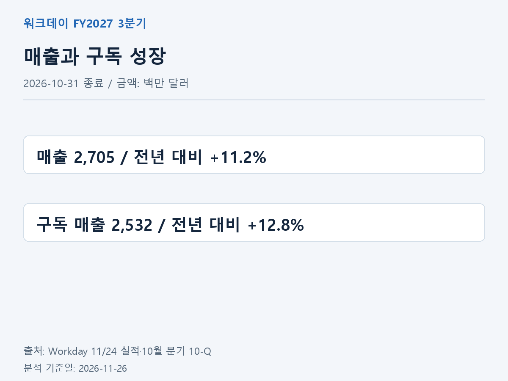
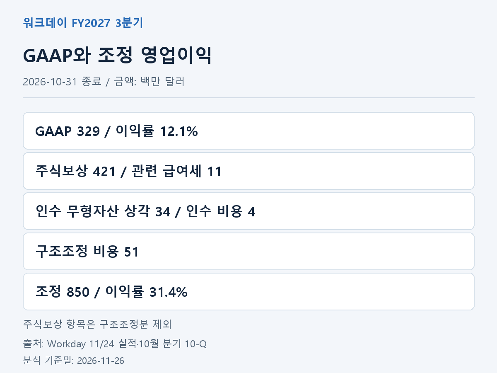
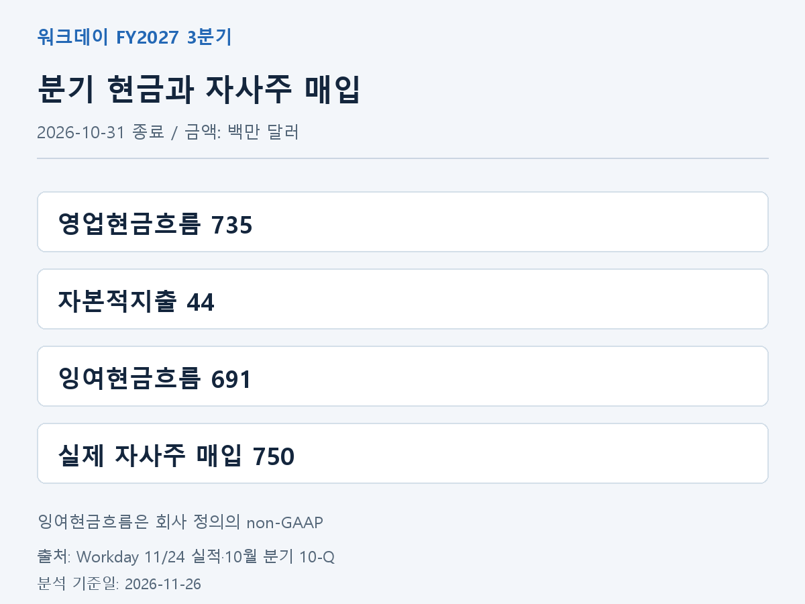
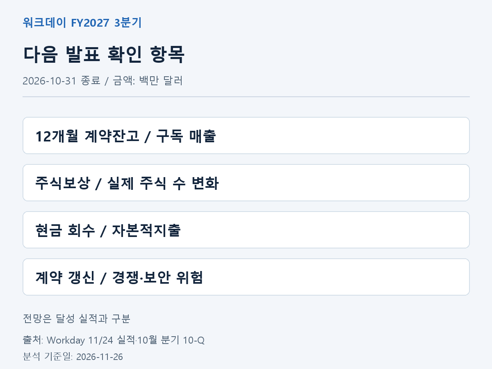

워크데이(WDAY)의 이번 분기는 매출 성장과 수익성 개선을 함께 보여준다. 다만 조정 영업이익률만 보면 주식보상과 구조조정 비용이 빠져 실제 회계 이익과 큰 차이가 난다. 구독 계약의 매출 인식 시차도 다음 분기를 판단할 때 고려할 부분이다.

분석 기준일은 2026년 11월 26일이다. 이번 주 11월 24일 발표된 FY2027 3분기, 10월 31일 종료 3개월 실적을 검토했다. Nasdaq 11월 2일 구성자료에 포함된 기업이며 회계연도 표기의 2027은 달력상 2026년 실적과 구분한다.

## 매출과 이익의 기준

금액은 백만 달러, 희석 EPS는 달러다. 컨센서스와 기준 시각이 있는 주가를 확보하지 않아 서프라이즈나 PER은 제시하지 않는다.

| 지표 | FY2027 3분기 |
| --- | ---: |
| 매출 / 전년 대비 | 2,705 / +11.2% |
| 구독 매출 / 전년 대비 | 2,532 / +12.8% |
| GAAP 영업이익 / 이익률 | 329 / 12.1% |
| 조정 영업이익 / 이익률 | 850 / 31.4% |
| GAAP / 조정 희석 EPS | 0.96 / 2.82 |

※ 출처: Workday 11월 24일 실적 발표·SEC Exhibit 99.1. 조정 수치는 회사가 제시한 non-GAAP 기준이다.

GAAP 영업이익 329에 주식보상 421, 관련 급여세 11, 인수 무형자산 상각 34, 인수 비용 4, 구조조정 비용 51을 더하면 조정 영업이익 850이 된다. 이 조정표의 주식보상 421에는 구조조정 항목에 들어간 주식보상이 포함되지 않아 중복 가산하면 안 된다.

※ 출처: 10월 31일 종료 Form 10-Q의 GAAP·non-GAAP 조정표와 주석.

## 계약잔고와 전망의 시간 차이

12개월 구독 매출잔고는 9,216으로 전년 대비 12.3%, 전체 잔고는 27,548로 6.1% 증가했다. 잔고는 이번 분기 매출에 더하는 금액이 아니다. 10-Q에 따르면 구독 매출은 서비스 제공 기간에 걸쳐 인식돼 신규 계약 변화가 실적에 늦게 나타날 수 있다.

회사는 FY2027 4분기 구독 매출 2,600, 조정 영업이익률 31.7%를 전망했다. 연간 구독 매출 9,958과 조정 영업이익률 31.5%도 회사 전망이며 이미 달성한 실적으로 읽으면 안 된다.

※ 출처: Workday 실적 발표의 Financial Outlook, Form 10-Q의 구독 매출 인식·장기 판매 주기 위험 설명.

## 현금과 자사주 매입

분기 영업현금흐름 735에서 자본적지출 44를 뺀 회사 정의의 잉여현금흐름은 691이다. 같은 분기 실제 자사주 매입은 750, 약 380만 주였다. 매입 지출이 잉여현금흐름보다 59 많다는 계산만으로 재무 여력이 부족하다고 단정할 수는 없다.

※ 출처: SEC Exhibit 99.1의 분기 현금흐름 조정표·주주환원 실적. 59는 두 공시 금액의 차이를 계산한 값이다.

## 자체 분석

조정 이익률의 상승은 비용 관리의 성과를 살펴볼 출발점이지만 주주에게 남는 이익을 그대로 뜻하지는 않는다. 주식보상은 당기 현금 지출과 다르게 처리되더라도 보유 지분의 희석과 연결될 수 있다. 자사주 매입도 총지출만 보지 말고 주식보상, 실제 주식 수 변화와 함께 읽는 편이 낫다.

구독 매출과 계약잔고는 서로 다른 시점의 정보를 담는다. 신규 계약이 약해져도 이전 계약에서 매출이 인식될 수 있으므로 한 분기의 매출 증가만으로 수요가 더 강해졌다고 판단하기 어렵다. 다음 발표에서는 같은 정의의 12개월 잔고와 구독 매출 증가율을 이어서 비교하고 전망 변경의 이유도 확인할 필요가 있다.

이번 실적만으로 적정 주가를 계산하지 않았다. 장기 계약의 안정성과 신규 판매의 둔화 가능성, 조정 이익과 회계 이익의 차이를 함께 반영해야 가격에 대한 판단이 가능하다. 현금흐름도 한 분기를 연간으로 단순 환산하면 청구·회수 시점의 영향을 놓칠 수 있어 이후 공시와 대조해야 한다.

## 경쟁과 관련 글

워크데이는 인사·재무 관리 소프트웨어를 공급하며 Oracle·SAP 등을 주요 경쟁사로 든다. 긴 판매 주기, 계약 갱신, 가격 경쟁과 고객 데이터 보안은 공시에서 확인할 위험이다. 새 기능의 출시가 곧바로 반복 매출 증가를 보장하지는 않는다.

※ 출처: Workday 10월 분기 Form 10-Q의 사업·경쟁·판매 주기·보안 위험 항목.

설비 투자 업종과 매출 구조를 비교하려면 [반도체 장비 3곳 비교](/stock/semicap-comparison-20261125/)도 함께 볼 수 있다. [Arm 분석](/stock/arm/)은 라이선스·로열티를 구분해 읽는 예다.

이 글은 정보 제공을 위한 분석이며 개별 투자 권유가 아니다. 원금 손실 가능성이 있고 과거 실적은 미래 수익을 보장하지 않는다.
