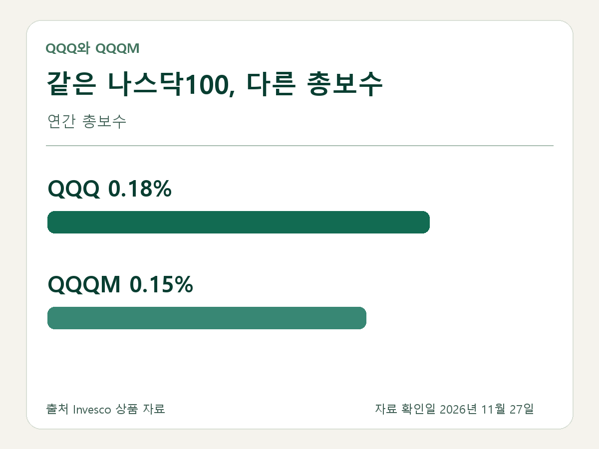
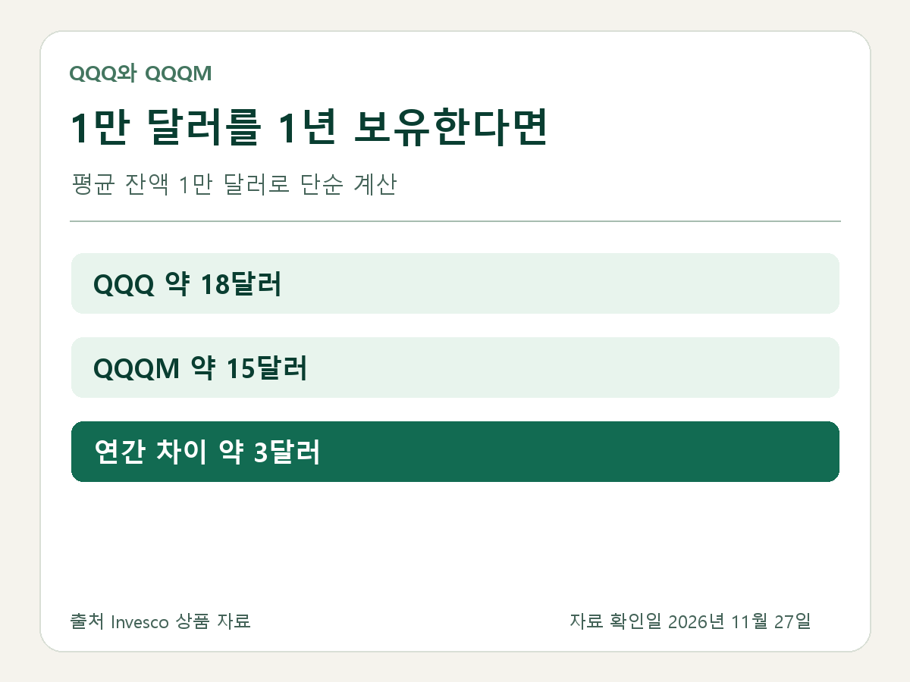
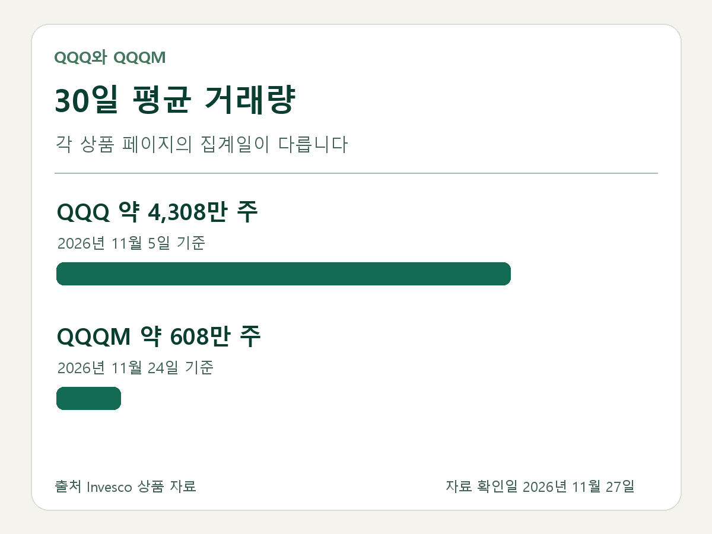
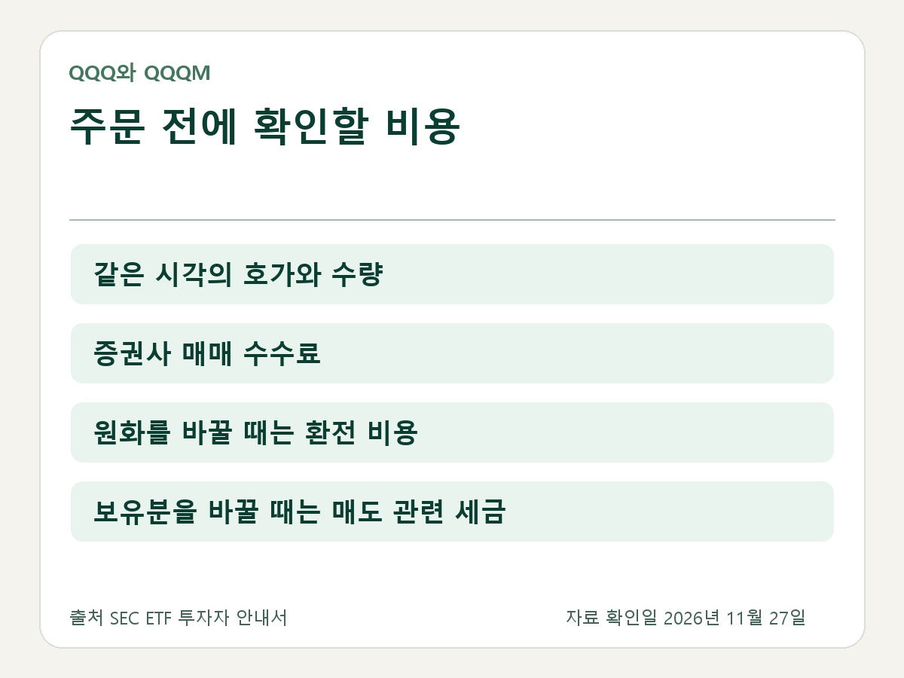

QQQ와 QQQM은 모두 나스닥100을 추종한다. Invesco가 공시한 연간 총보수는 QQQ 0.18%, QQQM 0.15%다. 평균 잔액 1만 달러를 1년 유지한다고 가정하면 보수 차이는 약 3달러다.

## 같은 지수, 다른 보수

나스닥100은 나스닥에 상장된 대형 비금융 기업 100곳을 담는다. 기업마다 지수 비중이 다르므로 상위 종목이나 특정 업종이 하락하면 두 ETF가 함께 영향을 받는다. ETF에는 운용비와 편입 종목의 거래 비용 등이 든다. 이런 비용으로 ETF의 성과는 지수와 다를 수 있다.

| 비교 항목 | QQQ | QQQM |
| --- | ---: | ---: |
| 추종 지수 | 나스닥100 | 나스닥100 |
| 연간 총보수 | 0.18% | 0.15% |
| 평균 잔액 1만 달러의 연간 보수 예시 | 약 18달러 | 약 15달러 |

보수 예시는 평균 잔액에 연간 총보수를 곱한 단순 계산이다. 매매 수수료, 환전 비용, 세금은 별개다. 공시 보수는 2026년 11월 27일에 확인했다.

## 거래량과 주문 호가

Invesco 상품 페이지에서 QQQ의 30일 평균 거래량은 2026년 11월 5일 기준 약 4,308만 주, QQQM은 11월 24일 기준 약 608만 주였다. 두 수치는 기준일이 다르다. 주문을 비교하려면 같은 시각의 매수·매도 호가와 각 가격에 걸린 수량을 확인한다.

호가 차이(스프레드)는 가장 낮은 매도 호가와 가장 높은 매수 호가 사이의 간격이다. 괴리율은 순자산가치(NAV)와 시장가격 사이의 차이를 보는 별도 지표다. 과거 거래량이 많아도 주문을 넣는 순간에는 호가가 벌어지거나 원하는 수량이 한 가격에 체결되지 않을 수 있다.

## 자체 분석

새로 사는 경우와 이미 갖고 있는 ETF를 바꾸는 경우를 따로 계산하면 보수 차이를 판단하기 쉽다. 추가 매수라면 같은 시각에 두 상품을 같은 금액으로 주문할 때 드는 비용을 비교할 수 있다. 오래 보유할 계획이라면 잔액을 기준으로 추정한 연간 보수 차이가 보유 기간에 따라 얼마나 쌓이는지도 볼 만하다.

기존 보유분을 교체하면 매도와 재매수가 모두 필요하다. 평균 잔액을 1만 달러로 고정하고 교체에 드는 일회성 비용이 9달러라고 가정하면, 연간 보수 차이 3달러로 그 비용만 만회하는 데 약 3년이 걸린다. 실제 주문에서는 두 거래의 호가와 수수료, 매도로 생길 수 있는 세금까지 반영해야 한다. 보유액과 비용이 달라지면 만회에 걸리는 기간도 달라진다.

## 원화로 평가할 때

달러로 표시한 ETF 가격이 그대로여도 원·달러 환율이 바뀌면 원화 평가액은 달라진다. 두 상품을 함께 담더라도 같은 지수를 추종하므로 지수 하락과 업종 쏠림에 함께 노출된다.

이 글은 투자 정보를 제공한다. 원금 손실 가능성이 있으며 과거 성과가 미래 수익을 보장하지 않는다.

## 출처

- [Invesco ETF 목록과 연간 총보수](https://www.invesco.com/us/en/financial-products/etfs.html)
- [Invesco QQQ 상품 페이지](https://www.invesco.com/us/en/financial-products/etfs/invesco-qqq-trust-series-1.html)
- [Invesco QQQM 상품 페이지](https://www.invesco.com/us/en/financial-products/etfs/invesco-nasdaq-100-etf.html)
- [SEC에 제출된 QQQ 요약 투자설명서](https://www.sec.gov/Archives/edgar/data/1067839/000110465925123275/tm2529177d5_497k.htm)
- [SEC에 제출된 QQQM 요약 투자설명서](https://www.sec.gov/Archives/edgar/data/1378872/000119312525325643/d54028d497k.htm)
- [Nasdaq 나스닥100 지수 개요](https://indexes.nasdaq.com/Index/Overview/NDX)
- [SEC 투자자 안내서의 ETF 거래 비용 설명](https://www.investor.gov/introduction-investing/general-resources/news-alerts/alerts-bulletins/investor-bulletins-24)
